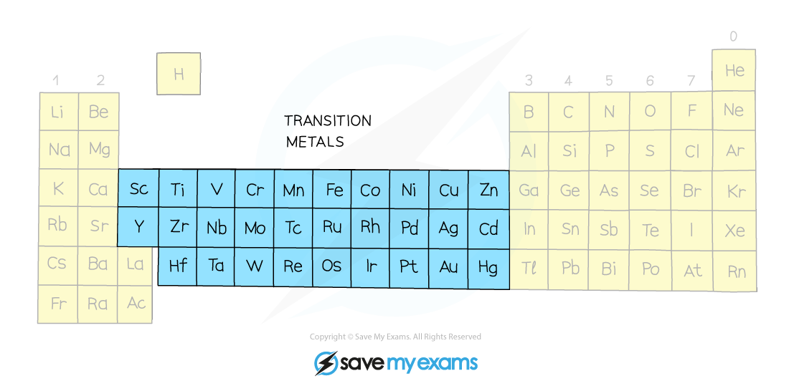

# Transition Elements

## Transition elements

> **Spec point** — `spcpt_tDtpbcY8Nf3ZQX56`

## Transition elements

- Transition elements are found in the centre of the Periodic Table between Group 2 and Group 3

### General properties

- Transition elements have properties typical of a metal:

  - They are **lustrous**
  - They are **hard** and **strong**
  - They** conduct** heat and electricity
  - They have **high densities**
  - They have **high melting points**
  
    - Except mercury: This has a low melting point which is why it is a liquid at room temperature

#### The transition elements in the Periodic Table

*Transition elements are found in the middle of the Periodic Table*

### Transition element properties

- There are some properties that are typical of transition elements :

  - They form **ions with different charges**
  
    - Iron forms Fe2+ and Fe3+ ions
  - They often act as **catalysts **as elements and in compounds
  
    - Iron, Fe, is used as a catalyst in the Haber process
    - Vanadium(V) oxide, V2O5, is used as a catalyst in the Contact process

- They form **coloured compounds**

  - Copper forms:
  
    - Blue copper sulfate
    - Black copper oxide
    - Green copper carbonate

#### Coloured compounds formed by transition metal ions

*The colours produced by some transition elements ions*

> **Exam Hint**
> Although scandium and zinc are in the transition element area of the Periodic Table, they are not considered transition elements because:
> 
> - They do **not** form coloured compounds
> - They do **not **show variable oxidation states
