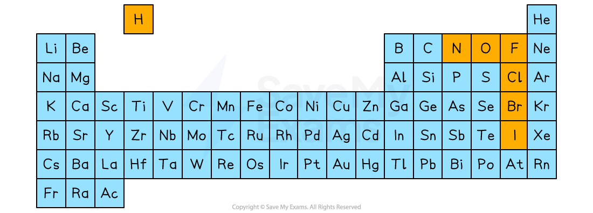
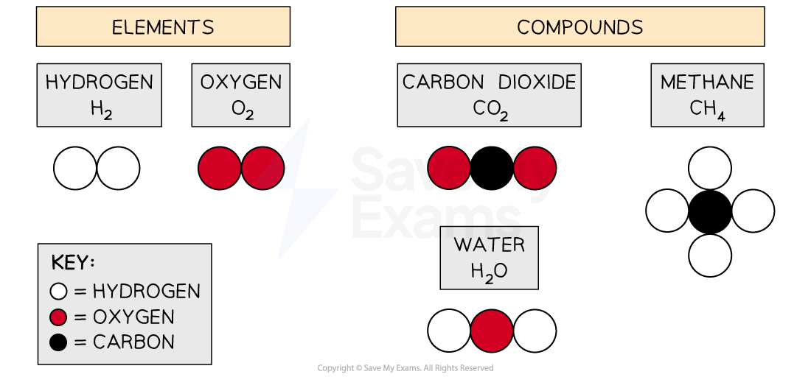

# Formulae

## Molecular formulae

> **Spec point** — `spcpt_nbYJxBH7hN7XmTrt`

## Molecular formulae

- Elements are often represented using their **chemical symbol **from the Periodic Table

#### Chemical symbols of elements table

| **Element** | **Symbol** | **Element** | **Symbol** |
|---|---|---|---|
| Lithium | Li | Calcium | Ca |
| Chromium | Cr | Gold | Au |
| Aluminium | Al | Sulfur | S |

- Seven elements exist as diatomic **molecules**, which means that they are molecules made of two atoms:

  1. Hydrogen, H2
  2. Nitrogen, N2
  3. Oxygen, O2
  4. Fluorine, F2
  5. Chlorine, Cl2
  6. Bromine, Br2
  7. Iodine, I2

#### Periodic Table identifying the 7 diatomic elements

***The highlighted elements all exist as diatomic molecules with the formula X******2***

- These 7 elements are also classed as **simple molecules**

- Atoms combine together in** fixed ratios** that will give them full outer shells of electrons

  - When this happens, a molecule is formed
- The molecular formula of a molecule shows:

  - The type of atoms involved, given by the chemical symbol
  **AND**
  - The number of atoms, given by the subscript (little) number after a chemical symbol

#### Examples of molecular formulae

| **Substance** | **Molecular formula** | **Made from** |
|---|---|---|
| Hydrogen | H2 | 2 hydrogen atoms |
| Chlorine | Cl2 | 2 chlorine atoms |
| Water | H2O | 2 hydrogen atoms 1 oxygen atom |
| Methane | CH4 | 1 carbon atom 4 hydrogen atoms |
| Ammonia | NH3 | 1 nitrogen atom 3 hydrogen atoms |
| Sulfuric acid | H2SO4 | 2 hydrogen atoms 1 sulfur atom 4 oxygen atoms |

- The table also shows that the molecular formula can be deduced from the relative number of atoms present

  - E.g. Ammonia contains 3 atoms of hydrogen and 1 atom of nitrogen, which means its molecular formula is NH3

### Diagrammatic representation of chemicals

- Diagrams or models can be used to represent and/or deduce the molecular formula of elements and simple compounds:

***When simple molecules are represented using coloured atoms, a key is used to show the colours for each type of atom***

- Using the water examples, it is important to know that these representations also show the arrangement of the atoms in the molecule

  - Water, H2O
  
    - The hydrogen atoms are on either side of the oxygen atom
    - It does not have two hydrogen atoms and an oxygen atom all joined together in a row

> **Worked Example**
> What is the molecular formula of the following compound?
> 
> 
> 
> **Answer:**
> 
> - The molecule contains:
> 
>   - 4 carbon atoms
>   - 10 hydrogen atoms
> - Therefore, the molecular formula is C4H10

## Deducing formulae of ionic compounds

> **Spec point** — `spcpt_9yCK42rkn2kgczrP`

## Deducing formulae of ionic compounds

### Extended Tier Only

- Metals and non-metals react together to form [ionic](https://www.savemyexams.com/igcse/chemistry_co-ordinated-sciences-double-award/cie/23/revision-notes/atoms-elements-and-compounds/ions-and-ionic-bonds/ions-and-ionic-bonds/) compounds

  - Ionic compounds are **not** simple molecules
  - **Remember: **Simple molecules are formed when non-metals react together to form compounds
- Ionic compounds involve the metal losing electrons and the non-metal gaining electrons to form ions

- Some ions that you will be expected to be able to use, because they are stated in the exam specification, include:

  - Hydrogen ions, H+ - sometimes referred to as protons
  - Group 1 ions, e.g. Li+, Na+, K+
  - Group 7 ions, F–, Cl–, Br–
  - Copper(II) ions, Cu2+
  - Iron(II) ions, Fe2+
  - Iron(III) ions, Fe3+
- There are some polyatomic (containing more than one atom) ions stated in the exam specification:

  - Carbonate ions, CO32–
  - Sulfate ions, SO42–
  - Hydroxide ions, OH–
  - Nitrate ions, NO3–
  - Ammonium ions, NH4+

### How to determine the formulae of ionic compounds

- Ionic compounds typically have **no overall charge**

  - This means that the size of any positively charged ion is cancelled by the size of any negatively charged ion
  - **Careful: **This should not be confused with an atom having no overall charge

#### Direct comparison

- The formula of an ionic compound can be determined by directly comparing the charges of the ions:

  - For example, iron(II) sulfate
  
    - The iron(II) ion is Fe2+, which means that it has a 2+ or +2 charge
    - The sulfate ion is SO42–, which means that it has a 2– or –2 charge
    - The charges cancel each other out
    
      -
    - This means that one SO42– ion is needed to cancel the +2 charge on Fe2+
    - Therefore, the formula of iron(II) sulfate is FeSO4

#### The swap-and-drop method

- When the ions in the ionic compound have **different charges**, it can be easier to use the **swap-and-drop** method

  - **Careful: **If you use this method with ions that have the same charge, then you must give the simplest whole number ratio to get the correct answer
- For example, copper(II) chloride:

  - The copper(II) ion is Cu2+, which means that it has a 2+ or +2 charge
  - The chloride ion is Cl–, which means that it has a 1– or –1 charge
  - The size of the charge on the copper(II) ion indicates the number of chloride ions needed, and the size of the charge on the chloride ion indicates the number of copper(II) ions needed

#### Determining the formula of copper(II) chloride

***The charges swap from element to element and drop down. The positive and negative signs are removed and there is no need for the number 1.***

- This gives the overall formula of copper(II) chloride as CuCl2

> **Worked Example**
> The compound produced in the reaction between iron wool and chlorine contains the ions Fe3+ and Cl–.
> 
> a) Give the formula of this compound.
> 
> b) State the name of this compound.
> 
> **Answers:**
> 
> **Part a)**
> 
> - **Direct comparison method:**
> 
>   - The iron ion is Fe3+, which means that it has a 3+ or +3 charge
>   - The chloride ion is Cl–, which means that it has a 1– or –1 charge
>   - The charges do not cancel each other out
>   
>     - Mathematically, (+3) + (–1) ≠ 0
>   - Three Cl– ions are needed to cancel the +3 charge on Fe3+
>   - Therefore, the formula is **FeCl****3**** **
> - **Swap-and-drop method**
> 
> 
> 
> - The formula is **FeCl****3**** **
> 
> **Part b)**
> 
> - The metal is iron and the chlorine will change to chloride
> - Therefore the name is **iron chloride**

> **Exam Hint**
> Take your time determining the chemical formula of ionic compounds with
> 
> - Different charges on the ions
> - Polyatomic ions
