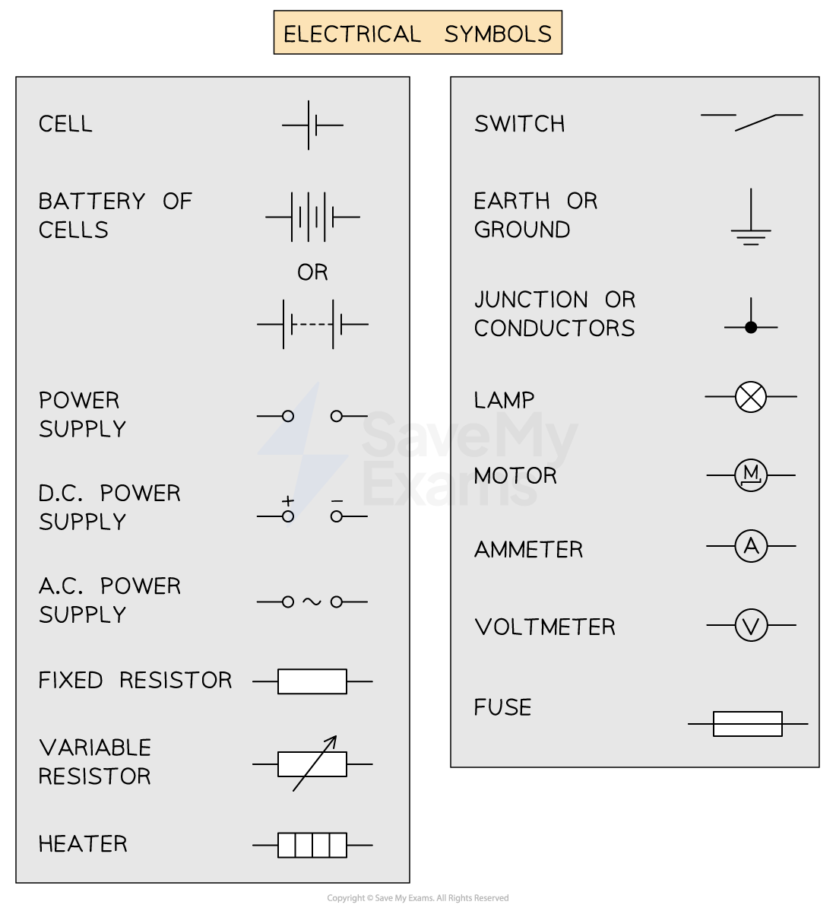
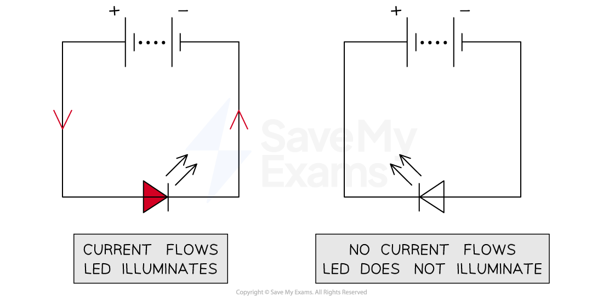

# Circuit Diagrams & Circuit Components

## Circuit components

> **Spec point** — `spcpt_qTVhTzBYXCgmYZDv`

## Circuit components

### What are circuit symbols?

- The diagram below shows the circuit symbols that could be used in circuit diagrams to represent circuit **components**

  - You will be expected to know **what each component is** and** how it behaves** in a circuit

***Circuit symbols represent these components in circuit diagrams***

### Types of circuit components

#### Power supplies

- Cells, batteries, and power supplies all **supply current** to the circuit

#### Resistors

- Fixed and variable resistors are used to **control current**

  - The resistance of a fixed resistor is constant
  - The resistance of a variable resistor can be adjusted

#### Meters

- Ammeters and voltmeters are used to **measure **the current and voltage at different points in a circuit

  - Ammeters are always connected in series
  - Voltmeters are always connected in parallel

#### Switches and functional components

- Switches open and close a circuit to control the flow of current
- Functional components perform specific roles when current passes through them:

  - Motors rotate
  - Lamps emit light
  - Heaters transfer thermal energy

#### Fuses

- Fuses protect expensive components from current surges and act as a safety measure against fire

### Energy transfers within circuit components

- Circuit components transfer energy from one energy store to another
- The energy transfer depends on the role of the component in the circuit, for example:

  - Cells and batteries transfer chemical energy into electrical energy
  - Generators transfer kinetic energy into electrical energy
  - Electric motors transfer electrical energy into kinetic energy

## Generators & diodes

> **Spec point** — `spcpt_SKGzv5fT4tnS28zm`

## Generators & diodes

### Extended Tier Only

- In addition to the above, you should be able to recognise and draw the circuit symbols for

  - a generator
  - a light-emitting diode (LED)

### Generators

- A generator is a device which produces current

  - A d.c. generator is a source of direct current (d.c.)
  - An a.c. generator is a source of alternating current (a.c.)

#### Generator circuit symbol

***Generators are a type of power supply. They can be a source of d.c. or a.c.***

### Light-emitting diodes (LEDs)

- Light-emitting diodes (LEDs) are a type of diode
- They illuminate when placed in the correct direction (forward bias) when a current flows in a circuit
- Since the LED has a visual response to current, it can be used to indicate the presence of a current in a circuit

#### LED circuit symbol

***LEDs indicate the presence of a current because they illuminate when current flows through them***

- Diodes only allow current to flow through them in **one **direction, as shown in the diagram below

  - This is the direction that the triangle points in the diagram

- LEDs behave in the same way, but they emit light when current flows through them

#### LEDs in a circuit

***When travelling in the same direction as the LED, current can flow and the LED illuminates. If the LED is flipped, it prevents current from flowing and does not illuminate***
