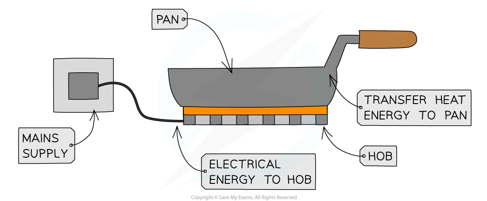

# Electrical Hazards

## Electrical hazards

> **Spec point** — `spcpt_B6KvyDQCYQdX8jmJ`

## Electrical hazards

### Heating effect of current

- When a current passes through a resistor (or wire), energy is transferred to **heat**
- The **temperature **of the resistor (or wire) **increases **due to the collisions of the free electrons within the wire
- Some of the energy is dissipated into the surroundings by heating

***The heating effect of current is used in many applications, such as electric hobs***

### Hazards of electrical systems

- Mains electricity can be dangerous if safety procedures are not followed

  - Voltages as low as 50 V can pose a serious risk of electrocution

- Common electrical hazards include:

  - damaged insulation
  - overheating cables
  - damp conditions
  - excess current from overloading of plugs, extension leads, single and multiple sockets when using a mains supply

#### Electrical danger sign

***The risk of electrocution is indicated by hazard signs but other risks which would not be signposted are listed below***

#### Damaged insulation

- If the insulation around an electrical cable is damaged, the metal part of the wire may become exposed
- If a person touches the exposed wire, they could be subjected to a lethal electric shock
- There is also a chance that current will flow between the exposed wire and any piece of metal it comes into contact with

#### Overheating of cables

- If an excess of current flows in a wire, this can lead to overheating
- This could cause the insulation to melt, or even cause a fire

#### Damp conditions

- Damp conditions can be dangerous in the presence of electricity since water is an electrical conductor
- If moisture comes into contact with a live wire, this could set up

  - a short circuit within the device, which could cause a fire
  - a conductive path for current to flow through a person to the earth, which could cause electrocution

#### Excess current from overloading

- An excessive current may flow if too many plugs, extension leads or sockets are connected to the mains supply
- The heat created could cause the insulation to melt, or even cause a fire

#### Electrical fire due to excessive current

***Too many appliances plugged into an extension lead can cause overheating and fire***
