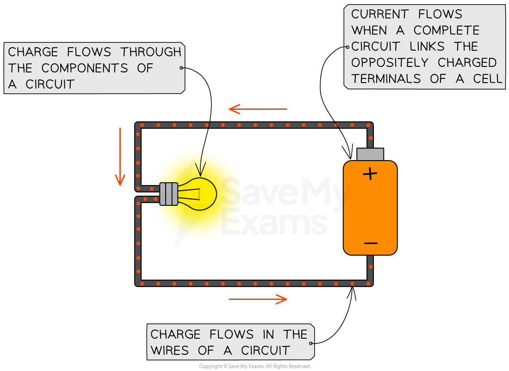
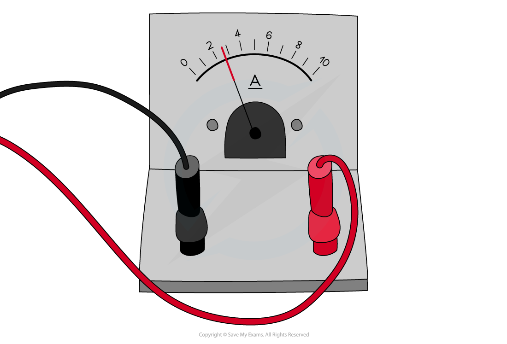
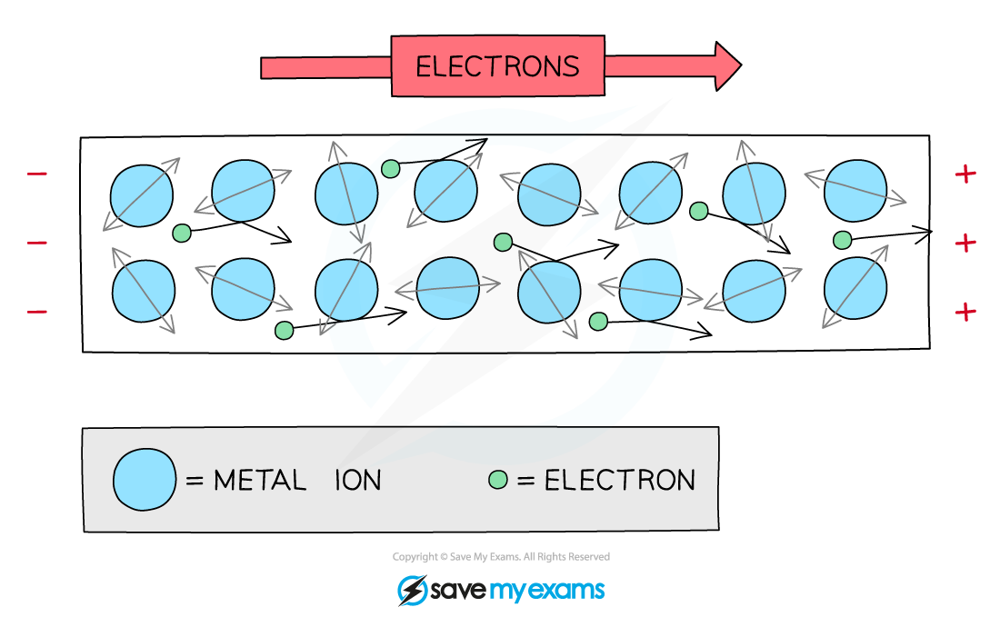
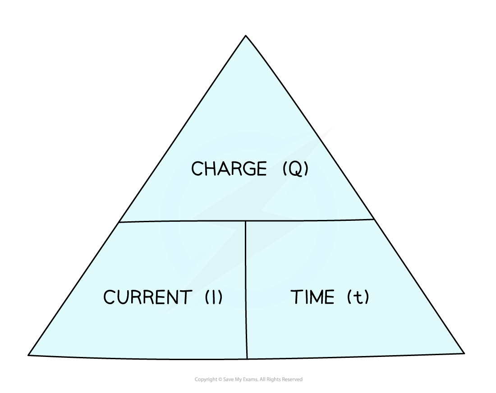
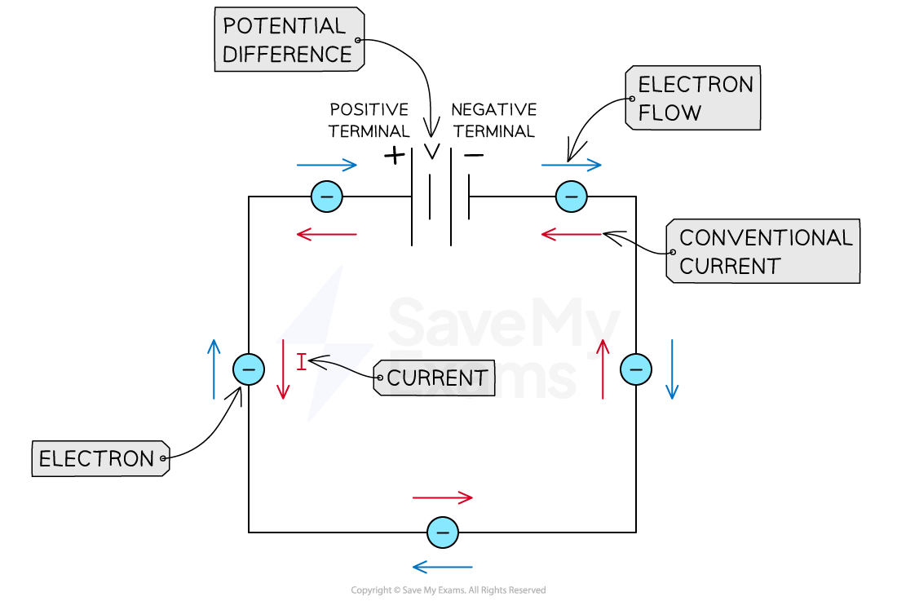

# Current

## Current

> **Spec point** — `spcpt_FdD5bKwchtdPffZT`

## Current

- Electric current is defined as **The rate of flow of electric charge**
- In metals, current is the flow of **electrons**
- Current flows

  - when a **circuit **is formed e.g. when a wire connects the two oppositely charged terminals of a cell
  - from the **positive** terminal to the **negative** terminal of a cell

***Charge flows from the positive terminal to the negative terminal***

## Measuring current

> **Spec point** — `spcpt_VDbHFSz39VBVTNx4`

## Measuring current

- Current can be measured using an **ammeter**
- Ammeters must be connected in **series **with the component being measured

***An ammeter can be used to measure the current around a circuit***

- Ammeters can be

  - digital (with an electronic read out)
  - analogue (with a needle and scale)

### Analogue ammeters

- Typical ranges are 0.1-1.0 A and 1.0-5.0 A for analogue ammeters

  - Always double check exactly where the marker is before an experiment, if not at zero, you will need to subtract this from all your measurements. They should be checked for *zero errors* before using

- They are also subject to *parallax error*

  - Always read the meter from a position directly perpendicular to the scale

### Digital ammeters

- Digital ammeters can measure very small currents, in mA or µA
- Digital displays show the measured values as digits and are more accurate than analogue displays
- They’re easy to use because they give a specific value and are capable of displaying more precise values

  - However digital displays may 'flicker' back and forth between values and a judgement must be made as to which to write down

- Digital ammeters should be checked for *zero error*

  - Make sure the reading is zero before starting an experiment, or subtract the “zero” value from the end results

## Electrical conduction in metals

> **Spec point** — `spcpt_fRHPyVg2nh7V2V2z`

## Electrical conduction in metals

### Extended Tier Only

- The wires in an electric circuit are made of **metal** because it is a good **conductor** of electric **current**
- In the wires, the current is a flow of **negatively** **charged** **electrons**

***In metal wires, the current is a flow of negatively charged electrons. When a potential difference is applied, electrons flow through the lattice of metal ions***

## Calculating current

> **Spec point** — `spcpt_drMSSCZ8YHCKcwsz`

## Calculating current

### Extended Tier Only

- Electric current can be defined more precisely as: **The charge passing a point in a circuit per unit time**
- Current is measured in units of **amperes **or **amps (A)**

  - 1 amp is equivalent to a charge of 1 coulomb flowing in 1 second, or 1 A = 1 C/s

- This means the size of an electric current is the amount of charge passing through a component each second
- Current, charge and time are related by the equation:

$I=\frac{Q}{t}$

- Where:

  - *Q* = charge, measured in coulombs (C)
  - *I* = current, measured in amps (A)
  - *t* = time, measured in seconds (s)

- The current, charge and time equation can be rearranged with the help of the following formula triangle:

#### Current charge time formula triangle

***Formula triangle for the charge, current and time equation***

> **Worked Example**
> When will 8 A of current pass through an electrical circuit?
> 
> **A.** When 8 J of energy is used by 1 C of charge
> 
> **B.** When a charge of 4 C passes in 0.5 s
> 
> **C. **When a charge of 8 C passes in 0.1 s
> 
> **D. **When a charge of 1 C passes in 8 s
> 
> **Answer: B**
> 
> - The equation relating current, charge and time is:
> 
> $Q=I\timest$
> 
> - Rearrange to make current *I* the subject of the equation:
> 
> $I=\frac{Q}{t}$
> 
> - Consider option **B**, where *Q* = 4 C and *t* = 0.5 s:
> 
> $I=\frac{4}{0.5}=8A$
> 
> - Therefore, the correct answer is **B**
> 
> **A** is incorrect as this is the definition of a voltage of 8 V between two points and does not describe current
> 
> **C **is incorrect as  $I=\frac{8}{0.1}=80A$
> 
> **D **is incorrect as  $I=\frac{1}{8}=0.125A$

> **Exam Hint**
> Electric currents in everyday circuits tend to be quite small, so it's common for examiners to throw in a **unit** **prefix** like 'm' next to quantities of current, e.g. 10 mA (10 milliamperes). Make sure you can convert these into standard units, e.g. 10 mA = 10 × 10-3 A.
> 
> Make sure to only use the triangle to help you **rearrange **the equation that links charge, current and time. Don't draw it if you are asked to write out the equation in full, such as *Q* = *I* × *t*, as you may lose marks for doing so.

## Conventional current

> **Spec point** — `spcpt_tr8wpBQRqGJRMKS4`

## Conventional current

### Extended Tier Only

- Current is the flow of **positive **charge i.e. from the **positive **terminal** to** the **negative **terminal of a cell

  - This is known as** conventional current**

- This is in the opposite direction to **electron flow**

  - Electrons are negatively charged, so they flow from the **negative **terminal **to** the **positive** terminal of a cell

#### Conventional current and electron flow

***By definition, conventional current always goes from positive to negative. This is in the opposite direction to the flow of electrons***
