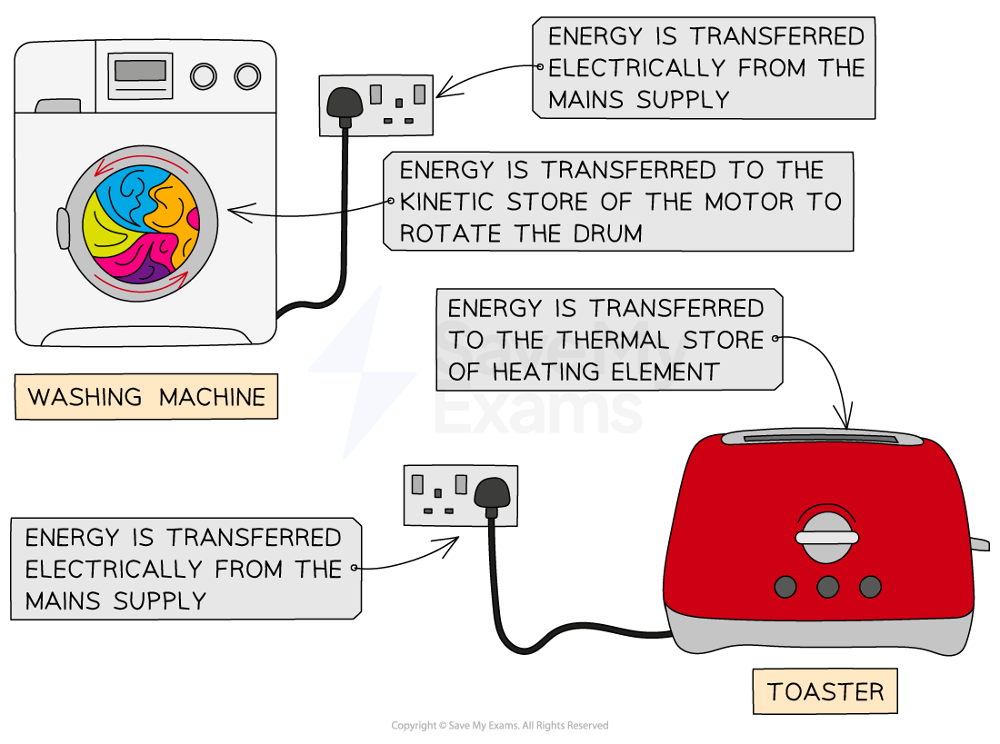

# Electrical Energy

## Energy transfer in electrical circuits

> **Spec point** — `spcpt_DfnP4dQZ9kP5xfjx`

## Energy transfer in electrical circuits

- As electricity passes around a circuit, energy is transferred from the power source to the various components

  - As charge passes through the power supply, energy is transferred to the charge
  - As the charge passes through each component, energy is transferred from the charge to the component
  - The component will often dissipate some of that energy to the surroundings

#### Energy transfers in a circuit

***Charge gains energy from the power supply, and transfers the energy to the components***

- Some domestic appliances transfer energy from the chemical store of cells and batteries, such as mobile phones, laptops, and remote controls
- Most larger household appliances transfer energy electrically from the mains supply

- Lots of household appliances contain motors

  - Vacuum cleaners: to create the suction to suck in dust and dirt off carpets
  - Washing machines: to rotate the drum to wash (or dry) clothes
  - Refrigerators: to compress the refrigerant chemical into a liquid to reduce the temperature
- Energy is transferred electrically from the mains supply to the kinetic store of the motor in the appliance

- Lots of household appliances contain heaters

  - Toasters: to heat up food
  - Kettles: to boil water
  - Boiler in a central heating system: hot water is pumped from the boiler so the radiator can heat up a room
- Energy is transferred electrically from the mains supply to the thermal store of the heater.

#### Energy transfers in common household appliances

***Energy is transferred electrically from the mains supply to the kinetic store of the motor in a washing machine, or to the thermal store of the heating element in a toaster***

## Electrical energy equation

> **Spec point** — `spcpt_878qtvvZqxcH33wN`

## Electrical energy equation

- The amount of energy transferred by an electrical appliance depends on:

  - how long the appliance runs for
  - the power rating of the appliance
- Electrical energy can be calculated using the following equation:

$E=VIt$

- Where:

  - $E$* *= energy, measured in joules (J)
  - $V$ = potential difference, measured in volts (V)
  - $I$ = current, measured in amps (A)
  - $t$ = time, measured in seconds (s)

> **Worked Example**
> A washing machine runs a cycle for 3 hours and 16 minutes. The potential difference of the mains supply is 230 V. A current of 10.0 A flows through the washing machine for the duration of the cycle.
> 
> Determine the amount of energy transferred from the mains supply during the cycle. Give your answer in MJ.
> 
> **Answer:**
> 
> **Step 1: List the known quantities**
> 
> - Potential difference, $V=230V$
> - Current, $I=10.0A$
> - Time, $t=3\mathrm{hrs}16\mathrm{min}$
> 
> **Step 2: Convert the time to seconds**
> 
> - 1 hour = 60 mins
> 
> $3\times60=180\mathrm{min}$
> 
> $180+16=196\mathrm{min}$
> 
> - 1 min = 60 s
> 
> $196\times60=11760s$
> 
> **Step 3: Write out the equation for electrical energy**
> 
> $E=VIt$
> 
> **Step 4: Substitute in the known values to calculate**
> 
> $E=230\times10\times11760$
> 
> $E=27048000J$
> 
> **Step 5: Give your answer in MJ**
> 
> - 1 MJ = 1 000 000 J
> 
> $E=27\mathrm{MJ}$
