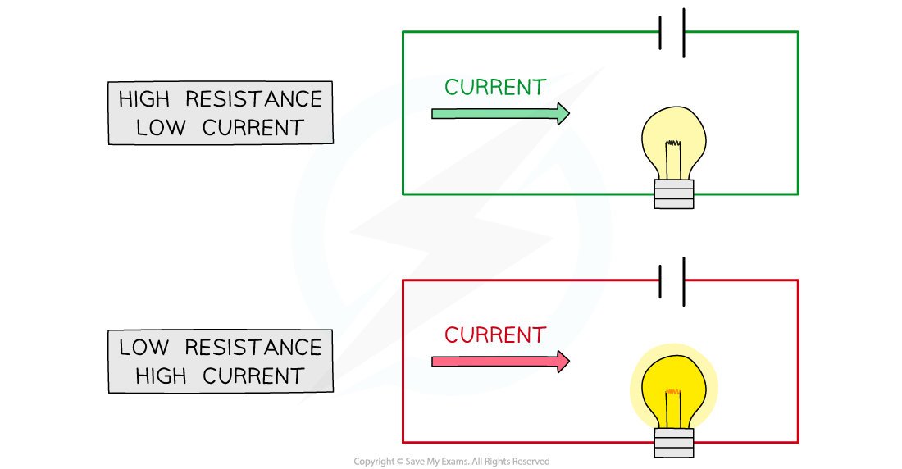
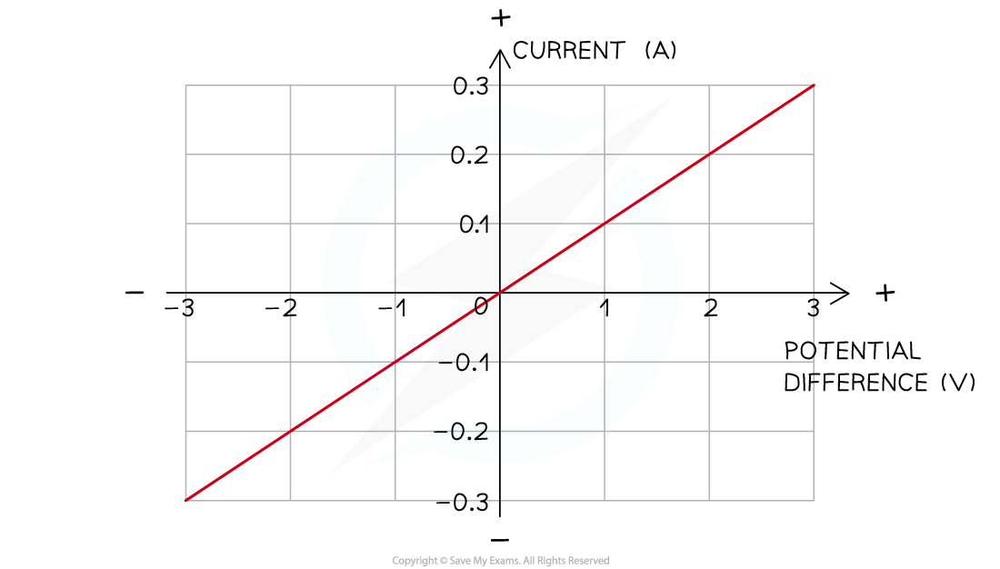

# Resistance

## Resistance

> **Spec point** — `spcpt_h2W9SQvkjFj3Gm6s`

## Resistance

- **Resistance **is defined as: **The opposition to current**
- Resistance occurs because the free **electrons **flowing in the circuit (current) **collide **with the metal ions in the wire
- These collisions **slow down** the electrons, or, in other words, **resist **their flow

  - The **higher **the resistance of a circuit, the **lower **the current
  - This means that good conductors have a **low **resistance and insulators have a **high **resistance

- The resistance of a circuit can be **increased **by adding resistors (or variable resistors) to it
- Every electrical component has a resistance, even wires

  - In exam questions, the resistance of the wires and batteries are assumed to be negligible

#### The effect of resistance on the current in a circuit

***When a circuit has a high resistance, a lower current will flow, and vice versa**** *

### Ohm's law

- Current, $I$, potential difference, $V$*,* and resistance, $R$, all affect one another
- Changing any **one** of these in a circuit, changes **all** of them
- Current and resistance are **inversely proportional**

  - If the resistance is doubled, current will halve
- This relationship is described by the following equation, known as Ohm's law

$R=\frac{V}{I}$

- Where

  - $R$ = resistance, measured in ohms (Ω)
  - $V$ = potential difference, measured in volts (V)
  - $I$ = current, measured in amperes or amps (A)

> **Worked Example**
> A 12 Ω resistor has a current of 0.3 A flowing through it.
> 
> Determine the potential difference across the resistor.
> 
> **Answer:**
> 
> **Step 1: List the known quantities**
> 
> - Resistance, $R=12Ω$
> - Current, $I=0.3A$
> 
> **Step 2: Write out the equation for Ohm's law and rearrange to make potential difference the subject**
> 
> $R=\frac{V}{I}$
> 
> $V=IR$
> 
> **Step 3: Substitute in the known values to calculate**
> 
> $V=0.3\times12$
> 
> $V=3.6V$

## Current-voltage graphs

> **Spec point** — `spcpt_K7hcyrfGm26TgS8C`

## Current-voltage graphs

### Extended Tier Only

- The relationship between current and potential difference of a component can be shown on a current-voltage (*I-V*) graph

- When the relationship between current and potential difference is **linear**:

  - the *I-V* graph is a **straight line **which passes through the** origin**
  - the resistance is **constant**
  - these are known as **ohmic resistors**

- When the relationship between current and voltage is **non-linear**:

  - the *I-V* graph that is **not** a straight line
  - the resistance is **not **constant
  - these are known as **non-ohmic resistors**

#### Current-voltage (I-V) graph for a resistor and a filament lamp

***Linear IV graphs are straight lines through the origin, indicating a constant resistance. Non-linear IV graphs are curved, indicating a variable resistance***

- Components with **linear***** ****I-V* graphs (ohmic resistors) include:

  - fixed resistors (at constant temperature)
  - wires (at constant temperature)

### I-V graph for ohmic conductors

- The relationship between current and voltage for a wire or fixed resistor is linear, or **directly proportional**, which means

  - the IV graph is a straight line, so voltage and current increase (or decrease) by the **same **amount
  - the slope of the graph is constant, so resistance is **constant**

#### I-V graph for a a wire of fixed resistor

***The current is directly proportional to the potential difference (voltage) as the graph is a straight line through the origin***

> **Exam Hint**
> In your IGCSE exam, you could be asked to recognise, sketch or explain the I-V graph for a wire or fixed resistor (ohmic conductors), but you do **not **need to know about the I-V graphs for a filament lamp or a diode.

## Video of Resistance

> **Spec point** — `spcpt_n4jdXkcxPtfKwg7n`

##
