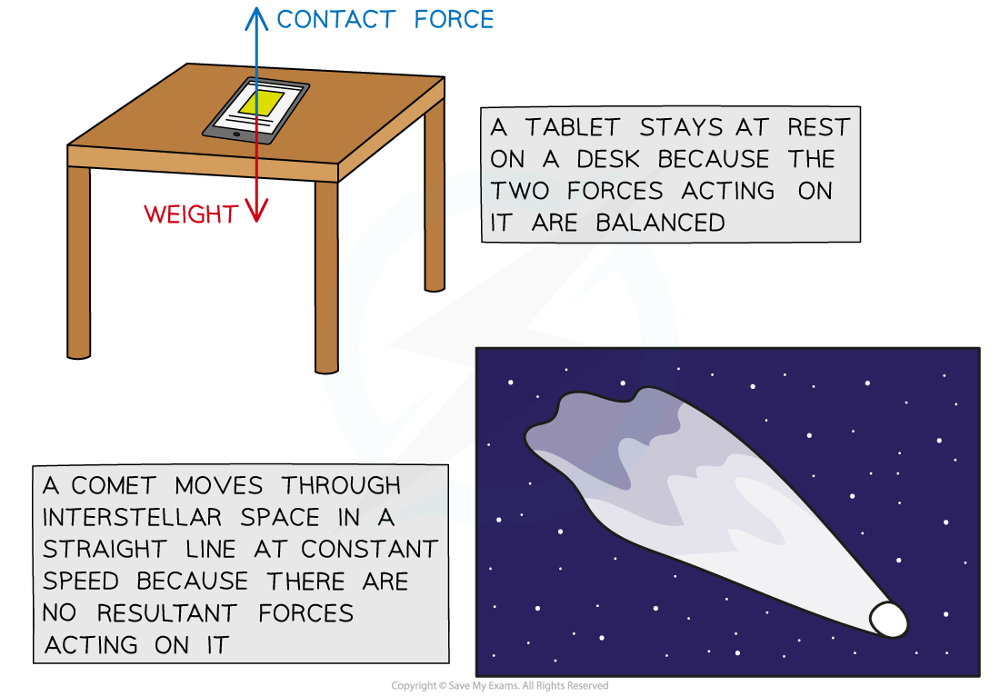

# Newton's First Law

## Newton's First Law

> **Spec point** — `spcpt_fQqwXPZpjxtP48Mw` · Know that an object either remains at rest or continues in a straight line at constant speed unless acted on by a resultant force

## Newton's first law

- Newton's **1st law of motion** states:

**Objects will remain at rest, or move with a constant speed unless acted on by a resultant force**

- This means if that:

  - A **stationary **object will **remain **stationary
  - An object **moving **with a **constant **speed will continue to move at that constant speed
  - Unless the object is acted upon by a **resultant force**
- Conversely, that means that if an object is at rest, or has a constant speed, **no** resultant force **can** be acting on it #### Objects with Zero Resultant Force

*Constant speed can only be achieved when the forces on an object are balanced - in other words, when the resultant force is zero *

### Examples of Newton's first law

- A mug on a table will remain stationary on the table unless acted upon by a resultant force

  - For example, if someone picks up the mug, or knocks into the table
- A piece of space debris will continue moving in a straight line at a constant speed unless acted upon by a resultant force

  - For example, if it enters the gravitational field of a planet or collides with an asteroid
- A car travelling in a straight line at a constant speed will continue to travel in a straight line at a constant speed unless acted upon by a resultant force

  - For example, if the driver brakes or accelerates

> **Worked Example**
> A car moves at a constant speed. The driving force from the engine is 3 kN.
> 
> 
> 
> Determine the frictional force acting on the car.
> 
> **Answer:**
> 
> **Step 1: Recall Newton's first law of motion**
> 
> - Newton's first law of motion states that **objects will remain at rest, or move with a constant speed unless acted on by a resultant force**
> 
> **Step 2: Relate Newton's first law to the scenario**
> 
> - Since the car is moving at a constant speed, there is no resultant force
> - This means the driving and frictional forces are balanced
> 
> **Step 3: State the value of the frictional force**
> 
> - Frictional force, *F* = driving force = **3 kN**

> **Exam Hint**
> Students often struggle to understand how an object can move when there is no resultant force acting on it. You may even have this misconception without realising it.
> 
> It is important to fully understand Newton's first law, because it underpins a lot of physics content and can cause you to make mistakes in seemingly unrelated questions.
> 
> Usually, students are comfortable with the idea that an object at rest on a table will not move unless something or someone physically moves it. The issue comes from the idea of an object in motion.
> 
> A rock drifting through the vacuum of deep space away from the gravitational pull of any large bodies, will continue to drift at that same speed, in that same direction, potentially forever. The only way to change its motion is for a force to be exerted upon it.
> 
> On Earth, there are always forces acting on objects, so in our everyday experience we need to think in terms of resultant forces and balanced forces.
> 
> A car can maintain a constant speed when the force from the engine is balanced with the frictional forces opposing its motion (friction between the tyres and road, and air resistance). If nothing changes with these forces, it will continue travelling at a constant speed. If you do want to change the motion of the car, to speed up or slow down, you need to provide a resultant force. By increasing the force from the engine, you can cause the car to speed up. By either decreasing the force from the engine, or increasing the frictional force (using the brakes) the car will slow down.
> 
> When the forces acting on an object are not balanced (a resultant force is exerted) this will cause a change in the object's motion.
