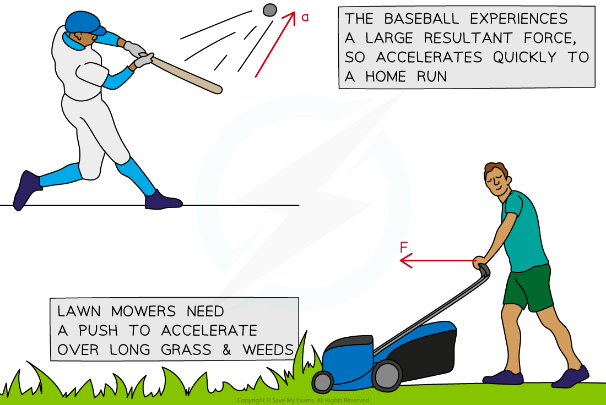
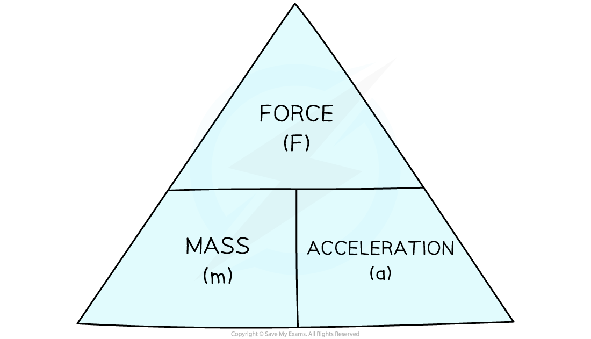

# Newton's Second Law

## Newton's second law

> **Spec point** — `spcpt_svrBX4KGBXW3qkyS`

## Newton's second law

### Extended Tier Only

- Newton's **second law of motion** states: **The acceleration of an object is proportional to the resultant force acting on it and inversely proportional to the object's mass**
- Newton's second law of motion explains what happens when a **non-zero resultant force **acts on an object
- A resultant force occurs when the forces acting on an object are **not balanced**
- A resultant force acting on an object will cause a **change in the object's motion**
- This change in motion is:

  - **Acceleration **if the object speeds up
  - **Deceleration **if the object slows down
- If the resultant force on an object is not zero, the object will **accelerate **in the **direction **of the **resultant force**
- The **bigger **this resultant force, the **larger **the acceleration
- For a given force, the **greater **the object's mass, the **smaller **the acceleration experienced

#### Examples of Newton's second law

***Objects like baseballs and lawnmowers accelerate when a resultant force is applied on them. The size of the acceleration is proportional to the size of the resultant force***

### Calculations using Newton's second law

- Newton's second law can be expressed as an equation:

$F=ma$

- Where:

  - *F* = resultant force on the object, measured in newtons (N)
  - *m* = mass of the object, measured in kilograms (kg)
  - *a* = acceleration of the object, measured in metres per second squared (m/s2)

- The **acceleration **occurs in the **same direction** as the **resultant force**

#### Formula triangle for acceleration, mass and resultant force

***To use a formula triangle, simply cover up the quantity you wish calculate and the structure of the equation is revealed***

- A more detailed explanation of how to use formula triangles is covered in the revision note [Speed](https://www.savemyexams.com/igcse/science/cie/combined-science/23/physics/revision-notes/motion-forces-energy/motion/speed/)

> **Worked Example**
> A car salesman says that their best car has a mass of 900 kg and can accelerate from 0 to 27 m/s in 3 seconds.
> 
> Calculate:
> 
> a) the acceleration of the car in the first 3 seconds.
> 
> b) the force required to produce this acceleration.
> 
> **Answer:**
> 
> **Part (a)**
> 
> **Step 1: List the known quantities**
> 
> - Initial speed, $v=0m/s$
> - Final speed, $u=27m/s$
> - Time, $t=3s$
> 
> **Step 2: State the equation for acceleration, in terms of change in speed**
> 
> $a=\frac{v-u}{t}$
> 
> $a=\frac{27-0}{3}$
> 
> $a=9m/s^{2}$
> 
> **Part (b)**
> 
> **Step 1: List the known quantities**
> 
> - Mass of the car, $m=900\mathrm{kg}$
> - Acceleration, $a=9m/s^{2}$
> 
> **Step 2: Identify which law of motion to apply**
> 
> - The question involves quantities of **force**, **mass** and **acceleration**, so Newton's second law is required:
> 
> $F=ma$
> 
> **Step 3: Calculate the force required to accelerate the car**
> 
> $F=900\times9$
> 
> $F=8100N$

> **Worked Example**
> Three shopping trolleys, **A**, **B** and **C**, are being pushed using the same force. This force causes each trolley to accelerate.
> 
> 
> 
> State which trolley would have the smallest acceleration. Explain your answer.
> 
> **Answer: C**
> 
> **Step 1: Identify which law of motion to apply**
> 
> - The question involves quantities of **force** and **acceleration**, and the image shows trolleys of different **masses**, so **Newton's second law** is required:
> 
> $F=ma$
> 
> **Step 2: Re-arrange the equation to make acceleration the subject**
> 
> $a=\frac{F}{m}$
> 
> **Step 3: Explain the inverse proportionality between acceleration and mass  **
> 
> - Acceleration is **inversely proportional** to mass
> - This means that for the **same amount of force**, a **large** **mass** will experience a **small** **acceleration**
> - Therefore, trolley **C** will have the smallest acceleration because it has the largest mass
