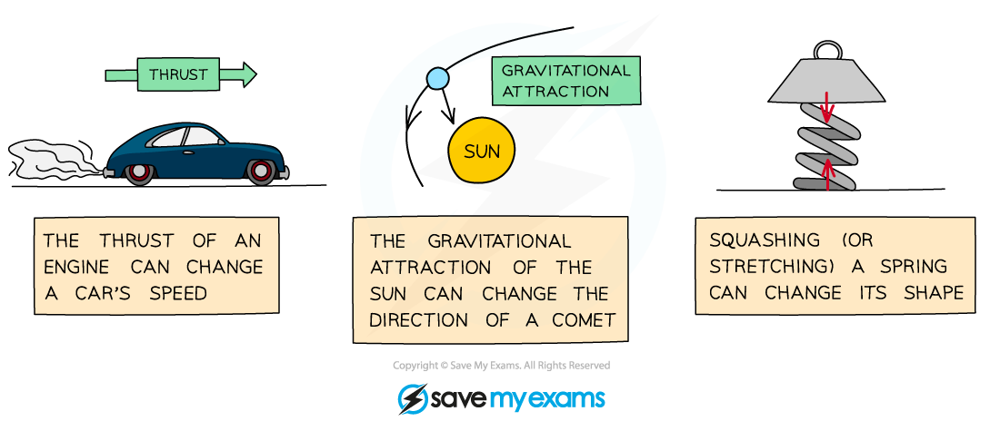
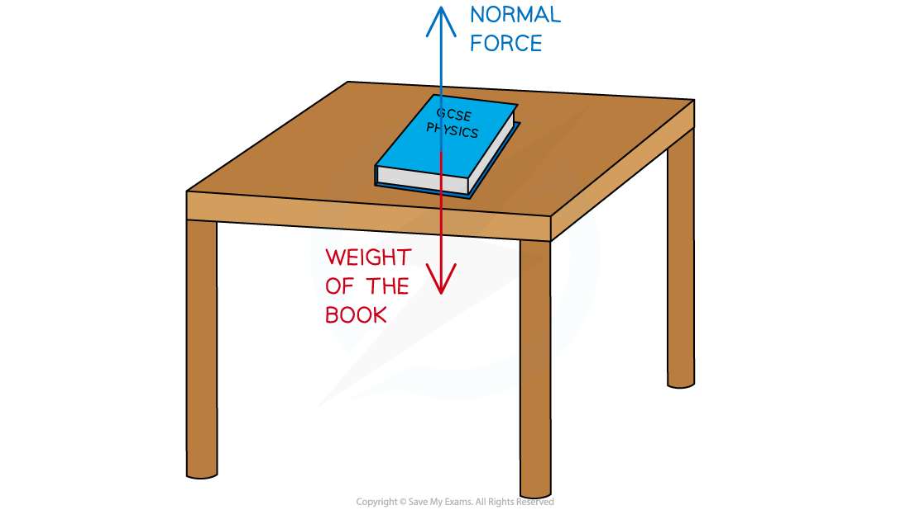

# Resultant Forces

## Effects of forces

> **Spec point** — `spcpt_355pnb92smCMpDsX`

## Effects of forces

- A **force **is defined as: **A push or a pull that acts on an object due to the interaction with another object**
- Forces can have a variety of effects on an object
- Forces can change an object's

  - **size**
  - **shape**
  - **motion **(speed or direction)

#### Effects of forces on different objects

***A thrust force can cause a car to speed up, a gravitational force can cause a comet to change direction, compression forces can cause a spring to change shape***

- The effects of forces on an object often depend on the type of force acting

  - The push force (thrust) of an engine can cause a car to speed up, whilst the force exerted by the brakes (friction) can cause it to slow down
  - The gravitational pull of the Sun on a comet causes the comet to change direction
  - When two opposing forces push on each end of a spring, the spring changes shape (it compresses)

## Resultant forces on a straight line

> **Spec point** — `spcpt_DvH5sG2f3KgbmFNV`

## Resultant forces on a straight line

### What is a resultant force?

- A **resultant force** is a single force that describes all of the forces operating on a body
- When multiple forces act on one object, the forces can be combined to produce one net force that describes the **combined action** of all of the forces
- This single resultant force determines:

  - The **direction** in which the object will move as a result of all of the forces
  - The **magnitude** of the net force experienced by the object

### Balanced and unbalanced forces

- The forces acting on an object can be described as **balanced **or **unbalanced**
- Forces are **balanced **if multiple forces act in **opposing directions** with an **equal magnitude** in each direction

  - The effects of the forces then **cancel out**
  - There is **no resultant force** in that plane of direction
- Forces are **unbalanced **if the effects of the forces acting in each plane do **not** cancel out

  - There is a **resultant force** in one or more planes of direction
- A book is a rest on a table

  - The gravitational pull of the Earth on the book (weight) acts in a downward direction
  - The push force of the table on the book (normal contact force) acts in the upward direction
  - The forces are equal in magnitude and opposite in direction
  - The forces are therefore balanced
  - There is no resultant force acting on the book

#### Zero resultant force on a book resting on a table

***A book resting on a table is an example of balanced forces***

### Calculating resultant force

- Force is a vector quantity, it has both magnitude and direction
- When adding forces together, it is important to assign positive and negative values to show the direction in which the forces are acting
- If a 5 N force acts to the right and a 5 N force acts to the left on an object, then we assign one of the values as positive and one as negative
- So the resultant force acting on the object is

`resultant space force space equals space 5 space plus space open parentheses negative 5 close parentheses`

$\mathrm{resulotant} \mathrm{force}=0N$

- The forces acting on the object are equal in magnitude and opposite in direction; therefore they cancel one another out
- This is like two people pushing a box with equal force from opposite sides, the box doesn't move
- If two people push the box from the same side in the same direction, one with a 3 N force and one with a 7 N force, then the forces will add together and the box will move in the direction of the resultant force

$\mathrm{resultant} \mathrm{force}=3+7$

$\mathrm{resultant} \mathrm{force}=10N$

- If two people push the box in opposite directions, one with a 7 N force to the left (negative) and one with a 3 N force to the right (positive), then the forces will add together and the box will move in the direction of the resultant force

`resultant space force space equals space open parentheses negative 7 close parentheses space plus space 3`

$\mathrm{resultant} \mathrm{force}=-4N$

#### Zero and non-zero resultant forces

***Zero and non-zero resultant forces acting on three objects***

> **Worked Example**
> Calculate the magnitude and direction of the resultant force in the diagram below.
> 
> 
> 
> **Answer:**
> 
> **Step 1: Assign a direction to the forces**
> 
> - Forces acting to the right are positive
> - Forces acting to the left are negative
> 
> **Step 2: Add together all the forces acting on the object**
> 
> `resultant space force space equals space open parentheses negative 14 close parentheses space plus space 4 space plus space 8`
> 
> `resultant space force space equals space open parentheses 14 close parentheses space plus space 12`
> 
> $\mathrm{resultant} \mathrm{force}=-2N$
> 
> **Step 3: State the magnitude and direction of the resultant force**
> 
> - The resultant force is 2 N to the left

> **Exam Hint**
> Mathematically, it doesn't matter which direction you assign to be positive or negative, as long as you are consistent throughout your calculation.
