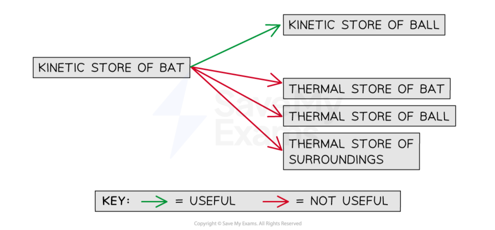
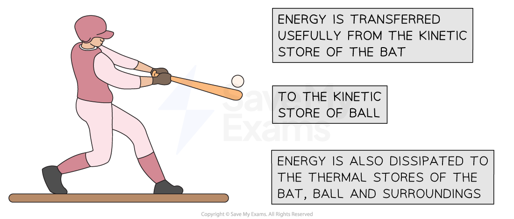
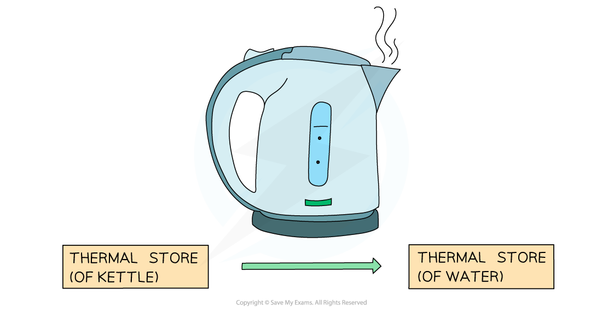

# Conservation of Energy

## Conservation of energy

> **Spec point** — `spcpt_z4zrz6J5JPygjHWy`

## Conservation of energy

- The **principle of conservation of energy** states that: **Energy cannot be created or destroyed, it can only be transferred from one store to another**
- The principle of conservation of energy means that for a closed system, the total amount of energy is **constant**
- The **total **amount of energy transferred **into **the system must be **equal **to the **total **amount of energy transferred **away **from the system

- Therefore, energy cannot be ‘lost’, but it can be transferred to the surroundings

  - Energy can be **dissipated** (spread out) to the surroundings by heating and radiation
  - Dissipated energy transfers are often not **useful**, in which case they can be described as **wasted **energy

### Examples of the principle of conservation of energy

#### Example 1: a bat hitting a ball

- The moving bat has energy in its **kinetic **store
- Some of that energy is transferred **usefully** to the **kinetic** store of the ball
- Some of that energy is transferred from the **kinetic **store of the bat to the **thermal **store of the ball **mechanically **due to the impact of the bat on the ball

  - This energy transfer is not useful; the energy is **wasted**
- Some of that energy is **dissipated** by **heating** to the **thermal **store of the bat, the ball, and the surroundings

  - This energy transfer is not useful; the energy is **wasted**
- The total amount of energy transferred into the system is equal to the total amount of energy transferred away from the system

#### Conservation of energy: a bat hitting a ball

***The principle of conservation of energy applied to a bat hitting a ball***

#### Example 2: Boiling Water in a Kettle

- When an electric kettle boils water, **energy** is transferred **electrically** from the mains supply to the **thermal store** of the heating element inside the kettle
- As the heating element gets hotter, **energy** is transferred **by heating** to the **thermal store** of the water

- Some of the energy is transferred to the **thermal** store of the plastic kettle

  - This energy transfer is not useful; the energy is **wasted**
- And some energy is **dissipated **to the **thermal store** of the surroundings due to the air around the kettle being heated

  - This energy transfer is not useful; the energy is wasted
- The total amount of energy transferred into the system is equal to the total amount of energy transferred away from the system

#### Conservation of energy: a kettle boiling water

***The principle of conservation of energy applied to a kettle boiling water***

*** ***

### Energy flow diagrams

- Energy stores and transfers can be represented using a flow diagram

  - This shows both the stores and the transfers taking place within a system

***Energy flow diagram showing energy stores and transfers in a nuclear power plant.***

***Note the colour difference of the labels (stores) and the arrows (transfer pathways) ***

- In an energy flow diagram, energy is always **conserved**

**total energy in = total energy out**

> **Worked Example**
> The diagram shows a rollercoaster going down a track.
> 
> The rollercoaster takes the path A → B → C → D.
> 
> 
> 
> Which statement is true about the energy changes that occur for the rollercoaster down this track?
> 
> **A.** *E*K → Δ*E*P → Δ*E*P → *E*K
> 
> **B.** *E*K → Δ*E*P → *E*K → Δ*E*P
> 
> **C.** Δ*E*P → *E*K → *E*K → Δ*E*P
> 
> **D.** Δ*E*P → *E*K → Δ*E*P → *E*K
> 
> **Answer: D**
> 
> - **At point A:**
> 
>   - The rollercoaster is raised above the ground, therefore it has energy in its **gravitational potential store**
>   - As it travels down the track, energy is transferred **mechanically** to its **kinetic store **
> - **At point B:**
> 
>   - Energy is transferred **mechanically **from the** **kinetic store** **to the** gravitational potential store**
>   - As the kinetic energy store **empties**, the gravitational potential energy store **fills**
> - **At point C:**
> 
>   - Energy is transferred **mechanically **from the gravitational potential store to the **kinetic store**
> - **At point D:**
> 
>   - The flat terrain means there is no change in the amount of energy in its gravitational potential store, the rollercoaster only has** **energy in its** kinetic store**
>   - The kinetic energy store is full
>   - In reality, some energy will also be transferred to the thermal energy store of the tracks due to **friction**, and to the thermal energy store of the surroundings due to **sound**
>   - We say this energy is **dissipated to the surroundings**
>   
>     - The total amount of energy in the system will be constant
>     - Total energy in = total energy out

> **Exam Hint**
> It is helpful to think of energy stores as beakers and the total energy in the system as water. The water can be poured from one beaker into another, back and forth, as energy is transferred between stores.
> 
> You may not always be given the energy transfers happening in the system in your exam questions.
> 
> By familiarising yourself with the energy stores and transfer pathways, you should be able to relate these to the situation presented in the question. For example, a ball rolling down a hill transfers energy from the ball's gravitational potential energy store to its kinetic energy store mechanically, while a spring transfers energy from its elastic potential energy store to its kinetic energy store mechanically.
