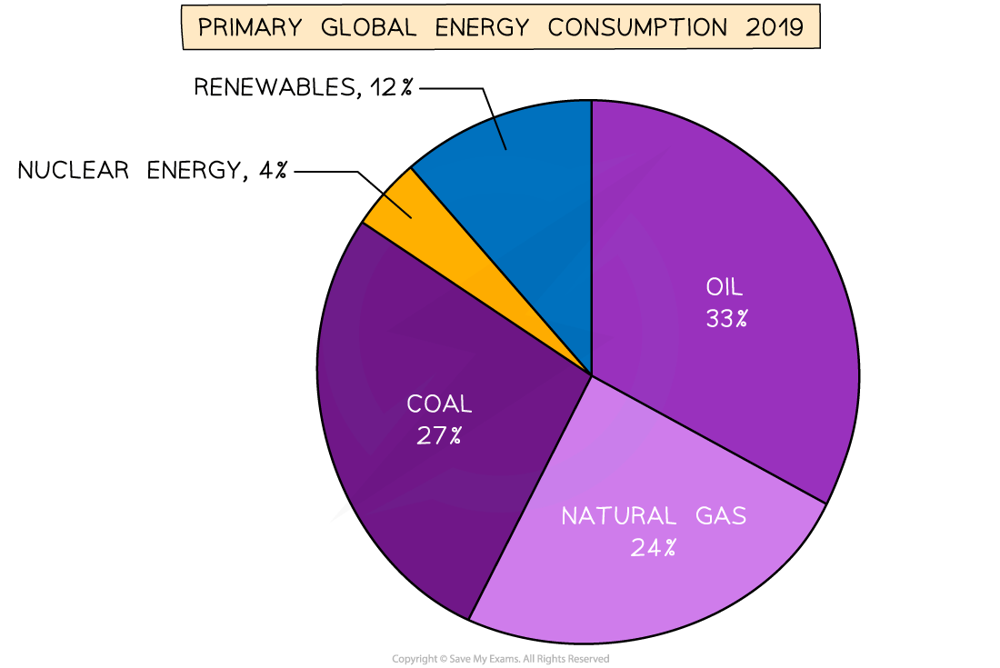
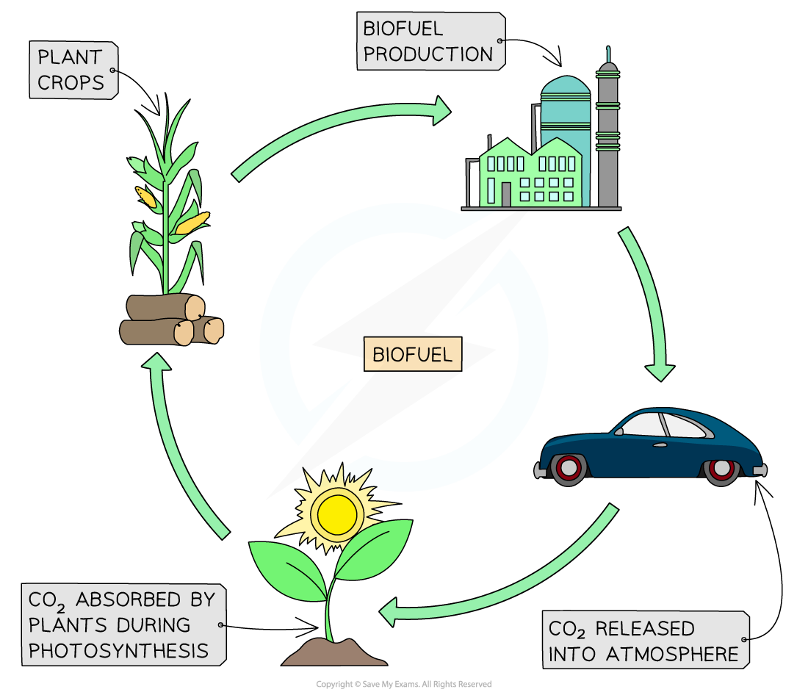

# Energy from Fuels

## Fossil fuels

> **Spec point** — `spcpt_q9XJH4BQc8tfJg22`

## Fossil fuels

- Fossil fuels are:

  - **Coal**
  - **Natural gas** (mostly methane)
  - Crude **oil** which is refined into petrol, diesel, and other fuels

#### Fossil fuels

***Fossil fuels: coal, oil and natural gas***

- Fossil fuels are formed from the **remains of plants and animals **

### Uses of fossil fuels

- Fossil fuels are used for:

  - Transport
  - Generating electricity
  - Heating

#### Transport

- The majority of vehicles in the world are powered by **petroleum** products such as petrol, diesel and kerosene

  - These resources all originate from crude oil, which is a **fossil fuel**

- A growing number of vehicles are now being powered by **electricity**

  - The advantage of this is that while the vehicle is being driven, it produces **zero carbon emissions**
  - The disadvantage is that when the vehicle is being charged, it is connected to the National Grid, which currently uses a **combination** of renewable and non-renewable energy sources

#### Electricity generation

- Fossil fuels, such as **gas **and **coal**, are used to produce energy **on-demand** when energy is needed

  - The fossil fuel is burned (combusted) and used to heat water to produce **steam**
  - The steam turns a **turbine**
  - The turbine turns a **generator**, which generates electricity
  - The current produced is transmitted via the **National Grid**
  - The steam is condensed into water to be used again

#### Electricity generation in a coal-fired power station

***Fossil fuels are burned to heat water to produce steam. The steam turns the turbine, which turns the generator, which produces electricity.***

- Electricity plays a bigger role in people's lives than ever before

  - With almost 8 billion people in the world, this means the **demand** for electricity is **extremely high**
  - To keep up with this demand, a combination of **all** the energy resources available is needed

#### Global energy consumption

***Currently, more than three quarters of the global electricity production uses fossil fuels; this is increasing the levels of atmospheric carbon dioxide, which leads to global warming***

* *

#### Heating

- The majority of heating systems run on **fossil fuels**

  - **Gas **central heating systems are the most common, with a gas boiler that heats water through a system of pipes and radiators throughout the building
  - Boilers can also be powered by **oil **or biofuels
  - Open fireplaces burn wood or **coal**
- Electric heaters run on electricity
- Bottled gas can also be used in portable heaters

  - Bottled gas is either **propane **or **butane **which are also produced from fossil fuels

## Biofuels

> **Spec point** — `spcpt_nPcM6BS7ktf5QXzp`

## Biofuels

- Biofuels are made from plant matter
- **Ethanol** or **methane** can be produced and used in place of fossil fuels

#### Cycle of biofuel production and use

***Plants take in carbon dioxide during photosynthesis, but carbon dioxide is released back into the atmosphere when biofuels are burned***

## Nuclear fuel

> **Spec point** — `spcpt_SF9B4wvwFBwDfkvR`

## Nuclear fuel

- Energy stored in the **nucleus** of atoms can be released when the nucleus is broken in two

  - This is known as nuclear **fission**

#### Nuclear fission

***Nuclear Fission: when a large nucleus is broken into two smaller nuclei, energy is released***

- Nuclear power stations use fission reactions to **heat water** to produce steam, to turn turbines that turn generators which** generate electricity**
