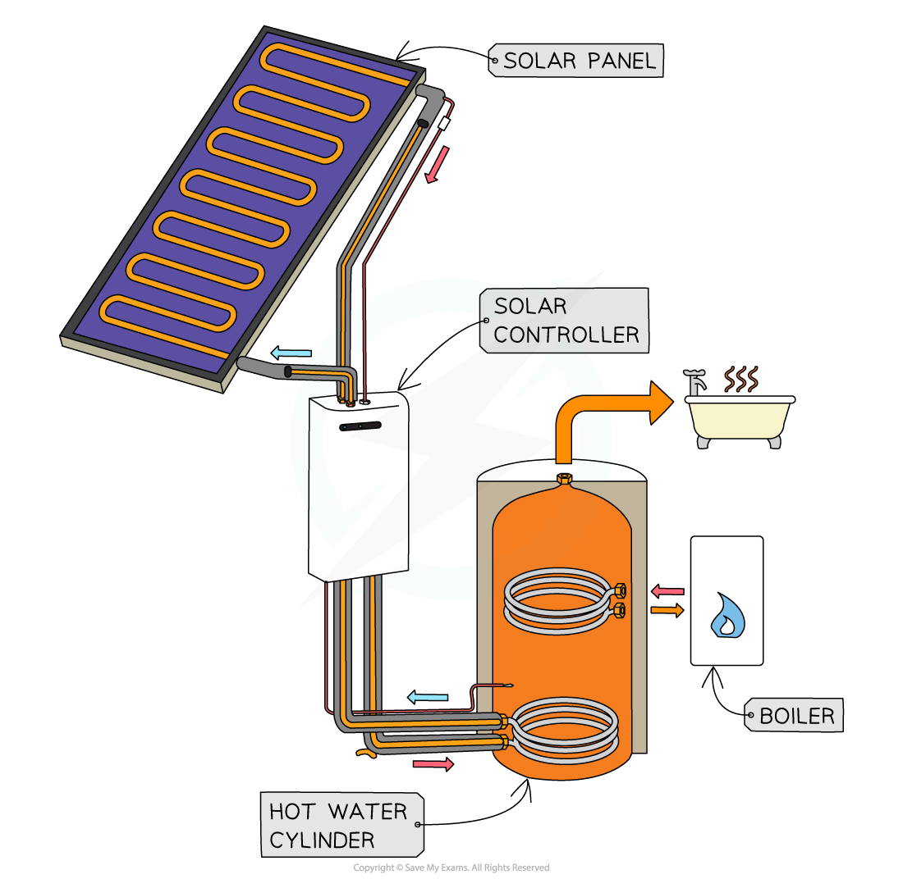

# Energy from the Sun

## The Sun

> **Spec point** — `spcpt_9VRmSXtcz4F5ShFR`

## The Sun

### Extended Tier Only

- The Sun transfers energy to Earth by **electromagnetic radiation**
- Most of our energy resources on Earth come indirectly from the **Sun**:

  - The Sun heats up the atmosphere, creating **wind** and producing **waves**
  - Water evaporated by the Sun falls as rain, filling up **reservoirs**
  - Plants grown using sunlight form the basis for fuels – both biofuels and fossil fuels
- Some energy resources, however, do not come from the Sun
- These include:

  - **Geothermal **– this comes from heat produced in the Earth’s core
  - **Nuclear **– this comes from elements which make up a small proportion of the Earth’s crust
  - **Tidal **– this comes (mainly) from the gravitational attraction of the Moon

#### The Sun

***Energy from the Sun is the source of the energy stored in many of Earth's energy resources***

## Solar cells

> **Spec point** — `spcpt_2849C69MCcHyTtN8`

## Solar cells

- The energy from the Sun that falls on the Earth is transferred by radiation

  - Mostly **visible light** and **infrared radiation**
- The amount of energy transferred from the Sun to the Earth **each hour** is equal to the energy use of the world for **one year!**
- Therefore, scientists are working hard to find methods of harnessing this energy

  - Solar energy has a **low energy density**, which means large collecting devices are required
  - Collecting solar energy has been **expensive** (due to the equipment required) and **inefficient**
  - Although **improved technology** has improved efficiency, **greater demand** has lowered costs

- **Solar cells** transfer energy from sunlight and produce a current, therefore generating **electricity **

  - Solar cells, sometimes called photovoltaic cells, are made of semiconducting materials
  - A number of cells connected together can supply electricity to homes, small-scale businesses, communication devices and satellites
  - Energy generated from solar cells can be stored in batteries for later use

#### Solar cells

***Solar cells use energy from sunlight to produce electricity***

## Solar panels

> **Spec point** — `spcpt_2st6bTwCvzrpQPs7`

## Solar panels

- Useful energy may be obtained from infrared and other electromagnetic waves from the Sun using **solar panels**
- **Solar panels** transfer energy from sunlight to the thermal store of the solar panels which is used to **heat water** in the pipes

  - Solar panels can be used to warm domestic water supplies
  
    - This can reduce the cost of producing hot water since it is heated partially by the solar panels
  - **Solar furnaces** consist of large curved mirrors that focus the sun's rays on to a small area
  
    - These can be used to boil water, generating enough steam to turn turbines and generate electricity in a power station

#### Solar panel

***Solar panels use energy from sunlight to heat water***

*** ***

- Water is **stored **in a water **tank **and pumped through small **pipes **running through the solar panel
- I**nfrared radiation** from the Sun heats the water in the pipes as it flows through them
- The water returns to the tank at a** higher temperature**
- Water may still need to be heated further to reach the desired temperature (eg. for a shower)

## Wind turbines

> **Spec point** — `spcpt_5ZDQmPkqPW65jrRs`

## Wind turbines

- Energy from the **wind **can be used to generate **electricity**
- The wind turns a **turbine**, which turns a **generator**, which generates electricity
- Energy from the kinetic store of the wind is transferred

  - mechanically to the kinetic store of the turbine
  - which is transferred mechanically to the kinetic store of the generator
  - which is transferred electrically to the National Grid

#### Wind turbines

***Wind turbines use energy from the wind to generate electricity***
