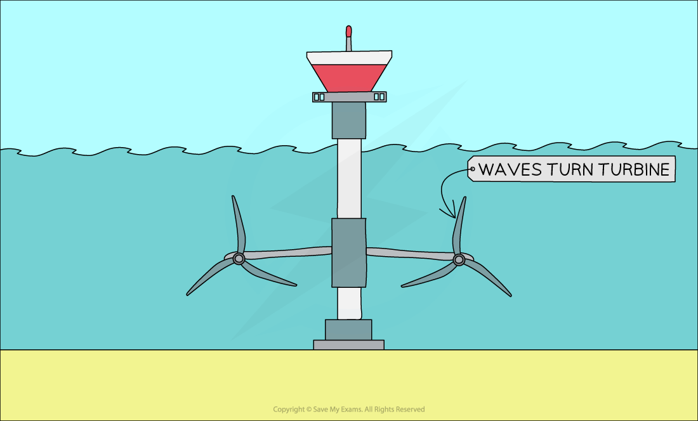

# Energy from Water

## Wave & tide power

> **Spec point** — `spcpt_JHTSXV648T9G7tDK`

## Wave & tide power

- Energy can be obtained from the kinetic store of the waves and tides
- The motion of the water is used to turn a turbine, which turns a generator, which generates electricity

### Wave power

- Wave power uses underwater turbines
- The waves move the water which causes the turbines to turn

#### Turbines using wave power

***Underwater turbines generate electricity***

### Tidal power

- Tidal power uses tidal barrages to store water at a height as the tide comes in and goes out
- When the barrage is opened, water flows through a channel over a turbine

#### Tidal barrage

***A tidal barrage stores water at a height and then opens a gate allowing water to flow over a turbine***

## Hydroelectric dams

> **Spec point** — `spcpt_jHPjKGJzsd2v7tdx`

## Hydroelectric dams

- When water is stored above ground level, it has energy in its **gravitational potential store**
- This energy can be transferred to **kinetic energy** if the water is allowed to flow down the slope
- Flowing water turns the turbine to **generate electricity**

#### A hydroelectric dam

***A hydroelectric dam transfers energy mechanically from the gravitational potential energy store of the water to its kinetic energy store. The moving water turns the turbine***
