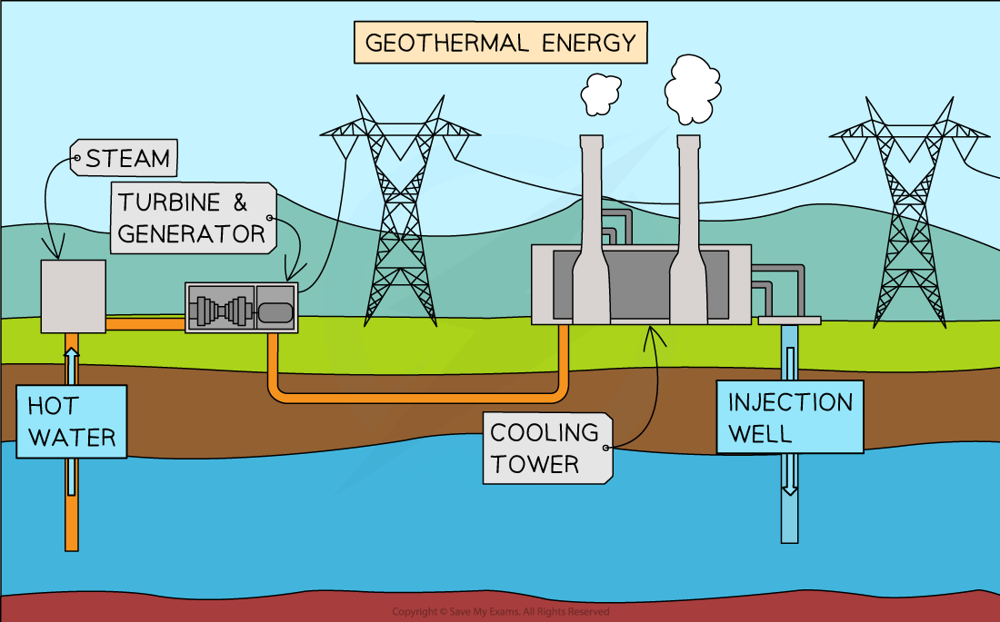

# Geothermal Energy

## Geothermal energy

> **Spec point** — `spcpt_GX9kpKTm7yPkbgGF`

## Geothermal energy

- **Tectonic activity** causes areas where the rocks below ground become **heated**
- Energy in the thermal store of the rocks can be obtained by:

  - Drilling **shafts **into the Earth's surface to expose the heated rocks
  - Injecting **water **into the shaft which is heated by the rocks
  - The water is returned via another shaft as **steam **or hot water
  - The steam can be used to turn a **turbine **and generate electricity
  - The hot water can be used to heat homes and provide a **hot water** supply to households

#### Geothermal power station

***Cold water is heated by the rocks and returned as hot water or steam, which can be used to generate electricity***
