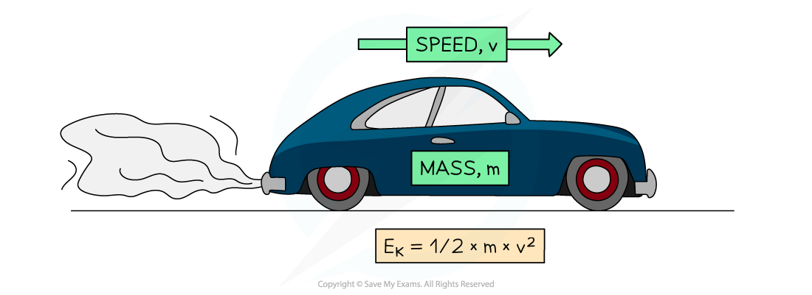

# Kinetic Energy

## Kinetic energy

> **Spec point** — `spcpt_QP6vmVdwGWPkpNkv`

## Kinetic energy

### Extended Tier Only

- Energy in an object's kinetic store is defined as:

**The amount of energy an object has as a result of its mass and speed**

- This means that any object in **motion** has energy in its kinetic energy store

  - If an object **speeds up**, energy is** transferred to** its kinetic store
  - If an object **slows down**, energy is **transferred away** from its kinetic store

#### Kinetic energy of a moving object

***A moving car has energy in its kinetic store***

### Kinetic energy equation

- The amount of energy in an object's kinetic store can be calculated using the equation:

$E_{k}=\frac{1}{2}mv^{2}$

- Where:

  - $E_{k}$ = kinetic energy, measured in joules (J)
  - $m$ = mass of the object, measured in kilograms (kg)
  - $v$ = speed of the object, measured in metres per second (m/s)
- The kinetic energy equation demonstrates that if the mass of an object is doubled for a given speed, then its kinetic energy will double

  - This is because kinetic energy is** directly proportional** to mass
  - $E_{k}\proptom$
- If the speed of the object is doubled for a given mass, it will have four times the kinetic energy

  - This is because kinetic energy is **directly proportional** to speed squared
  - $E_{k}\proptov^{2}$

> **Worked Example**
> Calculate the kinetic energy stored in a vehicle of mass 1200 kg moving at a speed of 27 m/s.
> 
> **Answer:**
> 
> **Step 1: List the known quantities**
> 
> - Mass of the vehicle, $m=1200\mathrm{kg}$
> - Speed of the vehicle, $v=27m/s$
> 
> **Step 2: Write down the equation for kinetic energy**
> 
> $E_{k}=\frac{1}{2}mv^{2}$
> 
> **Step 3: Calculate the kinetic energy**
> 
> `E_ k=1 half×1200×(27)²`
> 
> $E_{k}=437400J$
> 
> **Step 4: Round the final answer to 2 significant figures**
> 
> `E_ k=440 000 straight J (2 straight s. straight f.)`

> **Exam Hint**
> When performing calculations using the kinetic energy equation, always double-check that you have squared the speed. Forgetting to do this is the most common mistake that students make.
> 
> You will most likely need to rearrange the kinetic energy equation in your exam. The kinetic energy equation is one of the more difficult rearrangements at IGCSE, so make sure you are comfortable doing it before your exam.
