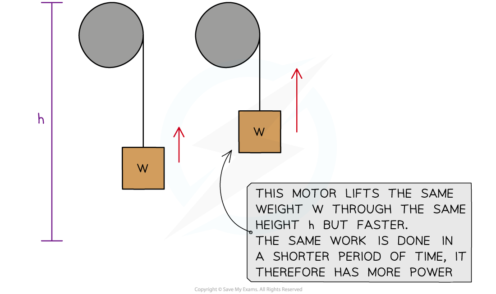
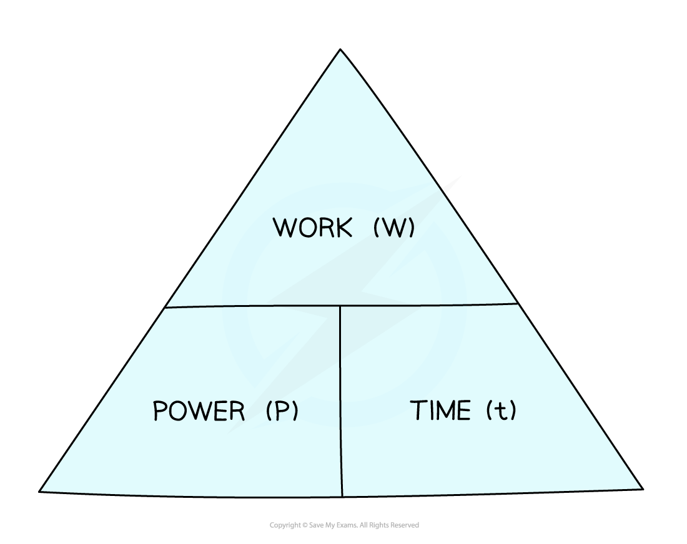

# Power

## Power

> **Spec point** — `spcpt_FyQT8r7Q7w8bhDBP`

## Power

- **Power **is: **Work done** **per unit time**
- Since work done is equal to energy transferred, **power **is also: **Energy transferred** **per unit time**
- Machines, such as car engines, transfer energy from one energy store to another constantly over a period of **time**

  - The **rate **of this energy transfer, or the rate of work done, is **power**
- **Time **is an important consideration when it comes to **power**
- Two cars transfer the **same amount of energy**, or do the **same amount of work **to accelerate over a distance
- If one car has **more power**, it will transfer that energy, or do that work, in a **shorter amount of time**

#### Two cars with different power ratings doing the same amount of work

***Two cars accelerate to the same final speed, but the one with the most power will reach that speed sooner. ***

- Two electric motors:

  - lift the same weight
  - by the same height
  - but one motor lifts it **faster** than the other
- The motor that lifts the weight faster has more **power**

***Two motors with different powers***

### Power ratings

- **Power ratings** are given to appliances to show the amount of energy transferred per unit time
- Common power ratings are shown in the table below:

#### Power ratings table

| **Appliance** | **Power rating** |
|---|---|
| A torch | 1 W |
| An electric light bulb | 100 W |
| An electric oven | 10 000 W = 10 kW |
| A train | 1 000 000 W = 1 MW |
| Saturn V space rocket | 100 MW |
| Large power station | 10 000 MW |
| Global power demand | 100 000 000 MW |
| A star like the Sun | 100 000 000 000 000 000 000 MW |

- 1 kW = 1000 W (1 kilowatt = 1000 watts)
- 1 MW = 1 000 000 W (1 megawatt = 1 million watts)

## Calculating power

> **Spec point** — `spcpt_7Rykpm3QJVXFkrjp`

## Calculating power

### The power equations

- There are two equivalent forms of the power equation

- Power can be expressed in terms of work done

$P=\frac{W}{t}$

- Or power can be expressed in terms of energy transferred

$P=\frac{\DeltaE}{t}$

- Where:

  - $P$* *= power measured in watts (W)
  - $W$* = *work done, measured in newton metres (N m)
  - $t$ = time measured in seconds (s)
  - $\DeltaE$ = energy transferred, measured in joules (J)

- Note that these two equations may be written slightly differently, but they represent the same thing

  - A transfer of energy (work done) over time

#### Power equation triangle

***To use a formula triangle, simply cover up the quantity you wish to calculate and the structure of the equation is revealed***

- Using an equation triangle is covered in more depth in the revision note [Speed](https://www.savemyexams.com/igcse/science/cie/combined-science/23/physics/revision-notes/motion-forces-energy/motion/speed/)

> **Worked Example**
> Calculate the energy transferred when an iron with a power rating of 2000 W is used for 5 minutes.
> 
> **Answer:**
> 
> **Step 1: List the known values**
> 
> - Power, $P=2000W$
> - Time, $t=5\mathrm{minutes}$
> 
> **Step 2: Convert minutes into seconds**
> 
> - $1\mathrm{min}=60s$
> 
> $5\mathrm{min}\times60s=300s$
> 
> **Step 3: Write down the power equation in terms of energy**
> 
> $P=\frac{\DeltaE}{t}$
> 
> **Step 4: Rearrange to make energy transferred, Δ*****E, the subject***
> 
> $\DeltaE=Pt$
> 
> **Step 5: Substitute in the known values**
> 
> $\DeltaE=2000\times300$
> 
> $\DeltaE=600000J$

> **Exam Hint**
> Think of power as “energy per second”. Thinking of it this way will help you to remember the relationship between power and energy.
> 
> In your IGCSE Combined Sciences exam, you will be expected to use both equations and to be able to rearrange them. You may be required to calculate the energy transferred in a previous question part, so always check back through the question if you seem to be missing a value!
