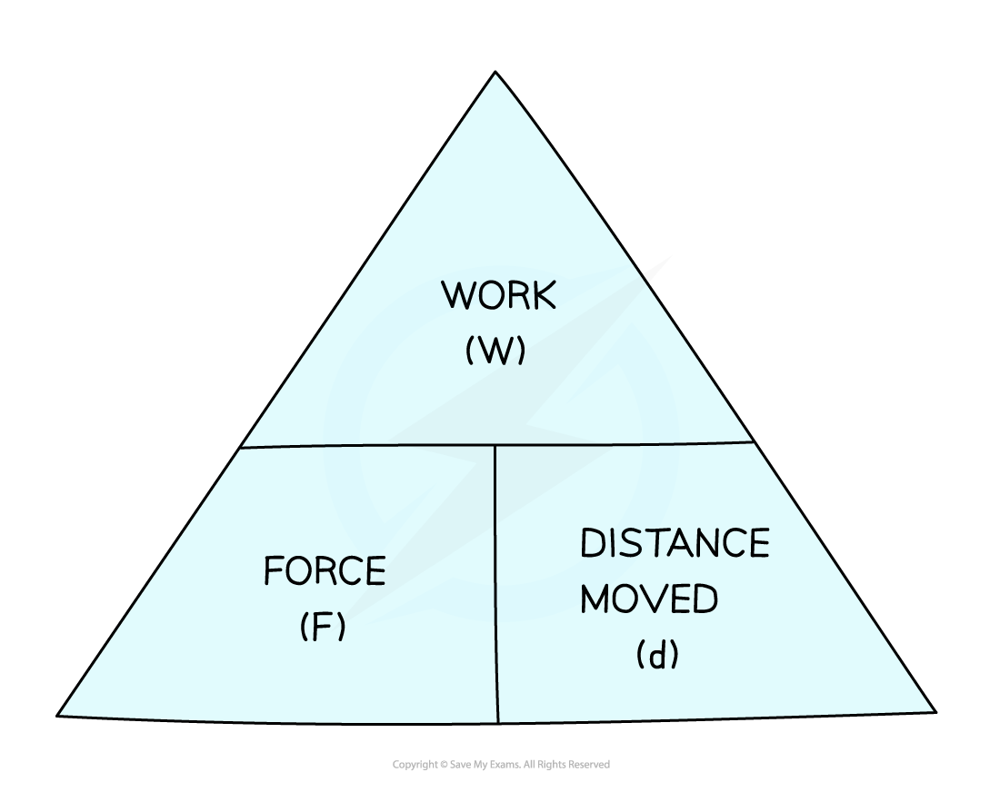
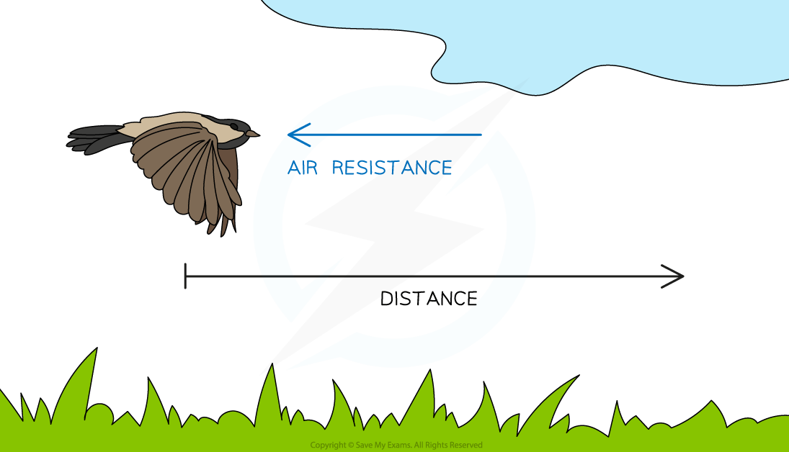

# Work Done

## Work done & energy transfers

> **Spec point** — `spcpt_PjXkhVvHgP2C8Ypz`

## Work done & energy transfers

- **Mechanical work** is done when an object is moved over a **distance** by a **force** applied in the **direction** of its displacement

  - It is said that the **force does work** on the object
  - If a force is applied to an object but doesn’t result in any movement, no work is done
- When **work **is done, **energy **is transferred
- Work done and energy transferred are **equivalent **quantities

#### Work done pushing a box

***Work is done when a force is used to move an object over a distance, and energy is transferred from the person to the box***

### Work done equation

- The formula for work done is:

$W=Fd=\DeltaE$

- Where:

  - $W$ = work done, measured in newton-metres (N m)
  - $F$ = force applied, measured in newtons (N)
  - $d$ = distance in metres (m)
  - $\DeltaE$ = energy transferred, measured in joules (J)

#### Formula triangle for work done, force and distance

***To use a formula triangle, simply cover up the quantity you wish to calculate and the structure of the equation is revealed***

- Using formula triangles is covered in more detail in the revision note on [Speed & velocity](https://www.savemyexams.com/igcse/physics_co-ordinated-sciences-double-award/cie/23/revision-notes/1-motion-forces-and-energy/motion/speed-and-velocity/)

- Mechanical work done and electrical work done are equivalent to energy transferred

$\mathrm{work} \mathrm{done}=\mathrm{energy} \mathrm{transferred}$

- Therefore:

$1Nm=1J$

### Examples of work done

- Work is done on a ball when it is lifted to a height:

  - A force is required to lift the ball
  - Work is done against the weight force to lift the ball through the gravitational field
  - Energy is transferred as work is done

***The weight on the ball produced by the gravitational field does work on the ball over a distance ***

- Work is done when a bird flies through the air

  - A force is required to overcome the drag force
  - Work is done against the drag force as the bird flies over a distance
  - Energy is transferred as work is done

#### Work done by a bird

***The bird does work against air resistance (drag) as it flies through the air***

> **Worked Example**
> A car moving at speed begins to apply the brakes. The brakes of the car apply a force of 500 N, which brings it to a stop after 23 m.
> 
> 
> 
> Calculate the work done by the brakes in stopping the car.
> 
> **Answer:**
> 
> **Step 1: List the known quantities**
> 
> - Distance, $d=23m$
> - Force, $F=500N$
> 
> **Step 2: Write out the work done equation**
> 
> $W=Fd$
> 
> **Step 3: Calculate the work done on the car by the brakes**
> 
> $W=500\times23$
> 
> $W=11500J$
> 
> **Step 4: Round to an appropriate number of significant figures**
> 
> - The lowest number of significant figures in the input values is 1 s.f. (500 N)
> - Therefore, the final answer must be rounded to 1 s.f.
> 
> `W space equals space 10 space 000 space straight J space open parentheses 1 space straight s. straight f. close parentheses`

> **Exam Hint**
> Remember to always convert the distance into **metres** and force into n**ewtons** so that the work done is in **joules** or **newton-metres**

## Video of Work done

> **Spec point** — `spcpt_ktTt9j4vgFhNngGH`

##
