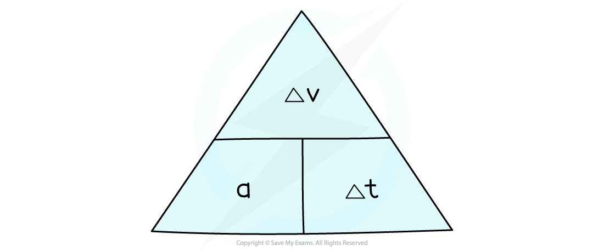

# Acceleration

## Acceleration

> **Spec point** — `spcpt_Bf9RMnVKGkWbZK4k`

## Acceleration

- An object can change its speed by:

  - speeding up
  - slowing down
- When an object speeds up, it is **accelerating**
- When an object slows down, it is **decelerating**

## Calculating acceleration

> **Spec point** — `spcpt_qvDXDvpQbNhxtfc6`

## Calculating acceleration

### Extended Tier Only

- When an object moves in a straight line, its acceleration can be defined as:

**The change in speed per unit time**

- In other words, acceleration is the rate of change of speed
- The acceleration of an object often changes throughout an object's journey
- Therefore, it is often useful to know the **average acceleration**

$a=\frac{\Deltav}{\Deltat}$

- Where:

  - $a$ = acceleration in metres per second squared (m/s2)
  - $\Deltav$ = change in speed in metres per second (m/s)
  - $\Deltat$ = time taken in seconds (s)

#### Formula triangle for acceleration, change in speed and change in time

***To use a formula triangle, simply cover up the quantity you wish calculate and the structure of the equation is revealed***

### Change in speed

- The **change in speed **is the **difference** between the initial and final speed:

$\Deltav=v-u$

- Where:

  - $\Deltav$ = change in speed in metres per second (m/s)
  - $v$ = final speed in metres per second (m/s)
  - $u$ = initial speed in metres per second (m/s)

- If an object speeds up, its acceleration is **positive**
- If an object slows down, its acceleration is **negative**
- Acceleration is positive if it is in the **same direction** as the motion of the object

#### Acceleration of different objects

***A rocket speeding up (accelerating) and a car slowing down (decelerating)***

> **Worked Example**
> A Japanese bullet train decelerates at a constant rate in a straight line. The speed of the train decreases from 50 m/s to 42 m/s in 30 seconds.
> 
> (a) Calculate the change in speed of the train.
> 
> (b) Calculate the deceleration of the train, and explain how your answer shows the train is slowing down.
> 
> **Answer:**
> 
> **Part (a)**
> 
> **Step 1: List the known quantities**
> 
> - Initial speed, $u=50m/s$
> - Final speed, $v=42m/s$
> 
> **Step 2: Write the equation for change in speed **
> 
> $\Deltav=v-u$
> 
> **Step 3: Substitute values for final and initial speed **
> 
> $\Deltav=42-50$
> 
> $\Deltav=-8m/s$
> 
> **Part (b)**
> 
> **Step 1: List the known quantities**
> 
> - Change in speed, $\Deltav=-8m/s$
> - Time taken, $\Deltat=30s$
> 
> **Step 2: Write the equation for acceleration**
> 
> $a=\frac{\Deltav}{\Deltat}$
> 
> **Step 3: Substitute the values for change in speed and time**
> 
> $a=\frac{-8}{30}$
> 
> $a=-0.27m/s^{2}$
> 
> **Step 4: Interpret the value for deceleration**
> 
> - The answer is **negative**, which indicates the train is **slowing down**

> **Exam Hint**
> Remember, the units for acceleration are **metres per second squared**, m/s2. In other words, acceleration measures how much the speed (m/s) changes every second, so the units are metres per second per second (m/s/s).
> 
> You may see the term "velocity" also used to describe speed. Speed means how fast something is going (e.g. 5 m/s), whereas velocity means how fast something is going and in which direction (e.g 5 m/s in a north direction). You don't need to know about velocity for IGCSE GCSE Combined Science.
