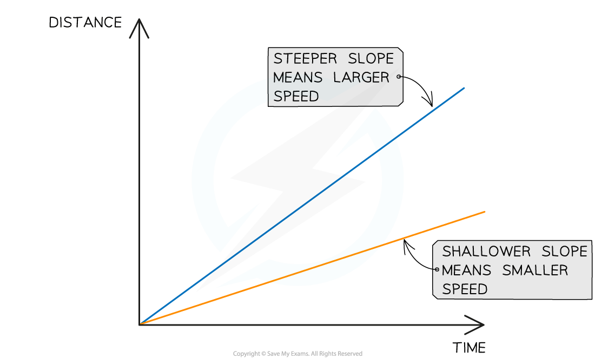

# Distance-Time Graphs

## Distance-time graphs

> **Spec point** — `spcpt_vVgRwKkfBFrKqgtY`

## Distance-time graphs

- A **distance-time graph** is used to describe the motion of an object and calculate its speed

#### Distance-time graph of an object moving at a constant speed

***The graph shows a moving object moving further away from its origin at a constant speed***

### Constant speed on a distance-time graph

- If an object is moving at a **constant speed**, the distance-time graph will be a **straight line**

  - If the constant speed is **zero**, the line will be **horizontal**
  - If the constant speed is **non-zero**, the line will have a **gradient**

- If an object has a speed of zero, the object is **stationary**

  - The distance moved by the object over time is zero

- The **gradient **of a distance-time graph represents the **magnitude **of the object's **velocity**, or its **speed**

  - A **steeper slope**, or a higher gradient, represents a **greater speed**
  - A **shallower slope**, or a lower gradient, represents a **slower speed**

#### Different speeds on a distance-time graph

***Both of these objects are moving at a constant speed, because the lines are straight. The steeper slope represents the faster speed and the shallower line represents the slower speed.***

## Using distance-time graphs

> **Spec point** — `spcpt_V8wvv4yXt3Fbc6H6`

## Using distance-time graphs

- The **speed** of a moving object can be calculated from the **gradient** of the line on a **distance-time** graph:

$\mathrm{speed}=\mathrm{gradient}=\frac{\Deltay}{\Deltax}$

***The speed of an object can be found by calculating the gradient of a distance-time graph***

- $\Deltay$ is the **change** in y (distance) values
- $\Deltax$ is the **change** in x (time) values

> **Worked Example**
> A distance-time graph is drawn below for part of a train journey. The train is travelling at a constant speed.
> 
> 
> 
> Calculate the speed of the train.
> 
> **Answer:**
> 
> **Step 1: Draw a large gradient triangle on the graph **
> 
> - The image below shows a large **gradient triangle** drawn with dashed lines
> - $\Deltay$ and $\Deltax$ are labelled, using the **units** as stated on each axes
> 
> 
> 
> **Step 2: Convert units for distance and time into standard units**
> 
> - The distance travelled, $s=8\mathrm{km}\times1000m=8000m$
> - The time taken, $t=6\mathrm{min}\times60s=360s$
> 
> **Step 3: State that speed is equal to the gradient of a distance-time graph**
> 
> - The **gradient** of a **distance-time** graph is equal to the **speed** of a moving object:
> 
> $\mathrm{gradient}=v=\frac{\Deltay}{\Deltax}=\frac{s}{t}$
> 
> **Step 4: Substitute values to calculate the speed**
> 
> $v=\frac{8000}{360}$
> 
> $v=22.2m/s$

> **Worked Example**
> A student decides to take a stroll to the park. They find a bench in a quiet spot, take a seat, and read a book on black holes. After some time reading, the student realises they lost track of time and runs home.
> 
> A distance-time graph for the trip is drawn below.
> 
> 
> 
> (a) How long does the student spend reading the book?
> 
> (b) Which section of the graph represents the student running home?
> 
> (c) What is the total distance travelled by the student?
> 
> **Answer:**
> 
> **Part (a)**
> 
> - The student spends **40 minutes** reading his book
> - The **flat** section of the line (section B) represents an object which is **stationary**, so section B represents the student sitting on the bench reading
> - This section lasts for **40 minutes**
> 
> 
> 
> **Part (b)**
> 
> - **Section C** represents the student running home
> - The **slope** of the line in section C is **steeper** than the slope in section A
> - This means the student was moving at a **faster** speed (running) in section C
> 
> **Part (c)**
> 
> - The total distance travelled by the student is **0.6 km**
> - The total **distance** travelled by an object is given by the final point on the line; in this case, the line ends at **0.6 km** on the **distance** axis
> 
> 

> **Exam Hint**
> When calculating a gradient, use the **entire line** where possible. Examiners tend to award credit if they see a **large gradient triangle** used, so you need to actually draw the lines directly on the graph itself!
> 
> Remember to check the **units** on each axis. These may not always be in standard units; in our example, the unit of distance was **km** and the unit of time was **minutes**. Double-check which units to use in your answer.
> 
> You can read more about the use of graphs in exams in the article [Graph skills for GCSE Physics](https://www.savemyexams.com/learning-hub/exam-guides/graph-skills-in-gcse-physics/)
