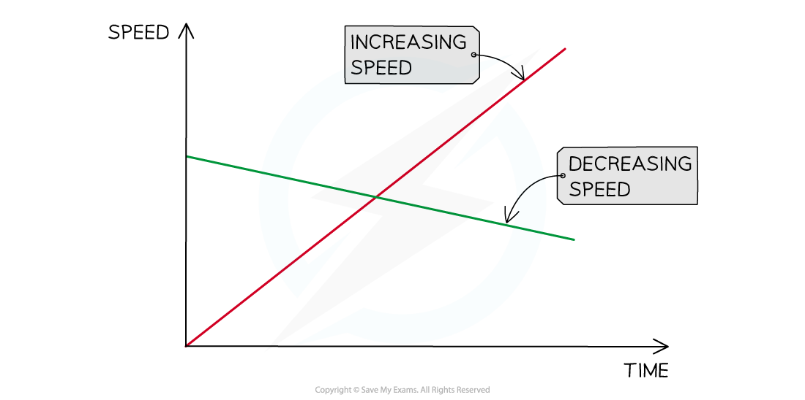
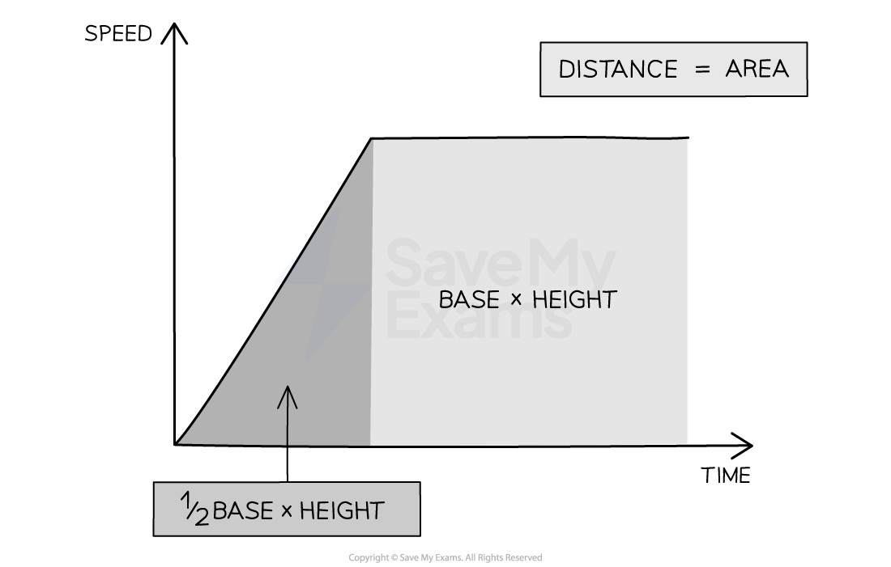
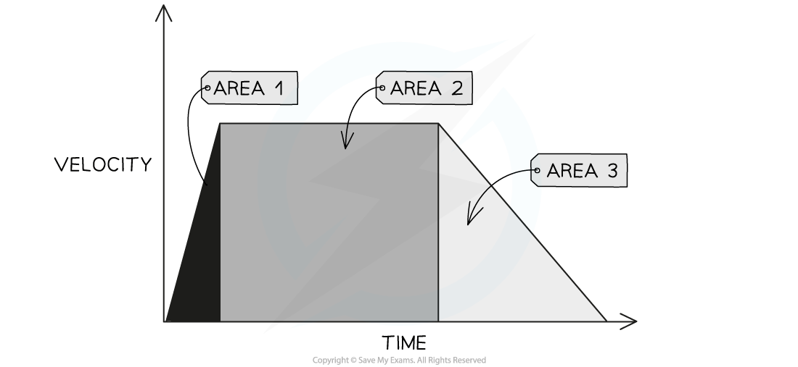

# Speed-Time Graphs

## Speed-time graphs

> **Spec point** — `spcpt_wvGZFWsXPWTPq3TK`

## Speed-time graphs

- A **speed-time graph** is used to describe the speed of an object and calculate its acceleration

### Constant acceleration on a speed-time graph

- If an object is moving at a **constant acceleration**, the speed-time graph will be a **straight line**

  - If the constant acceleration is **zero**, the line will be **horizontal**
  - If the constant acceleration is **non-zero**, the line will have a **gradient**
- If an object has an **acceleration **of **zero**, the object is travelling at a **constant velocity**

  - Its velocity is not changing over time
  - If the **constant speed** is **zero**, then the object is **stationary**

#### Motion on a speed-time graph

***This image shows how to interpret the slope of a speed-time graph***

*** ***

- The **gradient **of a speed-time graph represents the object's **acceleration**

  - A **steeper slope**, or a higher gradient, represents a **greater acceleration**
  - A **shallower slope**, or a lower gradient, represents a** slower acceleration**
- If the gradient is positive, the line slopes upward

  - A **positive gradient** represents an increasing speed, or **acceleration**
- If the gradient is negative, the line slopes downward

  - A **negative gradient** represents a decreasing speed, or **deceleration**

#### Speeding up and slowing down on a speed-time graph

***Both of these objects are moving at a constant acceleration, because the lines are straight. The positive gradient represents an increasing speed or positive acceleration. The negative gradient represents a decreasing speed or negative acceleration.***

> **Exam Hint**
> For CIE IGCSE Physics, you may be asked plot a graph of your own, or to interpret information given to you in a graph. You can read more about graph skills in the article [Graph skills in GCSE Physics](https://www.savemyexams.com/learning-hub/exam-guides/graph-skills-in-gcse-physics/)

## Calculating distance from speed-time graphs

> **Spec point** — `spcpt_T4yMVqGg2FG6p2Q2`

## Calculating distance from speed-time graphs

### Extended Tier Only

- **Speed-time graphs** can also be used to determine the distance travelled by an object

### The area under a speed-time graph

- The **area **under a speed-time graph** **represents the** distance travelled**

***The area under a speed-time graph represents the distance travelled***

** **

- If the area of a section of the speed-time graph forms a **triangle**, the area can be calculated using:

$A_{T}=\frac{1}{2}bh$

- If the area of a section of the speed-time graph forms a** rectangle**, the area can be determined using:

$A_{R}=bh$

- Where:

  - $A_{T}$ = area of a triangle
  - $A_{R}$ = area of a rectangle
  - $b$ = base
  - $h$ = height

- The **total distance travelled** can be determined by finding the** total area** under the speed-time graph
- The distance travelled for **part of the journey** can be determined by finding the area under the graph for a specific **time interval**

#### Area under a speed-time graph split into sections

***The area under a speed-time graph can split into triangular and rectangular sections***

> **Worked Example**
> The speed-time graph below shows a car journey that lasts for 160 seconds.
> 
> 
> 
> Calculate the total distance travelled by the car on this journey.
> 
> **Answer:**
> 
> **Step 1: Recall that the area under a velocity-time graph represents the distance travelled**
> 
> - In order to calculate the total distance travelled, the total area underneath the line must be determined
> 
> **Step 2: Identify each enclosed area**
> 
> - In this example, there are **five** enclosed areas under the line
> - These can be labelled as areas 1, 2, 3, 4 and 5, as shown in the image below:
> 
> 
> 
> **Step 3: Calculate the area of each enclosed shape under the line**
> 
> - Area 1 = area of a triangle
> 
> $A_{1}=\frac{1}{2}bh$
> 
> $A_{1}=\frac{1}{2}\times40\times17.5$
> 
> $A_{1}=350m$
> 
> - Area 2 = area of a rectangle
> 
> $A_{2}=bh$
> 
> $A_{2}=30\times17.5$
> 
> $A_{2}=525m$
> 
> - Area 3 = area of a triangle
> 
> $A_{3}=\frac{1}{2}bh$
> 
> $A_{3}=\frac{1}{2}\times20\times7.5$
> 
> $A_{3}=75m$
> 
> - Area 4 = area of a rectangle
> 
> $A_{4}=bh$
> 
> $A_{4}=20\times17.5$
> 
> $A_{4}=350m$
> 
> - Area 5 = area of a triangle
> 
> $A_{5}=\frac{1}{2}bh$
> 
> $A_{5}=\frac{1}{2}\times70\times25$
> 
> $A_{5}=875m$
> 
> **Step 4: Calculate the total distance travelled by finding the total area under the line**
> 
> - Add up each of the five areas enclosed:
> 
> $\mathrm{total} \mathrm{distance}=A_{1}+A_{2}+A_{3}+A_{4}+A_{5}$
> 
> $\mathrm{total} \mathrm{distance}=350+525+75+350+875$
> 
> $\mathrm{total} \mathrm{distance}=2175m$

> **Exam Hint**
> Some areas will need to be split into a triangle and a rectangle to determine the area for a specific time interval, like areas 3 & 4 in the worked example above.
> 
> If you are asked to find the distance travelled for a specific time interval, then you just need to find the area of the section above that time interval.
> 
> For example, the distance travelled between 70 s and 90 s is the sum of Area 3 + Area 4
