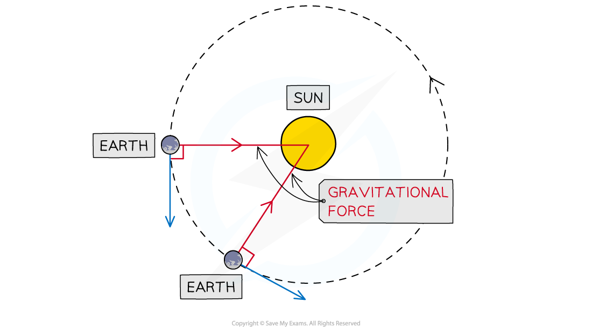

# Gravitational Field Strength

## Gravitational attraction of the Sun

> **Spec point** — `spcpt_JPFKdDpF7G4WwHHY`

## Gravitational attraction of the Sun

- Orbital motion is a result of the **gravitational force of attraction **acting between two bodies
- This gravitational force

  - always acts **towards the centre** of the larger body
  - causes the orbiting body to move in a **circular path**

- The Sun contains most of the mass (>99%) of the Solar System
- Therefore, for objects orbiting around the Sun

  - the Sun's **gravitational attraction** keeps them in orbit
  - the force is directed from the orbiting object to the centre of the Sun

#### Orbital motion of the Earth around the Sun

***The Sun's gravitational force of attraction keeps the Earth in orbit around the Sun***

## Orbital motion of planets

> **Spec point** — `spcpt_Cbdt65dwq8XSXd9p`

## Orbital motion of planets

### Extended Tier Only

- As the distance from the Sun increases:

  - the Sun's gravitational field strength **decreases**
  - the orbital speed of a planet **decreases**

- For an object to maintain a circular orbit, it must have a *centripetal force*

  - For planets orbiting the Sun, this force is the Sun's **gravitational attraction**

- Therefore, the centripetal force on a planet depends on

  - the strength of the Sun's gravitational field
  - the distance of the planet from the Sun

- The further away a planet is from the Sun, the **weaker **the strength of the Sun's gravitational attraction and the weaker the centripetal force

- The centripetal force on a planet is **proportional** to its orbital speed
- Therefore, the **further **a planet is from the Sun:

  - the **smaller **its orbital speed
  - the **longer **its orbital period

#### Orbital speed and distance

***The closest planets to the Sun have the fastest orbital speeds, and the furthest have the slowest***

- This trend in orbital speed and distance can be seen in the data of the planets in the Solar System:

#### Orbital radius, speed and period data

| **Planet** | **Orbital radius (million km)** | **Orbital speed (km/s)** | **Orbital period (days or years)** |
|---|---|---|---|
| **Mercury** | 57.9 | 47.9 | 88 days |
| **Venus** | 108.2 | 35.0 | 225 days |
| **Earth** | 149.6 | 29.8 | 365 days |
| **Mars** | 227.9 | 24.1 | 687 days |
| **Jupiter** | 778.6 | 13.1 | 11.9 years |
| **Saturn** | 1433.5 | 9.7 | 29.5 years |
| **Uranus** | 2872.5 | 6.8 | 75 years |
| **Neptune** | 4495.1 | 5.4 | 165 years |

> **Exam Hint**
> Be careful with your wording in this topic when talking about gravity. It is important to refer to the **force** of gravity as 'gravitational attraction', ' strength of the Sun's gravitational field' or 'the force** due to** gravity'. Avoid terms such as 'the Sun's gravity' or even more vague, 'the force from the Sun'.
