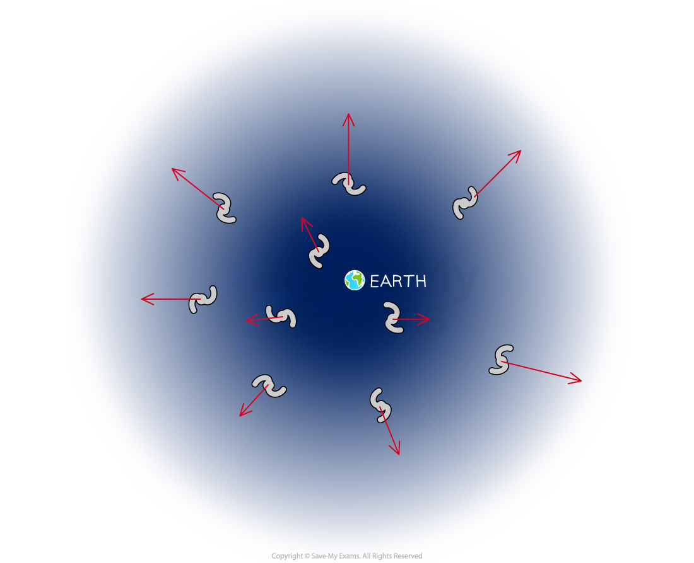

# The Big Bang Theory

## The Big Bang Theory

> **Spec point** — `spcpt_B5WMmHT9MNzdkJBN`

## The Big Bang Theory

### Extended Tier Only

- Around 13.8 billion years ago,** **the Universe began from a **single point** of **high density** and **temperature**
- A giant explosion, known as the **Big Bang**, caused the Universe to **expand **outwards
- As each point **moved away** from the others, the Universe began to cool
- As a result of the initial explosion, the Universe **continues to expand**

#### The Big Bang Theory

***Tracing the expansion of the Universe back to the beginning of time leads to the idea it must have begun with a “Big Bang”***

- The Big Bang Theory is supported by many astronomical observations which indicate that distant galaxies are moving **away** from us
- If galaxies are moving away from us, this means the Universe must be **expanding**

#### Expansion of the Universe

***Observations of light from galaxies show they are moving away from us which means the Universe is expanding***

> **Exam Hint**
> The expansion of the Universe can be visualised by imagining a balloon with equally spaced points on it. The balloon represents space and the points represent galaxies.
> 
> 
> 
> When the balloon is deflated (i.e. the Universe was smaller), the points (galaxies) are closer together and are at an equal distance apart.
> 
> As the balloon (Universe) expands, all the points (galaxies) become further apart **by the same amount**.
> 
> This is because the **space between the galaxies **itself has expanded.
