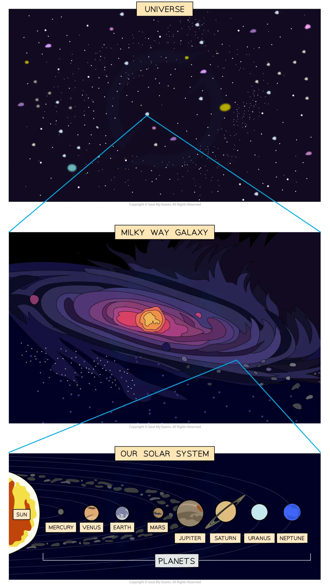

# The Scale of the Universe

## The Milky Way

> **Spec point** — `spcpt_5yJRRTPY3wD6MJs3`

## The Milky Way

### The Universe

- The Universe is defined as

**A large collection of billions of galaxies**

- It is also the name given to the entirety of space

### Galaxies

- A galaxy is defined as

**A large collection of billions of stars**

- Stars are large astronomical objects, such as the Sun

### The Milky Way

- **The Milky Way** is one of many billions of galaxies making up the Universe
- **The Sun** is one of many billions of stars making up the** **Milky Way
- Other stars in the Milky Way galaxy are **much further away** from Earth than the Sun is
- Some of these stars also have **planets** which orbit them

#### Hierarchy of the Solar System

***The Universe is a large collection of galaxies and a galaxy is a large collection of stars. The Sun is a star at the centre of our Solar System in the Milky Way galaxy***

## Astronomical distances

> **Spec point** — `spcpt_BnnxCvGWvTFyZnZ6`

## Astronomical distances

- Astronomical distances, such as the distances between stars and galaxies, are extremely **large**
- To describe these distances, astronomers use a special unit called the **light year**

- One light-year is defined as:

**The distance travelled by light in one year**

- The **diameter of the Milky Way** is approximately **100 000 light-years**
- This means that light would take 100 000 years to travel from one side of the Milky Way to the other

> **Worked Example**
> The centre of our galaxy is 30 000 light years away.
> 
> (a) How long does it take light to reach the Earth?
> 
> (b) How far away, in light years, is the edge of the Milky Way from Earth?
> 
> **Answer:**
> 
> **Part (a)**
> 
> - The centre of our galaxy is 30 000 light years away
> - It takes light **30 000 years** to reach the Earth from the centre of our galaxy
> 
> **Part (b)**
> 
> - The diameter of the Milky Way is 100 000 light years
> - The radius of the Milky Way is 50 000 light years
> - Therefore, the edge of the Milky Way **closest **to the Earth is 50 000 – 30 000 = **20 000 light years**
> **OR**
> - The edge of the Milky Way **furthest **from the Earth is 100 000 – 20 000 = **80 000 light years**
