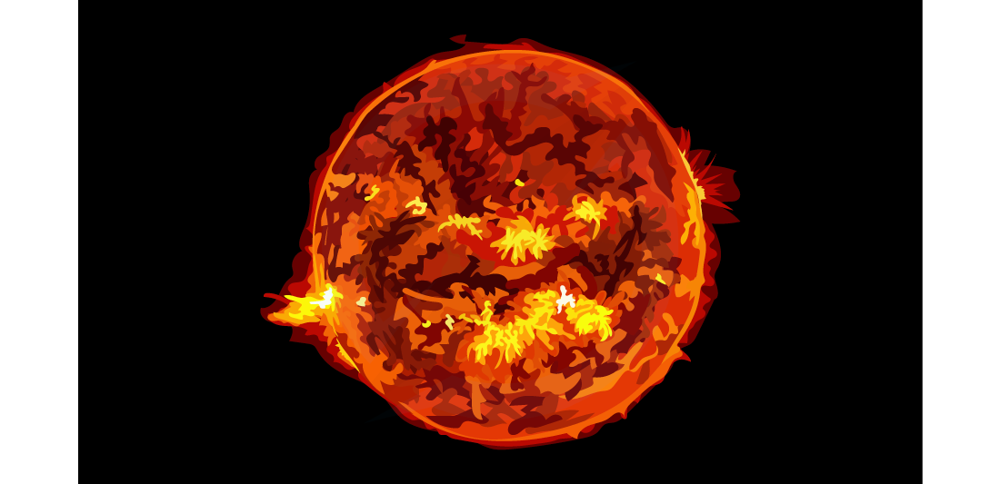

# The Sun as a Star

## The Sun as a star

> **Spec point** — `spcpt_6CpM3fdzKRWHNfFz`

## The Sun as a star

- The Sun is a **medium-sized star **which lies at the **centre **of the Solar System
- It consists mostly of the two elements **hydrogen** and **helium**
- It radiates most of its energy in the **infrared**, **visible** and **ultraviolet** regions of the electromagnetic spectrum

#### Our Sun

***The Sun is a medium-sized star consisting of mostly hydrogen and helium***

## Nuclear fusion in stars

> **Spec point** — `spcpt_PHC5gYsvSvWqwFGj`

## Nuclear fusion in stars

### Extended Tier Only

- Stars are huge balls of (mostly) **hydrogen** gas
- In the centre of a star, hydrogen nuclei undergo **nuclear fusion** to form helium nuclei
- An equation for a possible fusion reaction is:

`H _ 1 ^ 2 + H _ 1 ^ 3 -> He _ 2 ^ 4 + n _ 0 ^ 1`

- Where $H_{1}^{2}$ (deuterium) and `H _ 1 ^ 3` (tritium) are both isotopes of hydrogen

  - These are formed through other fusion reactions in the star

- A huge amount of **energy **is released in the reaction
- All stable stars are **powered **by nuclear fusion reactions

> **Exam Hint**
> It is useful to remember that hydrogen is the fuel within stars, but the details of the reaction between deuterium and tritium is not required at this level.
