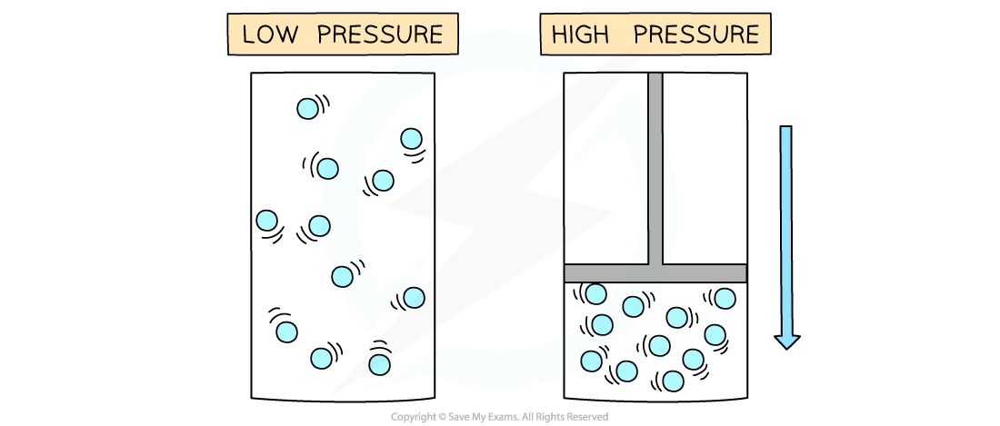
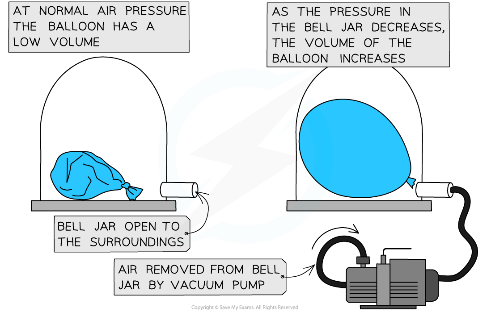

# Pressure Changes

## The gas laws

> **Spec point** — `spcpt_h5ff5fVSP355XDT4`

## The gas laws

### Extended Tier Only

### Pressure & volume (constant temperature)

- If the temperature of a gas remains **constant**, the pressure of the gas changes when it is:

  - **Compressed** – decreases the volume which **increases** the pressure
  - **Expanded** – increases the volume which **decreases** the pressure

***At constant temperature, changing the volume changes the pressure***

- Similarly, a change in pressure can cause a change in volume
- A **vacuum pump** can be used to remove the air from a sealed container
- The diagram below shows the change in volume to a tied up balloon when the pressure of the air around it decreases:

***At constant temperature, changing the pressure changes the volume***

- When a gas is compressed, the molecules will hit the walls of the container **more frequently**

  - This creates a larger overall **net force** on the walls which increases the **pressure**

### Pressure & temperature (constant volume)

- **Increasing temperature increases the pressure** of a gas which is kept at a **constant volume**
- The **average speed** of molecules increases when the temperature increases (and vice versa)
- As the gas heats up, the molecules will travel at a higher speed

  - They collide with the walls more often and with greater force, increasing the pressure
- Therefore, at a constant volume, an **increase** in temperature **increases** the pressure of a gas and vice versa

  - Diagram A shows molecules in the same volume collide with the walls of the container more as the temperature increases
  - Diagram B shows that since the temperature is directly proportional to the pressure (at constant volume), the graph is a straight line

***At constant volume, an increase in the temperature of the gas increases the pressure due to more collisions on the container walls***
