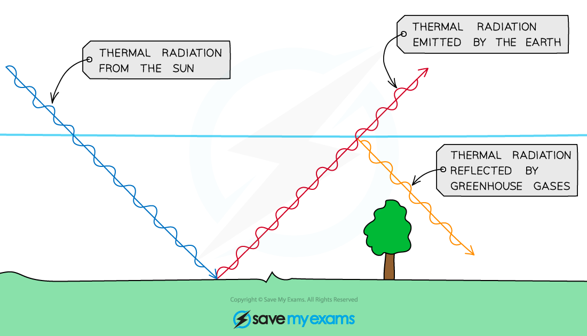

# The Greenhouse Effect

## The greenhouse effect

> **Spec point** — `spcpt_HMx6NqHMNcKgT4hG`

## The greenhouse effect

### Extended Tier Only

### Temperature of Earth

- The temperature of the Earth depends on a balance of:

  - Radiation from the Sun, which is **absorbed** by the Earth
  - Radiation **emitted **by the Earth
- Greenhouse gases, such as carbon dioxide and water vapour, **absorb **and **re-emit** the radiation emitted by Earth

  - This causes the surface temperature of the Earth to increase
- If the Earth had **no atmosphere**, none would be trapped and the surface temperature would be **extremely low**

  - If the concentration of greenhouse gases is too great, however, this can cause the surface temperature to become too high

#### Radiation and the greenhouse effect

***The Earth receives thermal radiation from the Sun but emits its own thermal radiation at the same time. The greenhouse effect is where this radiation is trapped by gases***

> **Worked Example**
> Explain why adding an excess of carbon dioxide to the Earth's atmosphere would lead to an increase in the surface temperature of Earth.
> 
> **Answer:**
> 
> **Step 1: Describe the greenhouse effect**
> 
> - Radiation from the Sun is absorbed by the Earth
> - Some is re-emitted by the Earth
> - Greenhouse gases, such as carbon dioxide, reflect a fraction of this emitted radiation and heat the Earth's surface
> 
> **Step 2: Describe the effect of increasing the amount of carbon dioxide**
> 
> - If there is more carbon dioxide, more of the Earth's emitted radiation is reflected back to the Earth
> - The rate of radiation absorbed by the Earth's surface increases, so its temperature increases

> **Exam Hint**
> Global warming is an important current topic in the world. Generally it is important to understand how this process works, but this also means it appears in exams frequently. Learning more about this topic not only means that you are prepared for application questions on radiation, but it also means you are well-informed about the environmental issues we are facing as a society.
