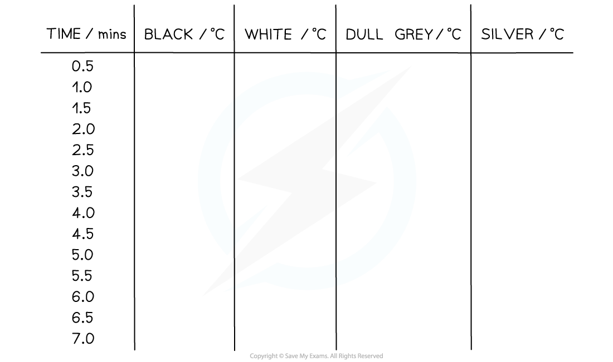
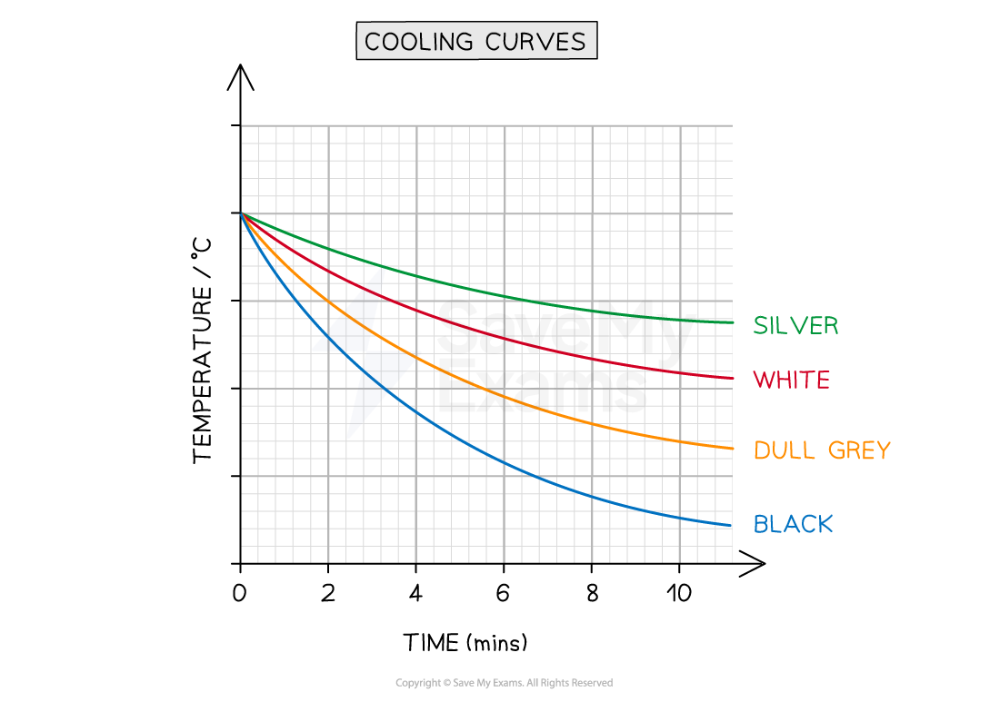

# Investigating Thermal Radiation

## Investigating thermal radiation

> **Spec point** — `spcpt_FHpfBkkqkscM4Jjd`

## Investigating thermal radiation

### Extended Tier Only

### Aims of the experiment

- The aim of the experiment is to investigate how the amount of infrared radiation absorbed or radiated by a surface depends on the nature of that surface

### Variables

- *Independent variable* = Colour
- *Dependent variable* = Temperature
- Control variables:

  - Identical flasks (except for their colour)
  - Same amounts of hot water
  - Same starting temperature of the water
  - Same time interval

### Equipment

#### Equipment List

| **Equipment** | **Purpose** |
|---|---|
| Heatproof mat | To protect surfaces and reduce heat loss |
| Stop watch | To measure time taken for cooling |
| Kettle | To boil water |
| 4 thermometers | To measure the water temperature in each flask |
| Flasks painted different colours (black, dull grey, white, silver) | To investigate the heat loss of different colours |

- *Resolution* of measuring equipment:

  - Thermometer = 1°C
  - Stopwatch = 0.01 s

### Method

***Different coloured beakers for investigating infrared radiation apparatus***

1. Set up the four identical flasks painted in different colours: black, grey, white and silver
2. Fill the flasks with hot water, ensuring the measurements start from the same initial temperature
3. Note the starting temperature, then measure the temperatures at regular intervals, e.g. every 30 seconds for 10 minutes

### Results

#### Example results table

### Analysis of results

- The intensity (and wavelength) of the emitted radiation depends on the colour of the surface

- Most of the energy lost from the beakers will be** by heating** due to **conduction **and **convection**

  - This will be **equal **for each beaker, as colour does not affect energy transferred by conduction and convection
- Any **difference** in energy transferred away from each beaker must, therefore, be due to infrared **radiation**
- To compare the rate of energy transfer away from each flask, plot a graph of **temperature** on the y-axis against **time** on the x-axis and draw curves of best fit

- The expected results are shown on the graph below:

***Example graph of the expected results for the different coloured beakers***

### Evaluating the experiments

*Systematic errors*

- Make sure the starting temperature of the water is the same for each material since this will cool very quickly
- It is best to do this experiment in pairs to coordinate starting the stopwatch and immersing the thermometer
- Use a data logger connected to a digital thermometer to get more accurate readings

*Random errors*

- Make sure the hole for the thermometer isn’t too big, otherwise thermal energy will escape through the hole
- Take repeated readings for each coloured flask
- Read the values on the thermometer at eye level, to avoid parallax error

### Safety considerations

- Safety goggles should be worn when filling the flasks with boiling water
- Keep water away from all electrical equipment
- Make sure not to touch the hot water directly

  - Run any burns immediately under cold running water for at least 5 minutes
- Do not overfill the kettle
- Make sure all the equipment is in the middle of the desk, and not at the end to avoid knocking over the beakers
- Carry out the experiments only whilst standing, in order to react quickly to any spills or burns

> **Exam Hint**
> Similar experiments can be performed to determine whether an object is a good **absorber** of thermal radiation by placing different coloured objects near a source of thermal radiation and measuring temperature changes.
