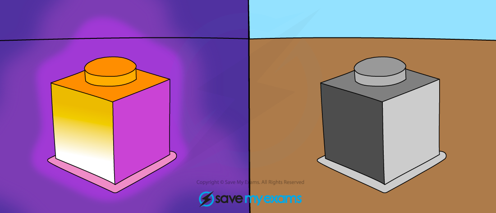

# Radiation

## Thermal radiation

> **Spec point** — `spcpt_YJYfWv94pmwNVmMr`

## Thermal radiation

### What is thermal radiation?

- All objects give off thermal radiation

  - The hotter an object is, the more thermal radiation it emits
  - Thermal radiation is mainly due to **infrared** **radiation (**part of the electromagnetic spectrum)
- Thermal radiation is **the only way in which heat can travel through a vacuum**

  - It is the way in which heat reaches us from the Sun through the vacuum of space
  - Thermal radiation does **not need a medium** to travel, unlike convection and conduction

## Effects of different surfaces

> **Spec point** — `spcpt_yrcPFvwtY7v36QP7`

## Effects of different surfaces

### What two factors affect the rate of thermal energy transfer?

- The amount of thermal radiation emitted by an object depends on a number of factors:

  - The **surface colour** of the object (black = more radiation emitted and absorbed)
  - The **texture **of the surface (shiny surfaces = less radiation emitted and absorbed)

#### Table of the effect of coloured surfaces on absorbing and emitting ability

| **Colour/texture** | **Absorbing** | **Emitting** |
|---|---|---|
| Black | Good absorber | Good emitter |
| Dull/dark | Reasonable absorber | Reasonable emitter |
| White | Poor absorber | Poor emitter |
| Shiny | Very poor absorber (it reflects) | Very poor emitter |

- Black objects are very good at absorbing thermal radiation, for example black clothes make you feel hotter in sunny weather

  - Black objects are also very good at emitting thermal radiation, which is the reason that some chargers for laptops, and radiators in cars are coloured black - it helps them to cool down
- Shiny objects reflect thermal radiation and so absorb very little

  - They also emit very little, though, and so take longer to cool down

***The infrared radiation emitted from a hot object can be detected using a special camera. The dull black side of the cube (left) is seen to glow brighter with infrared radiation than the shiny light side of the cube (right)***
