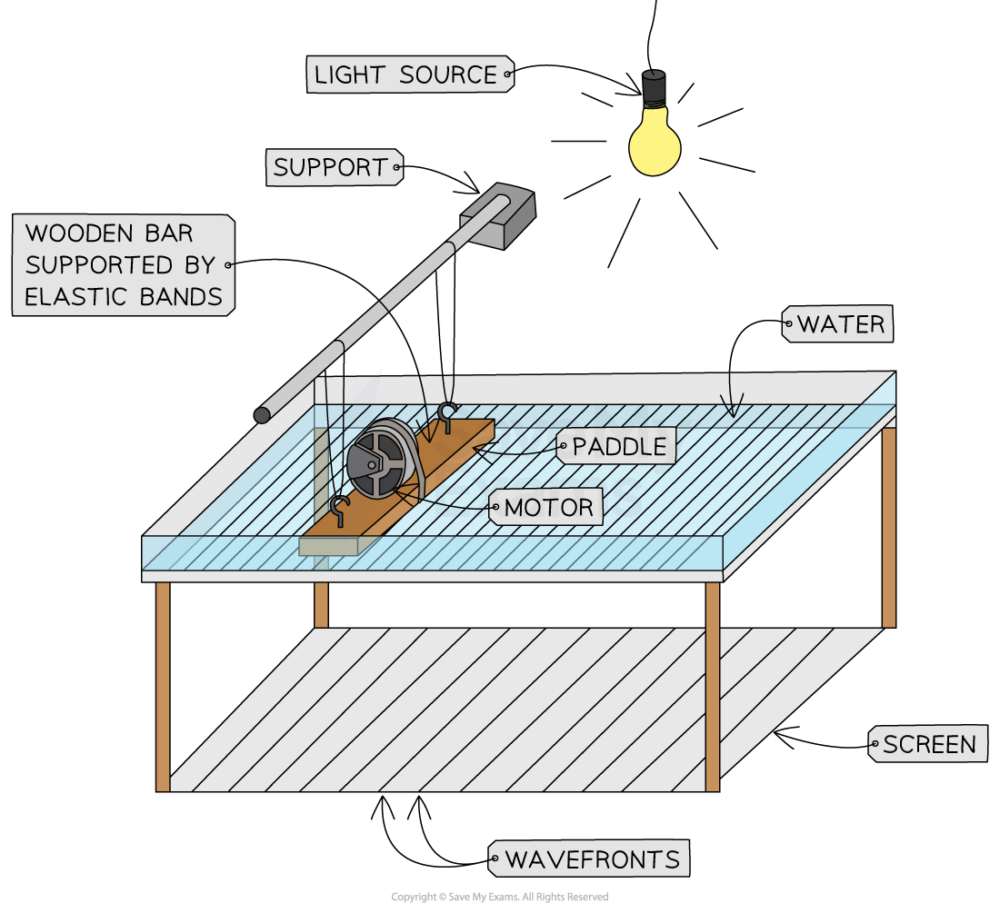
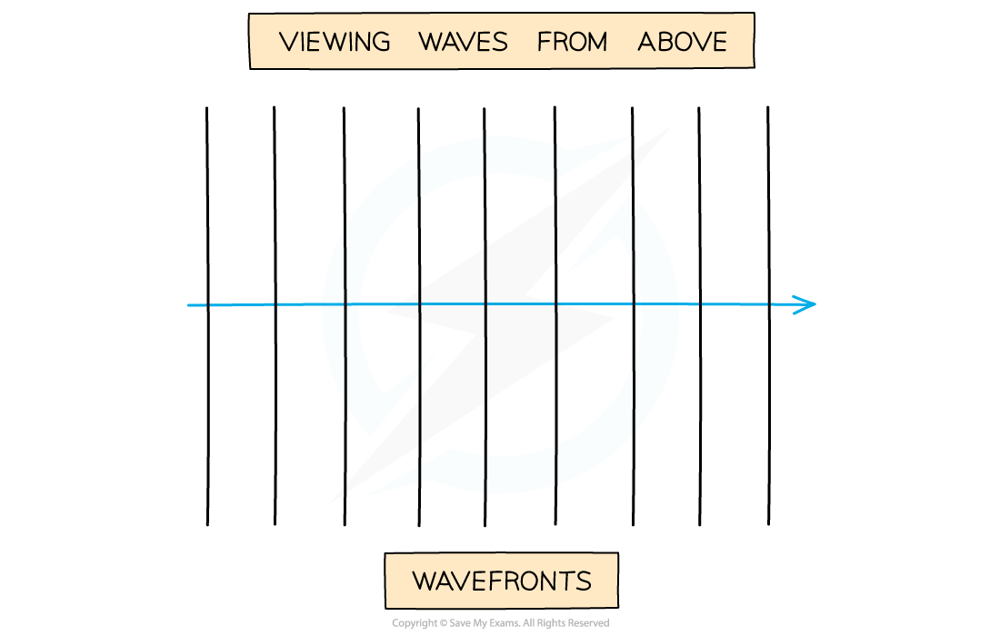

# Features of Waves

## Waves & energy transfer

> **Spec point** — `spcpt_ZDs3hdFsF6ZyDxCQ`

## Waves & energy transfer

- Waves transfer **energy** **without** transferring** matter**

  - For sound waves, this means it is the **wave** and not the **air molecules** (the matter) itself that travels
- Objects floating on water provide evidence that waves only transfer energy and **not** matter

  - It is possible to see objects on the surface of the water bob up and down but not change their position
  - This is because the **wave **and not the **water** (the matter) itself that travels

- Waves are described as **oscillations** or **vibrations** about a fixed point

  - For example, **ripples** cause particles of water to oscillate up and down
  - **Sound** waves cause particles of air to vibrate back and forth

> **Worked Example**
> The diagram below shows a toy duck bobbing up and down on top of the surface of some water, as waves pass it underneath.
> 
> 
> 
> <u>[Use this image](https://www.savemyexams.com/learning-hub/support/using-our-illustrations-images-fair-use/)</u>
> 
> Explain how the toy duck demonstrates that waves do not transfer matter.
> 
> **Answer: **
> 
> - The plastic duck moves up and down but does not travel with the wave along the surface of the water
> - The water waves transfer **energy**, but the water particles do not move
> - This means when a wave travels between two points, no matter travels with it, the points on the wave vibrate back and forth about **fixed** positions
> - Objects floating on the water bob up and down when waves pass under them, demonstrating that there is **no movement of matter** in the direction of the wave, only **energy**

> **Exam Hint**
> There is a key distinction between the particles (or oscillations) of a wave, and the wave itself.
> 
> The motion of the wave **causes** the particles to move. The particles themselves are not the wave.

## Wave motion

> **Spec point** — `spcpt_SxRD7xMYpP93MjXs`

## Wave motion

- Wave motion can be illustrated by:

  - vibrations in ropes and springs
  - experiments using water waves

#### Wave vibrations

[Use this image](https://www.savemyexams.com/learning-hub/support/using-our-illustrations-images-fair-use/)

***Waves can be shown through vibrations in ropes or springs***

- Properties of waves can be observed using water waves in a** ripple tank**

  - Properties include frequency, wavelength and wave speed as explained in the next section

#### Wave motion in a ripple tank

[Use this image](https://www.savemyexams.com/learning-hub/support/using-our-illustrations-images-fair-use/)

***Wave motion of water waves may be demonstrated using a ripple tank***

## Features of a wave

> **Spec point** — `spcpt_WQw9C8XpZQMwMVKK`

## Features of a wave

- When describing wave motion, there are several terms which are important to know, including:

  - Wavefront
  - Wavelength
  - Frequency
  - Crest (peak)
  - Trough
  - Amplitude
  - Wave speed

### Wavefront

- Wavefronts are a useful way of picturing waves from above: each wavefront is used to represent a single wave
- The image below illustrates how wavefronts are visualised:

  - The arrow shows the direction the wave is moving and is sometimes called a **ray**
  - The space between each wavefront represents the **wavelength**
  - When the wavefronts are **close together**, this represents a wave with a **short** wavelength
  - When the wavefronts are **far apart**, this represents a wave with a **long** wavelength

#### Wavefronts are viewed from above

<u>[Use this image](https://www.savemyexams.com/info/policies/using-our-illustrations-images-fair-use/)</u>

***Diagram showing a wave moving to the right, drawn as a series of wavefronts***

### Wavelength

- Wavelength is defined as: **The distance from one point on the wave to the same point on the next wave**
- In a transverse wave:

  - The wavelength can be measured from one peak to the next peak
- In a longitudinal wave

  - The wavelength can be measured from the centre of one compression to the centre of the next
- The wavelength is given the symbol **λ** (lambda) and is measured in** metres** (**m)**
- The distance along a wave is typically put on the x-axis of a wave diagram

#### Wavelength and amplitude of a transverse wave

<u>[Use this image](https://www.savemyexams.com/info/policies/using-our-illustrations-images-fair-use/)</u>

***Diagram showing the amplitude and wavelength of a wave***

### Frequency

- Frequency is defined as: **The number of waves passing a point in a second**
- Frequency is given by the symbol ***f ***and is* *measured in* ***Hertz (Hz)**

### Crests & troughs

- A crest, or a peak, is defined as: **The highest point on a wave above the equilibrium, or rest position**
- A trough is defined as **The lowest point on a wave below the equilibrium, or rest, position**

#### Wave crests and troughs

<u>[Use this image](https://www.savemyexams.com/info/policies/using-our-illustrations-images-fair-use/)</u>

***Diagram showing a crest and a trough on a transverse wave***

### Amplitude

- Amplitude is defined as: **The distance from the undisturbed position to the peak or trough of a wave**
- It is given the symbol **A** and is measured in **metres (m)**
- Amplitude is the maximum or minimum ***displacement*** from the ***undisturbed position***

### Wave speed

- Wave speed is the speed at which **energy** is transferred through a medium
- Wave speed is defined as: **The distance travelled by a wave each second**
- The equation used to calculate wave speed is explained in [The wave equation](https://www.savemyexams.com/igcse/physics_co-ordinated-sciences-double-award/cie/23/revision-notes/3-waves/general-properties-of-waves/the-wave-equation/)

> **Worked Example**
> Small water waves are created in a ripple tank by a wooden bar. The wooden bar vibrates up and down hitting the surface of the water. The diagram below shows a cross-section of the ripple tank and water.
> 
> 
> 
> <u>[Use this image](https://www.savemyexams.com/info/policies/using-our-illustrations-images-fair-use/)</u>
> 
> Identify the letter which shows:
> 
> a) The amplitude of a water wave.
> 
> b) The wavelength of the water wave.
> 
> **Answer: **
> 
> **Part (a)**
> 
> **Step 1: Recall the definition of amplitude**
> 
> - Amplitude = The distance from the undisturbed position to the peak or trough of a wave
> 
> **Step 2: Mark the undisturbed position on the wave**
> 
> - This is the centre of the wave
> 
> 
> 
> <u>[Use this image](https://www.savemyexams.com/info/policies/using-our-illustrations-images-fair-use/)</u>
> 
> **Step 3: Identify the arrow between the undisturbed position and a peak**
> 
> - The amplitude is shown by arrow **D**
> 
> **Part (b)**
> 
> **Step 1: Recall the definition of wavelength**
> 
> - Wavelength = The distance from one point on the wave to the same point on the next wave
> 
> **Step 2: Draw lines on each horizontal arrow**
> 
> - This helps to identify the points on the wave the arrows are referring to
> 
> 
> 
> <u>[Use this image](https://www.savemyexams.com/info/policies/using-our-illustrations-images-fair-use/)</u>
> 
> **Step 3: Identify the arrow between two of the same points on the wave**
> 
> - The wavelength is shown by arrow **C**
