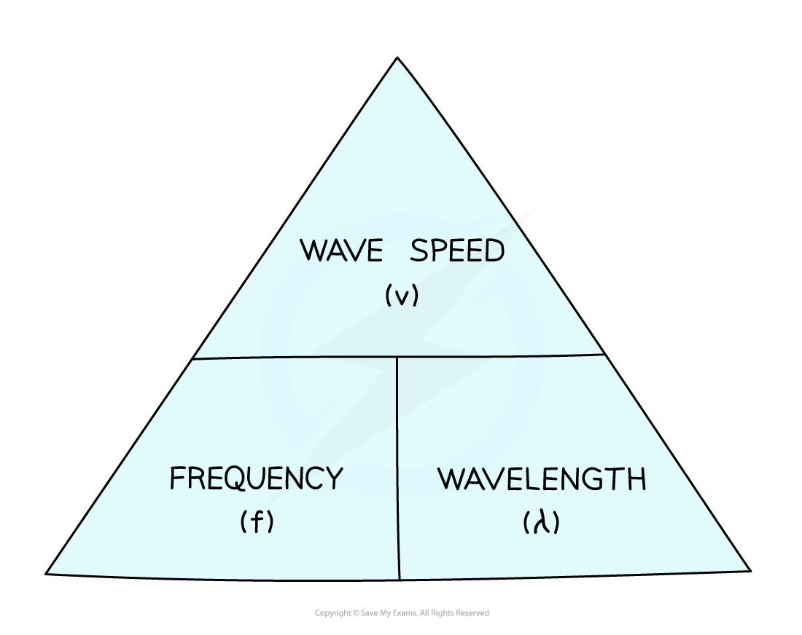

# The Wave Equation

## The wave equation

> **Spec point** — `spcpt_pywgSJg4xwvYVJnZ`

## The wave equation

- The equation used to calculate wave speed is:

$v=f\timesλ$

- Where:

  - *v *= wave speed, measured in metres per second (m/s)
  - *f *= wave frequency, measured in hertz (Hz)
  - *λ *= wavelength, measured in metres (m)

- Wave speed is defined as: **The distance travelled by a wave each second**
- Wave speed is the speed at which energy is transferred through a medium
- Transverse and longitudinal waves both obey the wave equation

#### Wave speed formula triangle

- For more information on how to use a formula triangle refer to the revision note on [speed](https://www.savemyexams.com/igcse/science/cie/combined-science/23/physics/revision-notes/motion-forces-energy/motion/speed/)

> **Worked Example**
> A wave in a pond has a speed of 0.15 m/s and a time period of 2 seconds. Calculate:
> 
> a) The frequency of the wave
> 
> b) The wavelength of the wave
> 
> **Answer:**
> 
> **Part (a)**
> 
> **Step 1: List the known quantities**
> 
> - Time period, *T* = 2 s
> 
> **Step 2: State the equation relating time period and frequency**
> 
> $T=\frac{1}{f}$
> 
> **Step 3: Rearrange for frequency, *****f*****, and calculate the answer**
> 
> $f=\frac{1}{T}=\frac{1}{2}$
> 
> Frequency, *f* = **0.5 Hz**
> 
> **Part (b)**
> 
> **Step 1: List the known quantities**
> 
> - Wave speed, *v* = 0.15 m/s
> - Frequency, *f* = 0.5 Hz
> 
> **Step 2: Write out the wave speed equation**
> 
> $v=f\timesλ$
> 
> **Step 3: Rearrange the equation to calculate the wavelength**
> 
> $λ=\frac{v}{f}$
> 
> **Step 4: Use the frequency you calculated in part (a) and put the values into the equation**
> 
> $λ=\frac{0.15}{0.5}$
> 
> Wavelength,* λ* = **0.30 m**

> **Exam Hint**
> When stating equations make sure you use the right letters. For example, use λ for wavelength, not L or W
> 
> If you can’t remember the correct letters, then just state the word equations
> 
> Be careful with units: wavelength is usually measured in metres and speed in m/s, but if the wavelength is given in cm you might have to provide the speed in cm/s
> 
> Likewise, watch out for the frequency given in kHz: 1 kHz = 1000 Hz
