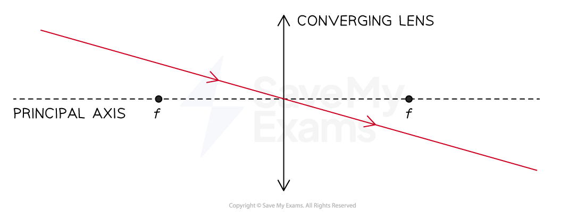
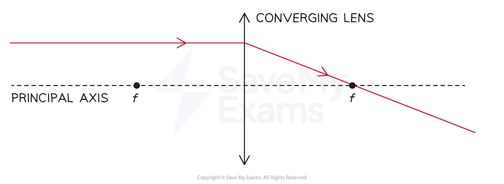
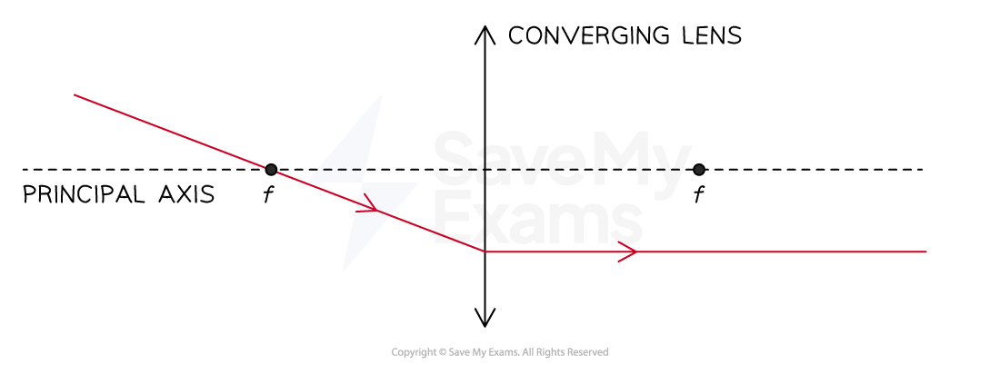
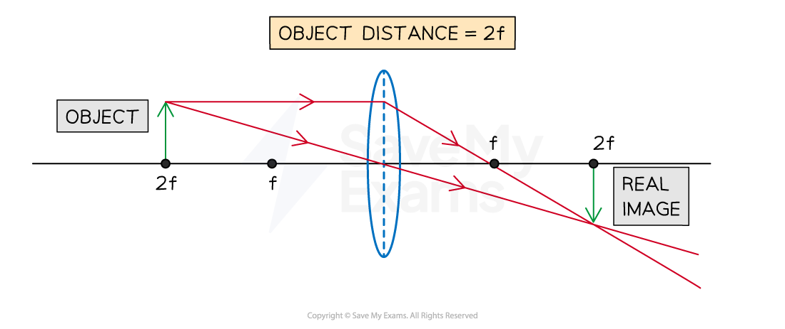

# Images

## Characteristics of images

> **Spec point** — `spcpt_hyMmSCTg6sJz9qyX`

## Characteristics of images

- An image can be described using the following characteristics which compare it to the object:

  - **Enlarged**/same size/**diminished**
  - Upright/**inverted**
- An image viewed through a magnifying glass is:

  - **Enlarged, bigger** than the **object**
  - **Upright**, has the same orientation as the object

#### An image viewed through a magnifying glass

***An image viewed through a magnifying glass is enlarged and upright compared to the object***

- An image viewed through an eye, a camera, or a glasses lens is:

  - **Diminished, smaller** than the **object**
  - **Inverted, upside down** compared to the object

#### An image viewed by the eye

***An image viewed by the eye is diminished and inverted compared to the object***

## Converging lens - real image

> **Spec point** — `spcpt_pG4CFsSF5TRy2J6h`

## Converging lens - real image

### Interpreting converging ray diagrams

- The three main rules for interpreting ray diagrams are as follows:

**1. Rays that pass through the optical centre of the lens travel straight through, without changing direction**

** **

**2. Rays that are parallel to the principal axis will be refracted and pass through the focal point *****f***

**3. Rays passing through the focal point *****f***** will emerge parallel to the principal axis**

### Interpreting converging ray diagrams of real images

- The position of the object relative to the focal length of a converging lens affects the position, size, and orientation of the image formed
- For real images formed by a converging lens, there are three common object positions to consider:

  - the object is placed further than 2f from the lens
  - the object is placed at 2f from the lens
  - the object is placed between f and 2f from the lens

#### Interpreting a ray diagram for an object placed further than 2f

- The image that forms will have the following properties:

| **The image forms...** | between *f* and 2*f* |
|---|---|
| **The nature of the image is...** | real |
| **The orientation of the image is...** | inverted |
| **The size of the image is...** | diminished |

#### Interpreting a ray diagram for an object placed at 2f

- The image that forms will have the following properties:

| **The image forms...** | at 2*f* |
|---|---|
| **The nature of the image is...** | real |
| **The orientation of the image is...** | inverted |
| **The size of the image is...** | the same |

#### Interpreting a ray diagram for an object placed between f and 2f

- The image that forms will have the following properties:

| **The image forms...** | beyond 2*f* |
|---|---|
| **The nature of the image is...** | real |
| **The orientation of the image is...** | inverted |
| **The size of the image is...** | magnified |

> **Worked Example**
> The ray diagram below shows a real image formed by a converging lens.
> 
> 
> 
> Describe the image formed by the lens.
> 
> **Answer:**
> 
> - The image is:
> 
>   - Formed between f and 2f from the lens
>   - Real
>   - Inverted
>   - Diminished
