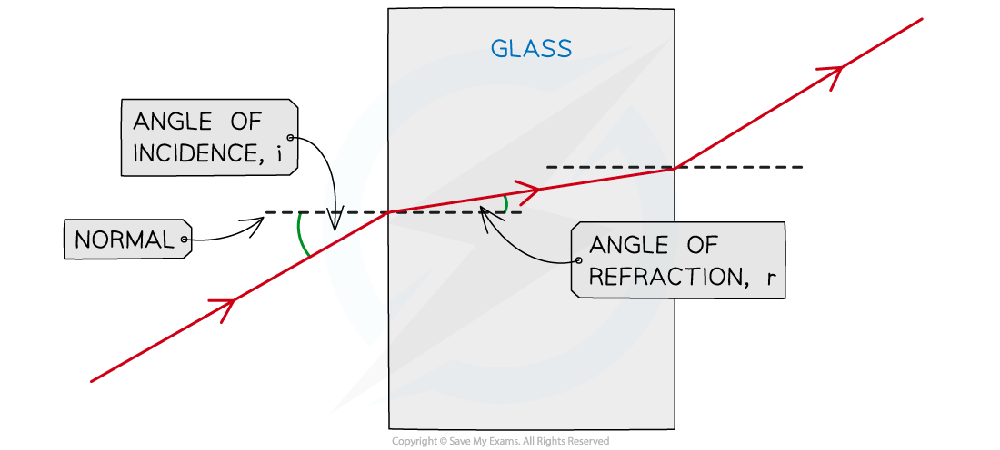

# Refraction of Light

## Defining refraction

> **Spec point** — `spcpt_Vhpm4WNN2bdSvhtK`

## Defining refraction

- Refraction is defined as: **The change in direction of a light ray passing from one medium to another**
- In refraction, angles are measured between the ray (showing the direction of the wave) and the *normal* line

  - The angle of the wave approaching the boundary is called the **angle of incidence *****(i)***
  - The angle of the wave leaving the boundary is called the **angle of refraction *****(r)***

- When drawing a ray diagram an arrow is used to show the direction the wave is travelling

  - An **incident** ray has an arrow pointing **towards** the boundary
  - A **refracted** ray has an arrow pointing **away** from the boundary
- The **angles** of **incidence** and **refraction** are usually labelled ***i*** and ***r*** respectively

#### Refraction ray diagram

***A ray diagram for light refracting at a boundary, showing the normal, angle of incidence and angle of refraction***

## Refraction of light

> **Spec point** — `spcpt_fdsQ5KbtCgPQKHBM`

## Refraction of light

- The change in direction depends on the difference in** density** between the two media:
- From **less dense to more dense** (e.g air to glass), light bends **towards** the normal

  - From **more dense to less dense** (e.g. glass to air), light bends **away** from the normal
  - When passing along the **normal **(perpendicular) the light **does not bend** at all
- Note that when a light wave enters and leaves the glass block there are **two **boundaries

  - The **refracted **ray at the **first **boundary becomes the **incident **ray at the **second **boundary

#### Refraction diagram of light from air through a glass block

***How to construct a ray diagram showing the refraction of light as it passes through a rectangular block***

- The **change in direction **occurs due to the **change in speed** when travelling in different substances

  - When light passes into a denser substance, the waves will **slow down**; hence, they bend **towards the normal**
- The only properties that **change** during refraction are **speed and wavelength** – the frequency of waves **does not change**

  - Different frequencies account for different **colours** of light (red has a low frequency, whilst blue has a high frequency)
  - When light refracts, **it does not change colour **(think of a pencil in a glass of water), therefore, the frequency does not change

> **Exam Hint**
> Practice drawing refraction diagrams as much as you can! It's very important to remember which way the light bends when it crosses a boundary:
> 
> As the light **enters** the block it bends **towards** the normal line
> 
> **Remember: Enters Towards**
> 
> When it **leaves** the block it bends **away** from the normal line
> 
> **Remember: Leaves Away**
> 
> You only need to know about light passing through the boundaries between **two **media.
