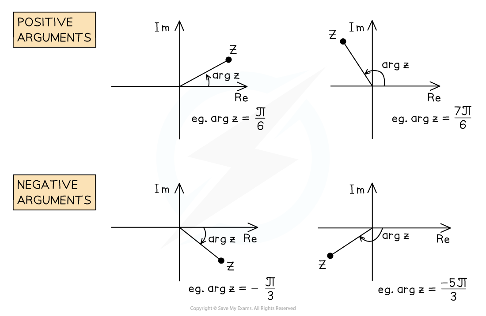
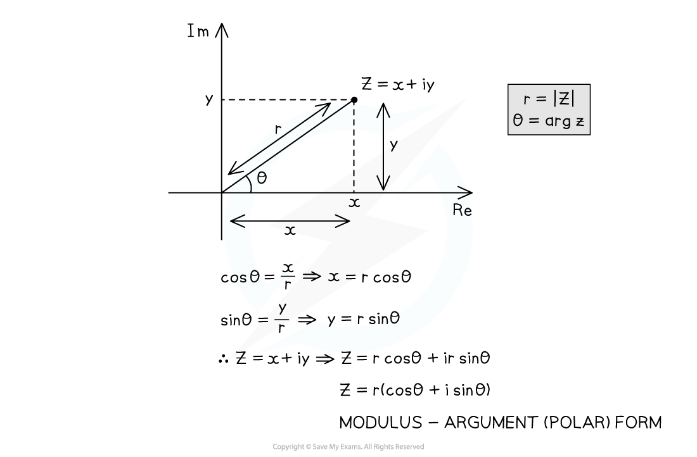

# Modulus & Argument

## Argand Diagrams

> **Spec point** — `spcpt_JHZkQZRBZM76WjSK`

## Argand Diagrams

### What is an Argand diagram?

- An **Argand diagram** is a **2D Cartesian grid** used to** visualise** complex numbers
- The complex number $x+yi$ is represented by the **point** with **coordinates **$(x,y)$

  - The **real** part is measured along the ***x***** -axis**
  
    - called  the **real axis**, written "**Re**"
  - The **imaginary** part is measured along the ***y***** -axis**
  
    - called the **imaginary axis**,** **written "**Im**"
- Complex numbers can be thought of as **points**, or as **vectors** from the origin

> **Exam Hint**
> If asked to sketch an Argand diagram, it does not need to be to scale (plotted), but should roughly show the correct positions.

> **Worked Example**
> Sketch, on the same Argand diagram, the complex numbers $5+7i$ and $-4-2i$.
> 
> 

## Modulus & Argument

> **Spec point** — `spcpt_FKPjqDV43mRmSbdk`

## Modulus & Argument

#### How do I find the modulus of a complex number?

- The **modulus** of a complex number is its **distance **from the** origin** on an **Argand diagram**

  - It is written `open vertical bar z close vertical bar`
  - If $z=x+iy$, then by **Pythagoras' theorem**
  
    - $\left| z \right| = \sqrt{x^{2} + y^{2}}$
- A modulus is always **positive** or **zero**

  - It cannot be negative
- For example

  - $\vert 3 + 4 \mathrm{i} \vert = \sqrt{3^{2} + 4^{2}} = 5$
  - $\vert 1 - \mathrm{i} \vert = \sqrt{1^{2} + ( - 1 )^{2}} = \sqrt{2}$
  - $\vert - 5 \vert = 5$
  - $\vert 8 \mathrm{i} \vert = 8$
  - $\vert 0 + 0 \mathrm{i} \vert = 0$

### What rules does the modulus follow?

- Helpful** modulus rules **are:

  - $\vert z_{1} z_{2} \vert = \vert z_{1} \vert \vert z_{2} \vert$
  - `| z _ 1 / z _ 2 | = (| z _ 1 |)/(| z _ 2 |)`
  - $\vert z \vert = \vert z \text{asterisk} \times \vert$
  - $z z \text{asterisk} \times = z \text{asterisk} \times z = \vert z \vert^{2}$
  
    - Proved using $z=x+yi$ and $z\ast=x-yi$
- Be careful:$\left| z_{1} + z_{2} \right| \text{eq} \left| z_{1} \right| + \vert z_{2} \vert$

  - For example, $z_{1}=3+4i$ and $z_{2}=-3+4i$
  
    - $\left| z_{1} \right| = \sqrt{3^{2} + 4^{2}} = 5$ and $\vert z_{2} \vert = \sqrt{( - 3 )^{2} + 4^{2}} = 5$
    - so $\vert z_{1} \vert + \vert z_{2} \vert = 10$
    - but $z_{1}+z_{2}=8i$ so `open vertical bar z subscript 1 plus z subscript 2 close vertical bar equals 8`

#### How do I find the argument of a complex number?

- The **argument **of a complex number is the **angle** in **radians** that it makes to the **positive real **axis

  - It is written as $\mathrm{arg}z$
  - The positive direction is **anticlockwise**
- The range normally used is $-π<\mathrm{arg}z\leqπ$

  - This is called the **principal range**
  - The sign of the angle depends on the **quadrant**:
  
    - The **1****st** quadrant is **positive acute**
    - The **2****nd** quadrant is **positive obtuse**
    - The **3****rd** quadrant is **negative obtuse**
    - The **4****th** quadrant is **negative acute**
- Arguments are found by

  - drawing a **sketch**
  - forming a **right-angled** triangle
  - using **trigonometry **
- The argument of the **origin**, $\text{arg} ( 0 + 0 \mathrm{i} )$, is **undefined**

  - No angle can be drawn

> **Exam Hint**
> Always draw a sketch to see which quadrant the complex number is in.

> **Worked Example**
> (a)  Find the modulus and argument of $z=2+3i$, giving your answers correct to 3 significant figures.
> 
> > *Sketch this on an Argand diagram*
> *Form a right-angled triangle*
> 
> 
> 
> > *Use *$\left| z \right| = \sqrt{x^{2} + y^{2}}$* (or Pythagoras) to find the modulus*
> 
> $\begin{gathered} \vert z \vert & = \sqrt{2^{2} + 3^{2}} \\ = \sqrt{13} \\ = 3.60555127... \end{gathered}$
> 
> > $z$* is in the first quadrant so the argument is positive and acute*
> *Use trigonometry to find the argument *$θ$* in radians*
> 
> $\begin{gathered} \tan \\theta & = \frac{3}{2} \\ \\theta = \tan ^{- 1} ( \frac{3}{2} ) \\ \\theta = 0.98279372... \end{gathered}$
> 
> > *Round the answers to 3 significant figures*
> 
> **Final answer:** $\vert z \vert = 3.61$** and **$\mathrm{arg}z=0.983$** to 3 significant figures**
> 
> (b)  Find the modulus and argument of $w=-1-\sqrt{3}i$, leaving your answers as exact values.
> 
> > *Sketch this on an Argand diagram*
> *Form a right-angled triangle*
> 
> 
> 
> > *Use *$\left| z \right| = \sqrt{x^{2} + y^{2}}$* (or Pythagoras) to find the modulus*
> 
> $\begin{gathered} \vert z \vert & = \sqrt{( - 1 )^{2} + ( - \sqrt{3} )^{2}} \\ = \sqrt{4} \\ = 2 \end{gathered}$
> 
> > $z$* is in the third quadrant so the argument is negative and obtuse*
> *Use trigonometry to first find *$α$* in radians*
> 
> $\begin{gathered} \tan \\alpha & = \frac{ \sqrt{3} }{1} \\ \\alpha = \tan ^{- 1} ( \sqrt{3} ) \\ \\alpha = \frac{\pi }{3} \end{gathered}$
> 
> > *Then find *$θ$* by subtracting *$α$* from 180° (*$π$* radians)*
> 
> $\begin{gathered} \\theta = \pi - \\alpha \\ = \pi - \frac{\pi }{3} \\ = \frac{2 \pi }{3} \end{gathered}$
> 
> > *Remember that the argument here must be a negative angle*
> 
> **Final answer:** $\vert z \vert = 2$** and **$\mathrm{arg}z=-\frac{2π}{3}$
> 
> **These answers must be exact**

## Modulus-Argument Form

> **Spec point** — `spcpt_M75m468rddysY3Wn`

## Modulus-Argument Form

### What is modulus-argument form?

- All complex numbers can be written in the form:

  - $z = r ( \cos \\theta + \text{isin} \\theta )$
  - where $r = \vert z \vert$ and $θ=\mathrm{arg}z$
  
    - This is called the **modulus-argument **(or polar)** **form
- **Negative arguments** should be shown clearly** without simplifying**

  - $z = 2 ( \cos ( - \frac{\pi }{3} ) + \text{isin} ( - \frac{\pi }{3} ) )$
  
    - Simplifying them gives the **Cartesian form**
    - $z = 2 ( 1 \frac{1}{2} + \mathrm{i} ( - \frac{ \sqrt{3} }{2} ) ) = 1 - \sqrt{3} \mathrm{i}$
- Be careful: $z = r ( \cos \\theta - \text{isin} \\theta )$ is** not** in modulus-argument form (due to the** minus sign**)

  - Rewrite it  as $z = r ( \cos ( - \\theta ) + \text{isin} ( - \\theta ) )$
  
    - This uses the **symmetries **$\cos ( - \\theta ) \equiv \cos ( \\theta )$ and $\sin ( - \\theta ) \equiv - \sin \\theta$
  - The argument is $-θ$

> **Worked Example**
> Write $z=-4+4i$ in the exact form $r(\mathrm{cos}θ+i\mathrm{sin}θ)$ where $r>0$ and $-π<θ\leqπ$.
> 
> > *Draw a sketch to find the modulus, *$r$*, and argument, *$θ$*, of *$z$
> *Form a right-angled triangle*
> 
> 
> 
> > *Use *$\left| z \right| = \sqrt{x^{2} + y^{2}}$* (or Pythagoras) to find the modulus*
> 
> $\begin{gathered} \vert z \vert & = \sqrt{( - 4 )^{2} + ( 4 )^{2}} \\ = \sqrt{32} \\ = 4 \sqrt{2} \end{gathered}$
> 
> > $z$* is in the second quadrant so the argument is positive and obtuse*
> *Use trigonometry to first find *$α$* in radians*
> 
> $\begin{gathered} \tan \\alpha & = \frac{4}{4} \\ \\alpha = \tan ^{- 1} ( 1 ) \\ \\alpha = \frac{\pi }{4} \end{gathered}$
> 
> > *Then find *$θ$* by subtracting *$α$* from 180° (*$π$* radians)*
> 
> $\begin{gathered} \\theta = \pi - \\alpha \\ = \pi - \frac{\pi }{4} \\ = \frac{3 \pi }{4} \end{gathered}$
> 
> > *Write the final answer in the form *$r(\mathrm{cos}θ+i\mathrm{sin}θ)$
> 
> $z = 4 \sqrt{2} ( \cos ( \frac{3 \pi }{4} ) + \mathrm{i} \sin ( \frac{3 \pi }{4} ) )$
> 
> **Leave the modulus and argument exact**
