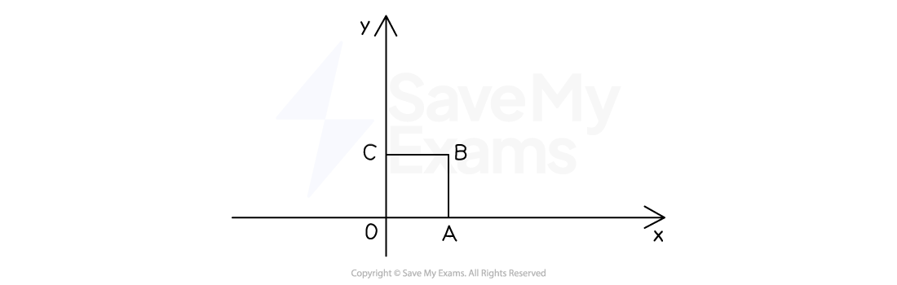

# Standard Matrix Transformations

## Reflection Matrices

> **Spec point** — `spcpt_fk4V4Cvw8BX5hfwZ`

## Reflection Matrices

### How do I find reflection matrices?

- Imagine the** unit** square *OABC*

  - It has a side-length **1 unit**
  - *O * is the origin

- The **coordinates** of ***A ***** and *****C***  as **column vectors** are

  - $A = ( \begin{gathered} 1 \\ 0 \end{gathered} )$ and $C = ( \begin{gathered} 0 \\ 1 \end{gathered} )$
- Under a **reflection **about an** axis or **$y=\pmx$, *A * moves to *A*'  and *C*  moves to *C*'

  - The **matrix, **$M$ representing this reflection is $M = ( \begin{gathered} A ' \vert & C ' \end{gathered} )$
  - ***A*****' ** **and** ***C*****'**  are column vectors of their **new positions**
  
    - The points ***O**** * **and** ***B***  are **not needed**, as we can draw the reflected square using just *A*'  and *C*'  (*O*  won't move)
- For example:

  - To find the matrix representing a **reflection about the **$x$**-axis**
  
    - *A * stays where it is, so $A ' = ( \begin{gathered} 1 \\ 0 \end{gathered} )$
    - *C*  goes to $C ' = ( \begin{gathered} 0 \\ - 1 \end{gathered} )$ (on the negative $y$-axis)
    - $M = ( \begin{gathered} A ' \vert & C ' \end{gathered} ) = ( \begin{gathered} 1 0 \\ 0 - 1 \end{gathered} )$
  - To find the matrix representing a **reflection in the line **$y=x$
  
    - *A*  goes to $A ' = ( \begin{gathered} 0 \\ 1 \end{gathered} )$ (on the positive *y*-axis)
    - *C * goes to $C ' = ( \begin{gathered} 1 \\ 0 \end{gathered} )$ (on the positive *x*-axis)
    - $M = ( \begin{gathered} A ' \vert & C ' \end{gathered} ) = ( \begin{gathered} 0 1 \\ 1 0 \end{gathered} )$
    - (This is not the same as the identity matrix, as the 1s are on the wrong diagonal)

> **Worked Example**
> (a)  The matrix $M$ represents a reflection in the *y*-axis.
> 
> Work out $M$.
> 
> > *Consider how the points **A**  and **C**   on the unit square are transformed by a reflection in the *$y$*-axis*
> 
> 
> 
> *The point ***A *** *$( \begin{gathered} 1 \\ 0 \end{gathered} )$* moves to ***A'***  *$( \begin{gathered} - 1 \\ 0 \end{gathered} )$* *
> 
> *The point ***C *** *$( \begin{gathered} 0 \\ 1 \end{gathered} )$* remains in the same place*
> 
> > *The transformation matrix is given by *$M = ( \begin{gathered} A ' \vert & C ' \end{gathered} )$* *
> 
> $M = ( \begin{gathered} - 1 & 0 \\ 0 1 \end{gathered} )$
> 
> (b)  Describe fully the transformation represented by the matrix $N = ( \begin{gathered} 0 - 1 \\ - 1 & 0 \end{gathered} )$.
> 
> > *Consider how the points **A**  and **C**  on the unit square are transformed *
> 
> *The point ***A *** *$( \begin{gathered} 1 \\ 0 \end{gathered} )$* moves to ***A' **$( \begin{gathered} 0 \\ - 1 \end{gathered} )$* *
> 
> *The point ***C *** *$( \begin{gathered} 0 \\ 1 \end{gathered} )$* moves to ***C'***  *$( \begin{gathered} - 1 \\ 0 \end{gathered} )$
> 
> > *It helps to draw a picture of the unit square being transformed with vertices clearly labelled*
> 
> 
> 
> > *This transformation could be a rotation of 180**°** about **O** or a reflection in *$y=-x$* *
> *The vertices **A'**  and **C'**  are in the correct places for a reflection, but not a rotation*
> 
> **Final answer:** **The matrix N represents a reflection in the line **$y=-x$

## Enlargement & Stretch Matrices

> **Spec point** — `spcpt_DdchQvsnwcKxhX8Q`

## Enlargement & Stretch Matrices

### Which matrix represents an enlargement?

- The matrix  $M = ( \begin{gathered} k 0 \\ 0 k \end{gathered} )$ represents an** enlargement** of **scale factor **$k$**  **about the **origin, *****O***

  - This is the same as $M=kI$
  
    - $I$ is the identity matrix

### Which matrix represents a stretch?

- The matrix  $M = ( \begin{gathered} a 0 \\ 0 1 \end{gathered} )$ represents a** stretch parallel **to the** **$x$**-axis **of **scale factor **$a$** **

  - The point $( x , y )$ becomes $( a x , y )$

- The matrix  $M = ( \begin{gathered} 1 0 \\ 0 b \end{gathered} )$ represents a** stretch parallel **to the** **$y$**-axis **of **scale factor **$b$** **

  - The point $( x , y )$ becomes $( x , b y )$
- The matrix  $M = ( \begin{gathered} a 0 \\ 0 b \end{gathered} )$ represents a **combined stretch **of **scale factor **$a$  **parallel **to the $x$**-axis** and **scale factor **$b$**  parallel **to the $y$**-axis**

  - If $a=b$, the combined stretch is an **enlargement**

> **Exam Hint**
> Use phrases like "parallel to the $x$-axis"  or "parallel to the $y$-axis" to describe stretches (not "left" or "up"!)

> **Worked Example**
> A transformation is represented by the matrix $M = ( \begin{gathered} 3 + p & 0 \\ 0 3 - p \end{gathered} )$.
> 
> Describe fully the transformation in each of the following cases:
> 
> (a)  $p=0$
> 
> > *Substitute in *$p=0$
> 
> $M = ( \begin{gathered} 3 + 0 & 0 \\ 0 3 - 0 \end{gathered} ) = ( \begin{gathered} 3 0 \\ 0 3 \end{gathered} )$
> 
> > *This has the form *$M = ( \begin{gathered} k 0 \\ 0 k \end{gathered} )$* where *$k=3$
> 
> **Final answer:** $M$** represents an enlargement of scale factor 3 about the origin**
> 
> **You must give its scale factor and centre of enlargement**
> 
> (b)  $p=2$
> 
> > *Substitute in *$p=2$
> 
> $M = ( \begin{gathered} 3 + 2 & 0 \\ 0 3 - 2 \end{gathered} ) = ( \begin{gathered} 5 0 \\ 0 1 \end{gathered} )$
> 
> > *This has the form *$M = ( \begin{gathered} a 0 \\ 0 1 \end{gathered} )$* where *$a=5$
> 
> **Final answer:** $M$** represents a stretch of scale factor 5 parallel to the **$x$**-axis**
> 
> **You must give its scale factor and direction**

## Rotation Matrices

> **Spec point** — `spcpt_yzsdTrmn8KXkYjYM`

## Rotation Matrices

### How do I find matrices for rotations by multiples of 90°?

- Imagine the** unit** square *OABC*

  - It has a side-length of** 1 unit**
  - *O* is the origin

- The **coordinates** of *A* and *C* as **column vectors** are

  - $A = ( \begin{gathered} 1 \\ 0 \end{gathered} )$ and $C = ( \begin{gathered} 0 \\ 1 \end{gathered} )$
- Under a **rotation about the origin**, *A * moves to *A*'  and *C*  moves to *C*'

  - The **matrix, **$M$ representing this rotation is $M = ( \begin{gathered} A ' \vert & C ' \end{gathered} )$
  - *A*'  and *C*'  are **column vectors** of their new positions
  
    - The points *O * and *B*  are not needed, as we can draw the rotated square using just *A*'  and *C*'  (*O   *won't move)
- For example:

  - To find the matrix representing a **rotation of 90° anticlockwise** about the origin
  
    - *A*  goes to $A ' = ( \begin{gathered} 0 \\ 1 \end{gathered} )$ (on the positive* *$y$-axis)
    - *C*  goes to $C ' = ( \begin{gathered} - 1 \\ 0 \end{gathered} )$ (on the negative $x$-axis)
    - $M = ( \begin{gathered} A ' \vert & C ' \end{gathered} ) = ( \begin{gathered} 0 - 1 \\ 1 0 \end{gathered} )$
  - To find the matrix representing a **rotation of 180° **about the origin
  
    - *A*  goes to $A ' = ( \begin{gathered} - 1 \\ 0 \end{gathered} )$ (on the negative $x$-axis)
    - *C * goes to $C ' = ( \begin{gathered} 0 \\ - 1 \end{gathered} )$ (on the negative $y$-axis)
    - $M = ( \begin{gathered} A ' \vert & C ' \end{gathered} ) = ( \begin{gathered} - 1 & 0 \\ 0 - 1 \end{gathered} )$
    - This is the same as $M=-I$ where* *$I$ is the identity matrix

> **Exam Hint**
> Students often confuse rotations of 180° with reflections in the lines $y=\pmx$ .

### How do I find matrices for rotations by any angle?

- A **rotation anticlockwise **by any **angle**, $θ$, about the** origin** is represented by the matrix:

  - $M = ( \begin{gathered} \cos \\theta & - \sin \\theta \\ \sin \\theta & \cos \\theta \end{gathered} )$
  
    - $θ$ can be in degrees or **radians**
- A **negative** value of $θ$ represents a **clockwise **rotation

  - Remember that  $\sin ( - \\theta ) = - \sin \\theta$ but that $\cos ( - \\theta ) = \cos \\theta$
- You can **substitute** in multiples of 90° to get the matrices above
- You may be required to recognise **common angles** from their ratios

  - For example, `(sqrt( 3)/(2) = cos ( pi / 6 )`

> **Exam Hint**
> You are given the rotation matrix in the Formulae Booklet.

> **Worked Example**
> (a)  Describe fully the transformation represented by the matrix $P = ( \begin{gathered} 0 1 \\ - 1 & 0 \end{gathered} )$.
> 
> > *Consider how the points **A**  and **C**  on the unit square are transformed *
> 
> *The point ***A *** *$( \begin{gathered} 1 \\ 0 \end{gathered} )$* moves to ***A' **$( \begin{gathered} 0 \\ - 1 \end{gathered} )$* *
> 
> *The point ***C *** *$( \begin{gathered} 0 \\ 1 \end{gathered} )$* moves to ***C'***  *$( \begin{gathered} 1 \\ 0 \end{gathered} )$
> 
> > *It helps to draw a picture of the unit square being transformed with vertices clearly labelled*
> 
> 
> 
> > *This transformation could be a rotation of 90**° clockwise** about **O ** or a reflection in the *$x$*-axis*
> *The vertices **A'**  and **C'**  are not in the correct places for a reflection, but are for a rotation*
> 
> **The matrix P represents a rotation of 90***°*** clockwise about the origin**
> 
> **You must give its angle, direction and centre of rotation**
> **270***°*** anticlockwise would also be accepted**
> 
> (b)  Find $Q$, the matrix that represents a clockwise rotation of 120°  about the origin, giving your answer in an exact form.
> 
> > *The matrix for an anticlockwise rotation by *$θ$* is*$( \begin{gathered} \cos \\theta & - \sin \\theta \\ \sin \\theta & \cos \\theta \end{gathered} )$
> $θ$* is negative, as the rotation is clockwise*
> 
> $θ=-120^{\circ}$
> 
> > *Substitute this value of *$θ$* into the matrix*
> *Use that *$\cos ( - \\theta ) = \cos \\theta$* and that *$\sin ( - \\theta ) = - \sin \\theta$
> 
> $( \begin{gathered} \cos ( - 120^{\circ} ) & - \sin ( - 120^{\circ} ) \\ \sin ( - 120^{\circ} ) & \cos ( - 120^{\circ} ) \end{gathered} ) = ( \begin{gathered} \cos ( 120^{\circ} ) & \sin ( 120^{\circ} ) \\ - \sin ( 120^{\circ} ) & \cos ( 120^{\circ} ) \end{gathered} )$
> 
> > *Use a calculator to find these values (or common angles and symmetry)*
> 
> $Q = ( \begin{gathered} - 1 \frac{1}{2} & \frac{ \sqrt{3} }{2} \\ - \frac{ \sqrt{3} }{2} & - 1 \frac{1}{2} \end{gathered} )$
