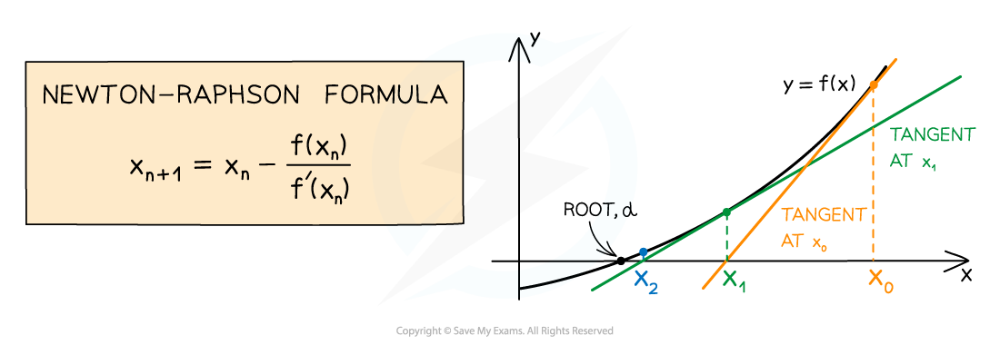
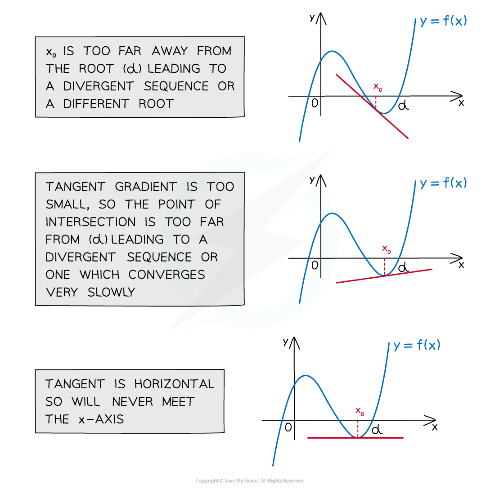

# Newton-Raphson Method

## Newton-Raphson Method

> **Spec point** — `spcpt_fm8GnX9jBsbsyZFJ`

## Newton-Raphson Method

### How do I apply the Newton-Raphson method?

- The **Newton-Raphson** **method **is a process for finding **roots **of equations

  - Equations must be **rearranged **into the form $\mathrm{f} ( x ) = 0$
- If $x=α$ is a** root** of the equation $\mathrm{f} ( x ) = 0$, then you need to** choose**  $x_{0}$, the **initial** (first) **approximation**

  - This is usual **given **in the question (and is a value** near **to the root)
- You can then find successive **approximations**  $x_{1}$, $x_{2}$, $x_{3}$, ...  using the **Newton-Raphson formula**:

  - $x_{n + 1} = x_{n} - \frac{ \mathrm{f} ( x_{n} )}{ \mathrm{f} ' ( x_{n} )}$
  - This is an *iterative formula*
  - $\mathrm{f} ' ( x )$ is the derivative of $\mathrm{f} ( x )$
  
    - Work this out beforehand
- **Increasing **the **number **of approximations improves the **accuracy**

  - The Newton-Raphson method usually *converges* quickly to the root compared to other methods

> **Exam Hint**
> The formula for the Newton-Raphson method is given in the Formulae Booklet.

### How do I apply the Newton-Raphson method on my calculator?

- If your calculator has a** recursion** function

  - Input the **formula**, **start value** and **number of steps**
  - The output is a **table** showing all the approximations
- Alternatively:

  - Type in the value of $x_{0}$ and press =
  
    - This **stores **it in the "Ans" (answer) button
  - Type  $\text{Ans} - \frac{ \mathrm{f} ( \text{Ans} )}{ \mathrm{f} ' ( \text{Ans} )}$ into your calculator and press =
  
    - This finds $x_{1}$
  - Without pressing any other button, press = again
  
    - This finds $x_{2}$
  - Repeatedly pressing = gives further approximations
  
    - The more you press it, the closer to the root it becomes

### How does the Newton-Raphson method work geometrically?

- The method works by drawing a **tangent** to the curve $y = \mathrm{f} ( x )$ at $x=x_{0}$

  - then finding where the tangent **cuts the *****x*****-axis**
  - This *x*-intercept is the **new **approximation, $x_{1}$
- This process is then **repeated**

  - Draw the tangent to $y = \mathrm{f} ( x )$ at $x=x_{1}$
  - Find its  *x*-intercept and call it $x_{2}$
- The approximations get closer and closer to the** root**

### How do I know if the Newton-Raphson method will fail?

- The Newton-Raphson method** fails** if the **initial value**, $x_{0}$, satisfies $\mathrm{f} ' ( x_{0} ) = 0$

  - Algebraically, this is because the formula $x_{n + 1} = x_{n} - \frac{ \mathrm{f} ( x_{n} )}{ \mathrm{f} ' ( x_{n} )}$ cannot **divide by zero**
  - Geometrically, this is because $x_{0}$ is at a stationary point on the curve $y = \mathrm{f} ( x )$
  
    - A** tangent** drawn at a **stationary point** is** horizontal **
    - This will **never intersect** the *x*-axis
- The Newton-Raphson method also fails if the sequence $x_{1}$, $x_{2}$, $x_{3}$, ... *diverges*

  - This can happen if $x_{0}$ is chosen:
  
    - **too far away** from the root
    - or at a point where the **gradient **is **very small**
- The Newton-Raphson method is sometimes avoided when $\mathrm{f} ( x )$ is too tricky to differentiate

> **Worked Example**
> The equation $2x^{4}-4x^{3}=-1$ has a solution in the interval $[ 1 , 2 ]$.
> 
> (a)  Using $x_{0}=2$ as the first approximation to the  solution, apply the Newton-Raphson method to find a second approximation.
> 
> > *Rearrange the formula into the form *$\mathrm{f} ( x ) = 0$
> 
> $2x^{4}-4x^{3}+1=0$*  so  *$\mathrm{f} ( x ) = 2 x^{4} - 4 x^{3} + 1$
> 
> > *(You could also use *$-1+4x^{3}-2x^{4}$*)*
> *Find *$\mathrm{f} ' ( x )$* using differentiation*
> 
> $\mathrm{f} ' ( x ) = 8 x^{3} - 12 x^{2}$
> 
> > *Substitute *$\mathrm{f} ( x )$* and *$\mathrm{f} ' ( x )$* into the Newton-Raphson formula *$x_{n + 1} = x_{n} - \frac{ \mathrm{f} ( x_{n} )}{ \mathrm{f} ' ( x_{n} )}$
> 
> $x_{n + 1} = x_{n} - \frac{( 2 x_{n}^{4} - 4 x_{n}^{3} + 1 )}{( 8 x_{n}^{3} - 12 x_{n}^{2} )}$
> 
> > *Substitute *$x_{0}=2$* into the formula to get *$x_{1}$
> 
> $x_{1} = 2 - \frac{( 2 \times 2^{4} - 4 \times 2^{3} + 1 )}{( 8 \times 2^{3} - 12 \times 2^{2} )} 
> = 2 - \frac{1}{16} 
> = 1.9375$
> 
> > *Check this solution lies in the interval *$[ 1 , 2 ]$
> 
> $x_{1}=1.9375$
> 
> $\frac{31}{16}$** is also accepted**
> 
> (b)  Explain why the midpoint of the interval $( 1 , 2 )$ cannot be used as the first approximation when applying the Newton-Raphson method.
> 
> > *The Newton-Raphson method fails if *$x_{0}$* satisfies *$\mathrm{f} ' ( x_{0} ) = 0$
> *Find the midpoint of the interval*
> 
> $x_{0}=\frac{1+2}{2}=1.5$
> 
> > *Check if *$\mathrm{f} ' ( 1.5 ) = 0$
> 
> $\mathrm{f} ' ( 1.5 ) = 8 \times 1.5^{3} - 12 \times 1.5^{2} = 0$
> 
> > *Write a conclusion either about dividing by zero, or about having a horizontal tangent*
> 
> **Final answer:** $\mathrm{f} ' ( 1.5 ) = 0$**, but you cannot divide by zero in the formula **$x_{n + 1} = x_{n} - \frac{ \mathrm{f} ( x_{n} )}{ \mathrm{f} ' ( x_{n} )}$
> **So 1.5 cannot be used as the first approximation**
> 
> **You could also say that **$x=1.5$** is at a stationary point where the tangent is horizontal, meaning it cannot intersect the ****x****-axis to make **$x_{1}$
