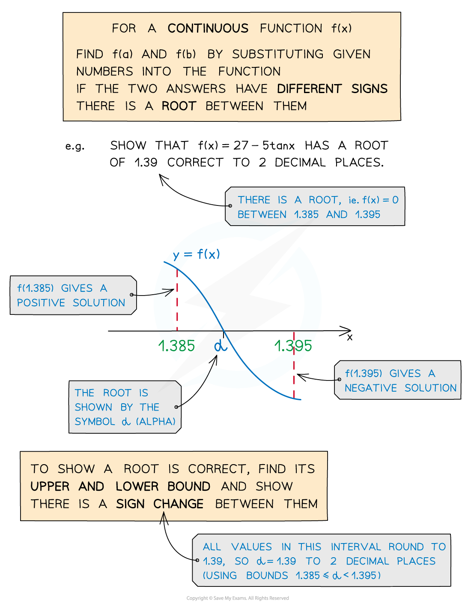
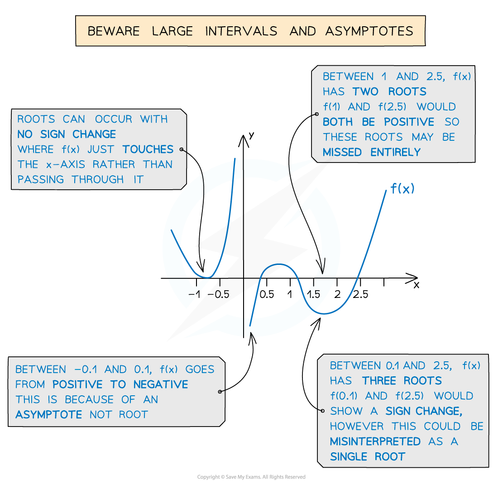

# Roots in Intervals

## Roots in Intervals

> **Spec point** — `spcpt_cB4gPQXjPVyXhqv2`

## Roots in Intervals

### What is a root of an equation?

- A **root** of the **equation** $\mathrm{f} ( x ) = 0$ is a **solution**

  - If $x=α$ is a root of $\mathrm{f} ( x ) = 0$ then $\mathrm{f} ( \\alpha ) = 0$
  
    - The Greek letter **alpha** is often used
- To find $α$ **exactly**, you need to solve the equation **algebraically** (analytically)
- Some equations **cannot **be solved algebraically

  - In which case you can **approximate** a root to a given **accuracy**
  
    - For example, to 3 decimal places
  - This is called solving equations **numerically**

### What is an interval?

- If you don't know the root but know that it lies between $x=a$ and $x=b$, where $a<b$, then

  - $a<x<b$ is an** interval** containing the root
- Intervals can be written using **bracket notation**

  - $( a , b )$ is $a<x<b$
  - $[ a , b ]$ is $a\leqx\leqb$

### How do I show that an interval contains a root?

- Use the **sign-change and continuity** **test** to show that the** interval **$a<x<b$ contains a **root **to the equation $\mathrm{f} ( x ) = 0$
- **Show** that $\mathrm{f} ( a )$ and $\mathrm{f} ( b )$ have** different signs** and **check** that $\mathrm{f} ( x )$ is **continuous** across $a<x<b$

  - Then the interval ** **$a<x<b$ **must** contains a **root**
  - **Continuous **means **no jumps or asymptotes **in the interval
  
    - Check the equation does not **divide by zero** within the interval
    - (Jumps or asymptotes outside of the interval are fine)
  - You must write a **conclusion** to the test in words, for example:
  
    - "$\mathrm{f} ( x )$ has a sign change in the interval $a<x<b$ and $\mathrm{f} ( x )$ is continuous in the interval, so a** **root must lie in the interval $a<x<b$"

> **Exam Hint**
> When writing your conclusion in the exam, don't forget to mention $\mathrm{f} ( x )$ being continuous in the interval!

### How do I show that an equation has a root to a given accuracy?

- If asked to show that $x=1.39$ is the root of an equation to **2 decimal places**

  - write an** interval **using the** lower **and **upper bound **of the root
  
    - $1.385<x<1.395$
  - use the** sign-change and continuity test** on this interval

- A suitable conclusion would be

  - $\mathrm{f} ( x )$ has a **sign change** in the interval $1.385<x<1.395$
  - and $\mathrm{f} ( x )$ is **continuous** in the interval
  - so a** **root** must** lie in the interval $1.385<x<1.395$
  - All values in the interval **round **to $1.39$
  - so the root is $1.39$ to **2 decimal places**

### How do I know when the sign-change test fails?

- You need to know the **three **cases when the sign-change and continuity test** fails** to work properly:

  - If the curve $y = \mathrm{f} ( x )$ only **touches** the $x$-axis at the root, you will **not** see a sign change (even though there **is** a root)
  - If the curve $y = \mathrm{f} ( x )$ has an **asymptote** in the interval, then you may see a sign change (but there is **no **root)
  
    - The asymptote means $\mathrm{f} ( x )$ is **not** continuous
  - If the interval is **too large**, there may be **more than one** root in it
  
    - You may see a sign change (an **odd** number of roots)
    - Or you may **not **see a sign change (an **even** number of roots)

> **Worked Example**
> The equation $\mathrm{f} ( x ) = 0$ where $\mathrm{f} ( x ) = x - x^{4} + \frac{1}{2 x - 1}$ has exactly one positive root.
> 
> (a)  Show that the intervals $[ 0 , 1 ]$ and $[ 1 , 2 ]$ both have a change of sign in $\mathrm{f} ( x )$.
> 
> > *Substitute* $x=0$*,* $x=1$ *and* $x=2$ *into* $\mathrm{f} ( x )$
> 
> $\begin{gathered} \mathrm{f} ( 0 ) & = 0 - 0^{4} + \frac{1}{2 \times 0 - 1} = - 1 \\ \mathrm{f} ( 1 ) & = 1 - 1^{4} + \frac{1}{2 \times 1 - 1} = 1 \\ \mathrm{f} ( 2 ) & = 2 - 2^{4} + \frac{1}{2 \times 2 - 1} = - \frac{41}{3} \end{gathered}$
> 
> > *Comment that the signs are different for each interval*
> 
> **Final answer:** $\mathrm{f} ( 0 ) = - 1 < 0$** and **$\mathrm{f} ( 1 ) = 1 > 0$** so there is a sign change in **$[ 0 , 1 ]$
> $\mathrm{f} ( 1 ) = 1 > 0$** and **$\mathrm{f} ( 2 ) = - \frac{41}{3} < 0$** so there is a sign change in **$[ 1 , 2 ]$
> 
> (b)  Determine, with a reason, which of the intervals contains the root.
> 
> > *An interval contains a root if* $\mathrm{f} ( x )$ *has a sign change and is continuous in that interval*
> *Check to see if* $\mathrm{f} ( x )$ *is continuous in* $[ 0 , 1 ]$
> *You need to look for any asymptotes*
> 
> $\frac{1}{2x-1}$ *is undefined when* $x=\frac{1}{2}$
> 
> > *The asymptote* $x=\frac{1}{2}$ *lies in the interval* $[ 0 , 1 ]$* *
> *There are no other asymptotes and only one root*
> 
> **Final answer:** **The interval **$[ 1 , 2 ]$** contains the root as there is a sign change and **$\mathrm{f} ( x )$** is continuous**
> **The interval  **$[ 0 , 1 ]$** contains the asymptote  **$x=\frac{1}{2}$**  so **$\mathrm{f} ( x )$** is not continuous**
