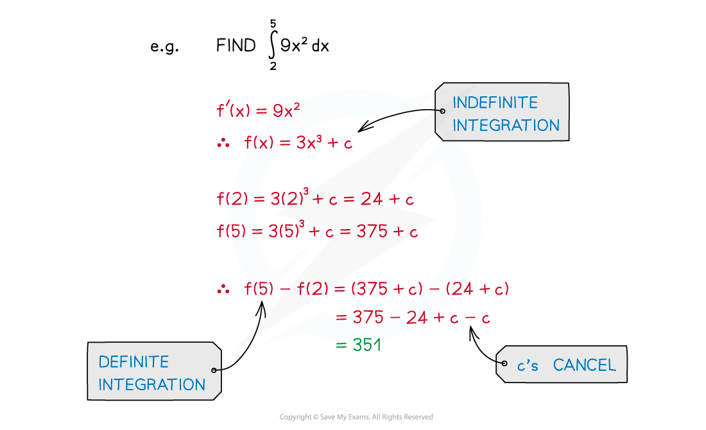

# Definite Integration

## Definite Integration

> **Spec point** — `spcpt_9Cpr29P5QKVBBZY6`

## Definite integration

### What is definite integration?

- **Definite** **Integration** occurs in an alternative version of the Fundamental Theorem of Calculus
- This version of the Theorem is the one referred to by most AS/A level textbooks/websites

- **a** and **b** are called limits

  - **a** is the lower limit
  - **b** is the upper limit
- **f’(x)** is the **derivative** of **f(x)**

### Why is there no constant of integration in definite integration?

- “**+c**” would appear in both **f(a)** and **f(b)**

  - Since we then calculate **f(b)** – **f(a)** they cancel each other out
  - There would be a “**+c**” from **f(b)** and a **–**“**+c**” from **f(a)**
- So “**+c**” is not included with definite integration

### How do I find a definite integral on my calculator?

- STEP 1: If not given a name, call the integral

  - This saves you having to rewrite the whole integral every time!
- STEP 2:  If necessary rewrite the integral into a more easily ***integrable*** form

  - Not all functions can be integrated directly
- STEP 3:  Integrate without applying the limits

  - Notation: use square brackets [ ] with limits placed after the end bracket
- STEP 4:  Substitute the limits into the function and calculate the answer

#### Using a calculator

- Advanced scientific calculators can work out the values of definite integrals
- The button will look similar to:

- (Note how the calculator did not return the exact value $( \frac{1256}{3} )$ of the integral)

> **Exam Hint**
> - Look out for questions that ask you to find an **indefinite** integral in one part (so “**+c**” needed), then in a later part use the same integral as a **definite** integral (where “**+c**” is not needed).

> **Worked Example**
> Find the value of
> 
> $\int_{2}^{4} 3 x ( x^{2} - 2 ) \mathrm{d} x$
> 
> **Answer:**
> 
> > *Start by expanding the brackets inside the integral*
> 
> $\int_{2}^{4} ( 3 x^{3} - 6 x ) \mathrm{d} x$
> 
> > *Integrate as usual (here it's a 'powers of *$x$*' integration)*
> 
> > *Write the answer in square brackets with the integration limits outside*
> 
> $\begin{gathered} \int_{2}^{4} ( 3 x^{3} - 6 x ) \mathrm{d} x & = [ 3 ( \frac{x^{3 + 1} }{3 + 1} ) - 6 ( \frac{x^{1 + 1} }{1 + 1} ) ]_{2}^{4} \\ = [ \frac{3}{4} x^{4} - 3 x^{2} ]_{2}^{4} \end{gathered}$
> 
> > *Now substitute 4 into that function *
> *And subtract from it the function with 2 substituted in*
> 
> $\begin{array}{rcl} [ \frac{3}{4} x^{4} - 3 x^{2} ]_{2}^{4} & = ( \frac{3}{4} ( 4 )^{4} - 3 ( 4 )^{2} ) - ( \frac{3}{4} ( 2 )^{4} - 3 ( 2^{2} ) ) \\ = ( 192 - 48 ) - ( 12 - 12 ) \\ = 144 - 0 \\ = 144 \end{array}$
> 
> `Error converting from MathML to accessible text.`
