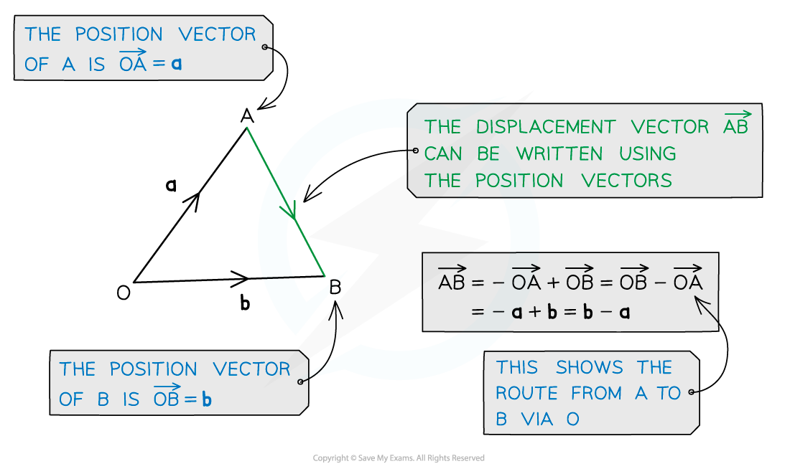

# Position Vectors

## Position Vectors

> **Spec point** — `spcpt_6fw2v3vcB3GvKrhp`

## Position vectors

### What is a position vector?

- Position vectors describe the **position of a point** in relation to the *origin*
- They are different to **displacement vectors** which describe the **direction and distance** between any two points

### Distance between two points

- The distance between two points is the **magnitude** of the vector between them (see Magnitude Direction)

### How do I find the magnitude of a displacement vector?

- You can use **coordinate geometry** to find **magnitudes **of **displacement vectors** from *A* to *B*

  - From the **position vectors** of *A*  and *B*  you know their coordinates
  
    - If  $a = \vec{OA} = x_{1} i + y_{1} j = ( \begin{gathered} x_{1} \\ y_{1} \end{gathered} )$,  then point A has coordinates $( x_{1} , y_{1} )$
    - If  $b = \vec{OB} = x_{2} i + y_{2} j = ( \begin{gathered} x_{2} \\ y_{2} \end{gathered} )$,  then point B has coordinates $( x_{2} , y_{2} )$
  - The **distance** between two points is given by $d = \sqrt{( x_{1} - x_{2} )^{2} + ( y_{1} - y_{2} )^{2}}$
  
    - So  $\left| \vec{AB} \right| = \sqrt{( x_{1} - x_{2} )^{2} + ( y_{1} - y_{2} )^{2}}$
  - For example, if points A and B have position vectors $5i+3j$ and $3i-6j$ respectively
  
    - then  $\left| \vec{AB} \right| = \sqrt{( 5 - 3 )^{2} + ( 3 - ( - 6 ) )^{2}} = \sqrt{85} = 9.22 ( 3 \mathrm{s} . \mathrm{f} . )$

- Alternatively, you could find $\left| \vec{AB} \right|$ by

  - first using  $\overset{\rightarrow}{AB}=-\overset{\rightarrow}{OA}+\overset{\rightarrow}{OB}$ to find $\overset{\rightarrow}{AB}$ in **vector form**
  
    - and then calculating its **magnitude** directly
  - See the Worked Example below

> **Exam Hint**
> - Remember if asked for a position vector, you must find the vector all the way from the origin.
> - Diagrams can help, if there isn’t one, draw one.

> **Worked Example**
> 
