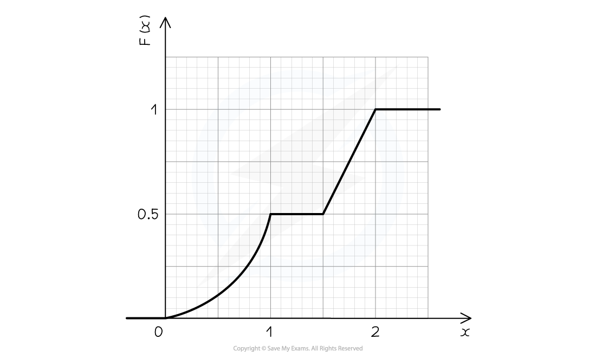

# Cumulative Distribution Function

## Cumulative Distribution Function

> **Spec point** — `spcpt_QTHzFn6gZrVKcRdG`

## Cumulative Distribution Function

#### What is the cumulative distribution function (c.d.f.)?

- For a **continuous** **random** **variable**,*X* , with **probability** **density** **function f(x)** the **cumulative** **distribution** **function** (c.d.f.) is defined as

$F ( x_{ } 0 ) = P ( X \le x_{ } 0 ) = integral_{ } - \text{infinity} ^{ } x_{ } 0 f ( t ) d t$

- Compare this to the cumulative distribution function for a **discrete random variable**

$F(x_{0})=P(X\leqx_{0})=$$\underset{x\leqx_{0}}{\sum}P(X=x)$

- F(x0) is the probability that *X* is a value less than or equal to x0
- Notice the use of **uppercase **$\text{F}$ for the **c.d.f.** but **lowercase** $\text{f}$  for the **p.d.f.**
- On the graph of the p.d.f. y= f(x)  this would be the area under the graph up to the (vertical) line x=x0
- F(x) should be defined for all values of $x\inℝ$
- The graph of the c.d.f. y = F(x) will

  - start on the x-axis (i.e. start at a probability of 0)
  - end at x = 1  (i.e. finish at a probability of 1)
  - will be **continuous** function, even when defined ***piecewise***

e.g.

`F ( x ) = { | 0 x less than 0 | | 0.5 x ^2 | 0 <= x <= 1 | | 0.5 | 1 <= x <= 1.5 | | x - 1 | 1.5 <= x <= 2 | | 1 x greater than 2 | | close`

- The horizontal lines at F(x) = 0 and F(x) = 1 may not always be shown

#### How do I find probabilities using the cumulative frequency distribution?

- $P(a\leqX\leqb)=F(b)-F(a)$
- Although $P(X=k)$, for all values of k , F(k) is not necessarily zero

#### How do I find the cumulative frequency distribution (c.d.f.) from the probability density function (p.d.f.) and vice versa?

- To find the c.d.f.,F(x)  , from the p.d.f.,f(x), **integrate**

$\mathrm{F} ( x ) = \int_{- \infty}^{x} \mathrm{f} ( t ) d t$

- Ensure you define F(x) fully for$x\inℝ$  so include values of x for which F(x) = 0  and values of x for which F(x) = 1
- For piecewise functions as well as integrating you will need to add on the value of the c.d.f. at the end of the previous part

  - Suppose there are two sections to a p.d.f. $x\leqa$ and $x>a$
  - For $x>a$:

$\mathrm{F} ( x ) = \int_{- \infty}^{x} \mathrm{f} ( t ) \mathrm{d} t = \int_{- \infty}^{a} \mathrm{f} ( t ) \mathrm{d} t + \int_{a}^{x} \mathrm{f} ( t ) \mathrm{d} t = \mathrm{F} ( a ) + \int_{a}^{x} \mathrm{f} ( t ) \mathrm{d} t$

- Therefore the c.d.f can be calculated for the interval *a < x < b*  by using

$\mathrm{F} ( x ) = \mathrm{F} ( a ) + \int_{a}^{x} \mathrm{f} ( t ) \mathrm{d} t$

- See part (b) in the Worked Example below

- To find the p.d.f from the c.d.f., **differentiate**

$f(x)=\frac{d}{dx}F(x)$

- Any part of a c.d.f that is constant corresponds to the p.d.f. for that part being zero (the derivative of a constant is zero)

#### How do I find the median, quartiles and percentiles using the cumulative frequency distribution (c.d.f.)?

- For piecewise functions, first identify the section the required value lies in

  - To do this find the upper limit of each section of the c.d.f.
- To find the **median**, $m$, solve the equation F(m) = 0.5

  - The median is sometimes referred to as the second quartile, Q2
- To find the **lower quartile**, Q1, solve the equation F(Q1) = 0.25
- To find the **upper quartile**,Q3  , solve the equation F(Q3 ) = 0.75
- To find the **n****th**** percentile**, solve the equation ** **$F(p)=\frac{n}{100}$

> **Worked Example**
> a) The continuous random variable, $X$ , has cumulative distribution function
> 
> $\mathrm{F} ( x ) = \{ \begin{gathered} 0 & x < 0 \\ 1 \frac{1}{4} x ( 4 - x ) & 0 \text{less} \text{or} \text{equal} \text{than} x \text{less} \text{or} \text{equal} \text{than} 2 \\ 1 & x > 2 \end{gathered} )$
> 
> Find
> 
> (i) $P(X>1.5)$
> 
> (ii) $P(0.5\leqX\leq1)$
> 
> (iii) The lower quartile of $X$.
> 
> (b) The continuous random variable, $X$, has probability density function
> 
> `f ( x ) = { | 0.5 x | 0 <= x <= 1 | | 0.5 | 1 <= x <= 2.5 | | 0 otherwise | close >`
> 
> Find the cumulative frequency distribution, $F(x)$ .
> 
> **Answer:**
> 
> 
> 
> 

> **Exam Hint**
> - Remember that P(X=k) = 0  , for any value of k, is zero
> 
>   - This can be easily missed when working with c.d.f. rather than a p.d.f.
> - A quick check you can do is verify that your c.d.f. is continuous
> 
>   - The value of the c.d.f. at the upper limit of one section should equal the value of the c.d.f at the lower limit of the next section
