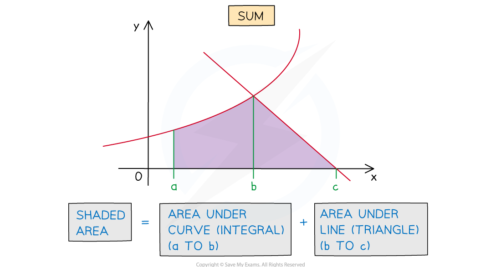
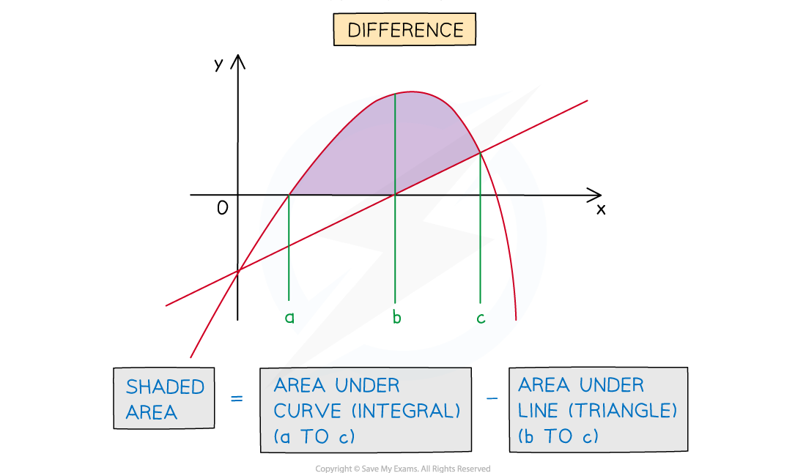
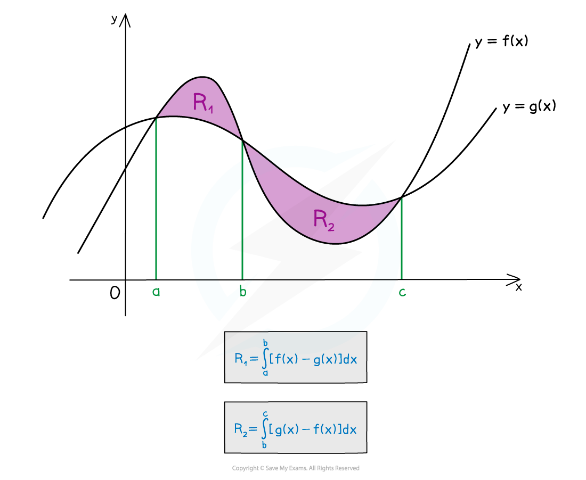

# Areas Between Curves

## Area Between a Curve and a Line

> **Spec point** — `spcpt_t6x5YNTWFJs9Vbwn`

## Area Between a Curve and a Line

### What do we mean by 'area between a curve and a line'?

- **Areas** whose boundaries include a **curve** and a (non-vertical) **straight** **line** can be found using integration

  - For an **area** under a **curve** a **definite** **integral** will be needed
  - For an **area** under a **line** the shape formed will be a **trapezium** or **triangle**
  
    - **basic** **area** **formulae** can be used rather than a definite integral
    - (although a definite integral would still work)
- The **area** required could be the **sum** or **difference** of areas under the curve and line

### How do I find the area between a curve and a line?

- **STEP 1**
If not given, **sketch** the graphs of the curve and line on the same diagram
- **STEP 2**
Find the **intersections** of the curve and the line

  - If no diagram is given this will help **identify the area(s)** to be found
- **STEP 3**
Determine whether the area required is a **sum or difference**

  - Calculate the **area under a curve** using a integral of the form $\int_{a}^{b} y \mathrm{d} x$
  - Calculate the **area under a line** using
  
    - $A=\frac{1}{2}bh$ for a **triangle**
    - $A=\frac{1}{2}(a+b)h$ for a **trapezium **
    
      - For a trapezium, y-coordinates will be needed for a  and  b
      - and the height  h will lie parallel to the x-axis
  - Those areas will need to be **added** or **subtracted**, depending on the question
- **STEP 4**
**Evaluate** the definite integral(s)

  - Then find the **sum** or **difference** of areas as required

> **Exam Hint**
> - Add information to any diagram provided
> 
>   - intersections between lines and curves
>   - mark and shade the area you’re trying to find
> - If no diagram is provided, sketch one!

> **Worked Example**
> The region$R$ is bounded by the curve with equation $y=10x-x^{2}-16$ and the line with equation$y=8-x$.
> 
> (a) Sketch the graphs of the curve and the line on the same set of axes.
> 
> Be sure to Identify and label the region$R$ on your sketch, and indicate the points of intersection between the curve and the line.  You may assume without proof that the curve's $x$-axis intercepts all lie on the positive $x$-axis.
> 
> > *Because of the minus sign in front of* $x^{2}$*, the curve will be an 'upside down u-shaped' parabola*
> 
> *We need to find the points of intersection of the curve and line*
> *Set their equations equal and solve to find the* $x$*-coordinates*
> 
> $\begin{array}{rcl} 8 - x & = 10 x - x^{2} - 16 \\ x^{2} - 11 x + 24 & = 0 \\ ( x - 3 ) ( x - 8 ) & = 0 \end{array}$
> 
> $x=3\mathrm{or}x=8$
> 
> > *So the curve and line intersect when* $x=3$ *and when* $x=8$
> 
> > *Substitute into the equation of the line to find the corresponding* $y$*-coordinates*
> 
> $x=3:y=8-3=5\,\,x=8:y=8-8=0$
> 
> > *So the points of intersection are* $( 3 , 5 )$ *and* $( 8 , 0 )$
> 
> > *That gives us enough information to sketch the graphs*
> 
> 
> 
> (b) Find the area of region $R$
> 
> > *Here we're going to need a **difference** of areas:  (area under curve)*$-$*(area under line)*
> 
> > *The area under the line is a right-angled triangle with vertices at* $( 3 , 0 )$*,* $( 3 , 5 )$ *and* $( 8 , 0 )$
> 
> > *So the height is* $5-0=5$ *and the base is* $8-3=5$
> 
> $\mathrm{Area} \mathrm{of} \mathrm{triangle}=\frac{1}{2}\times5\times5=\frac{25}{2}$
> 
> > *For the area under a curve we need to use a definite integral between* $x=3$ *and* $x=8$
> 
> `| Area under the curve | = integral _ 3 ^ 8 ( 10 x - x ^2 - 16 ) d x | | _ = [ 5 x ^2 - 1 third x ^3 - 16 x ] _ 3 ^ 8 | | _ = ( 5 ( 8 ) ^2 - 1 third ( 8 ) ^3 - 16 ( 8 ) ) - ( 5 ( 3 ) ^2 - 1 third ( 3 ) ^3 - 16 ( 3 ) ) | | _ = ( 320 - 512 / 3 - 128 ) - ( 45 - 9 - 48 ) | | _ = 64 / 3 - ( - 12 ) | | _ = 100 / 3 | |`
> 
> > *For the area of* $R$*, subtract the area of the triangle from the area under the curve*
> 
> $\mathrm{Area} \mathrm{of} \mathrm{region}R=\frac{100}{3}-\frac{25}{2}=\frac{125}{6}$
> 
> $\frac{125}{6}\mathrm{units}^{2}$

## Area Between 2 Curves

> **Spec point** — `spcpt_ZQ4j8c8Zt59FSkXq`

## Area Between 2 Curves

### What do we mean by 'area between two curves'?

- **Areas** whose boundaries include **two** **curves** can be found by integration

  - The **area** **between** **two** **curves** will be the **difference** of the areas under the two curves
  
    - both areas will require a **definite** **integral**
  - Finding **points of intersection** may involve a more awkward equation than solving for a curve and a line

### How do I find the area between two curves?

- **STEP 1**
If not given, **sketch** the graphs of both curves on the same diagram
- **STEP 2**
If not given, find the **intersections** of the two curves

  - These are needed to identify the **area(s)** to be calculated
  - and also to set up the correct **integrals**
- **STEP 3**
Determine which curve is the **‘upper’ boundary** for each region

  - For each region, the area is given by **definite integral** of the form$\int_{a}^{b} ( y_{1} - y_{2} ) \mathrm{d} x$
  
    - $y_{1}$ is the function forming the **‘upper’ boundary**
    - $y_{2}$ is the function forming the ‘**lower’ boundary**
  - Be careful when there is **more than one** region
  
    - Which functions form the ‘upper’ and ‘lower’ boundaries can **change**

- **STEP 4**
**Evaluate** the definite integral(s)

  - If there is **more than one** region, **add** their areas together to find the total area
  - As long as '$y_{1}$' in the integrals is always the **upper** function
  
    - then  $y_{1}-y_{2}\geq0$
    - This means you don't have to worry about **negative integrals**
    - even if part or all of the area between the curves is **below the *****x-*****axis**

> **Exam Hint**
> - Add information to any given diagram as you work through a question
> 
>   - intersections between curves
>   - mark and shade the area you're trying to find
> - If no diagram is provided sketch one

> **Worked Example**
> The diagram below shows the curves with equations $y=f(x)$ and $y=g(x)$, where  $f(x)=(x-2)(x-3)^{2}$  and  $g(x)=x^{2}-5x+6$.
> 
> Find the area of the shaded region.
> 
> 
> 
> > *Start by finding the points of intersection*
> 
> > *Set the equations of the curves equal to each other, and solve to find the* $x$*-coordinates*
> 
> $( x - 2 ) ( x - 3 )^{2} = x^{2} - 5 x + 6$
> 
> > *It's tempting to expand the brackets on the left-hand side of the equation*
> *Actually. here it will be more useful to factorise the right-hand side*
> 
> $\begin{gathered} ( x - 2 ) ( x - 3 )^{2} & = ( x - 2 ) ( x - 3 ) \\ ( x - 2 ) ( x - 3 )^{2} - ( x - 2 ) ( x - 3 ) & = 0 \\ ( x - 2 ) ( x - 3 ) ( ( x - 3 ) - 1 ) & = 0 \\ ( x - 2 ) ( x - 3 ) ( x - 4 ) & = 0 \end{gathered}$
> 
> $x=2,3\mathrm{or}4$
> 
> > *Note that we don't need to know the corresponding* $y$*-coordinates here!*
> 
> > *We have two regions here*
> 
> > *The first region is from* $x=2$ *to* $x=3$*, and* $\mathrm{f} ( x )$ *is the 'upper curve'*
> 
> $\begin{gathered} \text{Region} 1 & = \int_{2}^{3} ( ( x - 2 ) ( x - 3 )^{2} - ( x^{2} - 5 x + 6 ) ) \mathrm{d} x \\ = \int_{2}^{3} ( x^{3} - 9 x^{2} + 26 x - 24 ) \mathrm{d} x \\ = [ 1 \frac{1}{4} x^{4} - 3 x^{3} + 13 x^{2} - 24 x ]_{2}^{3} \\ = ( 1 \frac{1}{4} ( 3 )^{4} - 3 ( 3 )^{3} + 13 ( 3 )^{2} - 24 ( 3 ) ) - ( 1 \frac{1}{4} ( 2 )^{4} - 3 ( 2 )^{3} + 13 ( 2 )^{2} - 24 ( 2 ) ) \\ = ( \frac{81}{4} - 81 + 117 - 72 ) - ( 4 - 24 + 52 - 48 ) \\ = - \frac{63}{4} - ( - 16 ) \\ = 1 \frac{1}{4} \end{gathered}$
> 
> > *The second region is from* $x=3$ *to* $x=4$ *and* $\mathrm{g} ( x )$ *is the 'upper curve'*
> 
> $\begin{gathered} \text{Region} 2 & = \int_{3}^{4} ( ( x^{2} - 5 x + 6 ) - ( x - 2 ) ( x - 3 )^{2} ) \mathrm{d} x \\ = \int_{3}^{4} ( - x^{3} + 9 x^{2} - 26 x + 24 ) \mathrm{d} x \\ = [ - 1 \frac{1}{4} x^{4} + 3 x^{3} - 13 x^{2} + 24 x ]_{3}^{4} \\ = ( - 1 \frac{1}{4} ( 4 )^{4} + 3 ( 4 )^{3} - 13 ( 4 )^{2} + 24 ( 4 ) ) - ( - 1 \frac{1}{4} ( 3 )^{4} + 3 ( 3 )^{3} - 13 ( 3 )^{2} + 24 ( 3 ) ) \\ = ( - 64 + 192 - 208 + 96 ) - ( - \frac{81}{4} + 81 - 117 + 72 ) \\ = 16 - \frac{63}{4} \\ = 1 \frac{1}{4} \end{gathered}$
> 
> > *Now just add the two areas together to get the total area*
> 
> $\mathrm{Total} \mathrm{area}=\frac{1}{4}+\frac{1}{4}=\frac{1}{2}$
> 
> **Final answer:** **Area of the shaded region **$=\frac{1}{2}\mathrm{units}^{2}$
