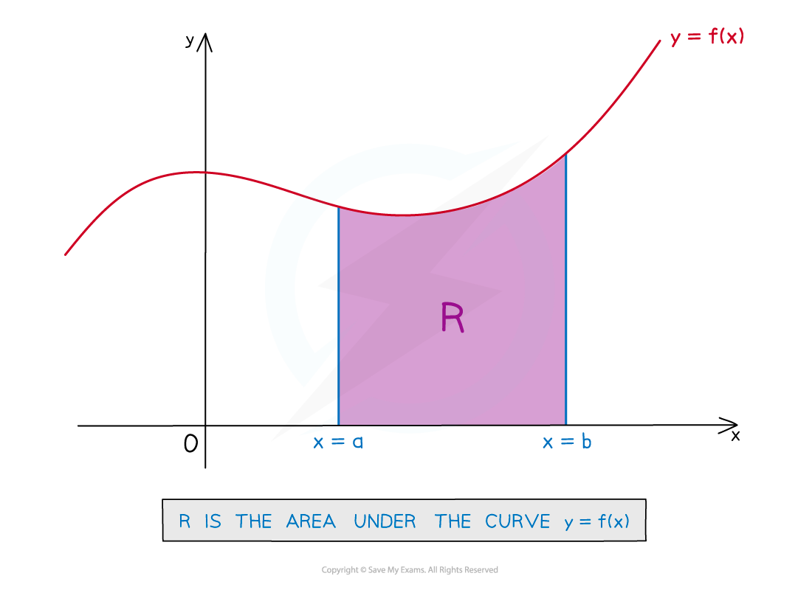
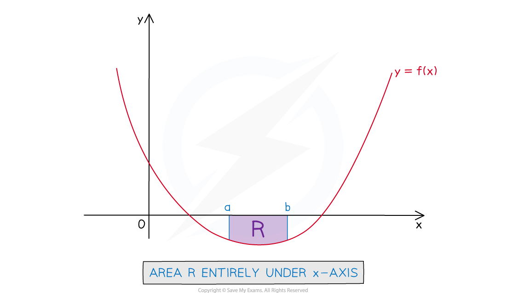
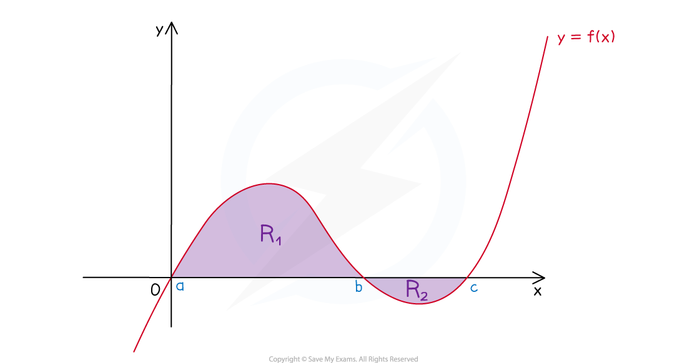

# Calculating Areas

## Definite Integrals

> **Spec point** — `spcpt_M2RHvyxt445bmXBD`

## Definite Integrals

### What is a definite integral?

- A definite integral is defined by the following formula

  - $\int_{a}^{b} \mathrm{f}^{'} ( x ) \mathrm{d} x = [ \mathrm{f} ( x ) ]_{a}^{b} = \mathrm{f} ( b ) - \mathrm{f} ( a )$
  
    - i.e. **integrate** as usual to find $\mathrm{f} ( x )$
    - then **substitute** to find $\mathrm{f} ( b )$ and $\mathrm{f} ( a )$
    - and subtract $\mathrm{f} ( a )$ from $\mathrm{f} ( b )$ to find the **value** of the definite integral
  - $a$ and $b$ are **numbers** and are called the **integration limits**
  
    - $a$ is the **lower limit**
    - $b$ is the **upper limit**
    - the integral is 'from $a$ to $b$'
  - A **constant** **of** **integration** (“$+c$”) is **not needed** with definite integrals
- Note that the answer to a **definite integral** is a **number**

  - The answer to an **indefinite integral** is another **function**

> **Exam Hint**
> - Be careful when substituting in to find $\mathrm{f} ( b ) - \mathrm{f} ( a )$
> 
>   - It's quite easy to make mistakes here
>   - Especially when fractions and negative numbers are involved
> - Your calculator may be able to find the value of definite integrals
> 
>   - You can use this to check your work
> - Look out for phrases in exam questions like "Use algebraic integration" or "Using calculus"
> 
>   - These mean that full working out of the integral 'by hand' is required
>   - A calculator answer without working would not score marks

> **Worked Example**
> Show that
> 
> $\int_{2}^{4} 3 x ( x^{2} - 2 ) \mathrm{d} x = 144$
> 
> > *Start by expanding the brackets inside the integral*
> 
> $\int_{2}^{4} ( 3 x^{3} - 6 x ) \mathrm{d} x$
> 
> > *Integrate as usual (here it's a 'powers of *$x$*' integration)*
> 
> > *Write the answer in square brackets with the integration limits outside*
> 
> $\begin{gathered} \int_{2}^{4} ( 3 x^{3} - 6 x ) \mathrm{d} x & = [ 3 ( \frac{x^{3 + 1} }{3 + 1} ) - 6 ( \frac{x^{1 + 1} }{1 + 1} ) ]_{2}^{4} \\ = [ \frac{3}{4} x^{4} - 3 x^{2} ]_{2}^{4} \end{gathered}$
> 
> > *Now substitute 4 into that function*
> *And subtract from it the function with 2 substituted in*
> 
> $\begin{gathered} [ \frac{3}{4} x^{4} - 3 x^{2} ]_{2}^{4} & = ( \frac{3}{4} ( 4 )^{4} - 3 ( 4 )^{2} ) - ( \frac{3}{4} ( 2 )^{4} - 3 ( 2^{2} ) ) \\ = ( 192 - 48 ) - ( 12 - 12 ) \\ = 144 - 0 \\ = 144 \end{gathered}$
> 
> > *And that's the answer we were asked to show!*
> 
> $integral_{ } 2^{ } 4 3 x \text{stretchy} ( x ^{2} - 2 \text{stretchy} ) d x = 144$

## Calculating Areas with Definite Integrals

> **Spec point** — `spcpt_yJ97KHnfRVsN7qBW`

## Calculating Areas with Definite Integrals

### How can I calculate areas using definite integrals?

- Region $R$ in the following diagram is the '**area under a curve**' between $x=a$ and $x=b$

  - It is the region bounded by
  
    - the **curve** $y = \mathrm{f} ( x )$
    - the $x$**-axis**
    - and the **lines** $x=a$ and and $x=b$

- The **exact area** of a region like region $R$ in the diagram can be found by evaluating the **definite integral**

  - $\text{Area} = \int_{a}^{b} \mathrm{f} ( x ) \mathrm{d} x$
  
    - i.e. definite integrals can be used as **area calculators**!
  - Note that **for this to work**, $a$ **must** be 'on the left' and $b$ **must** be 'on the right'
  
    - i.e. $a\leqb$

### How do I form a definite integral to find the area under a curve?

- The curve $y=f(x)$ and the $x$-axis should be **obvious** boundaries

  - but the trick can be identifying $a$ and $b$
  
    - i.e. the **lower** and **upper** **limits** of the **definite integral**
- If a diagram is **given** in the question, this can help locate the limits

  - If a diagram is not given, then **sketch** one
- The 'left' and 'right' boundaries may be **vertical lines**

  - In that case their **equations** give the integral limits
  
    - $x=a$ and $x=b$
- The $y$**-axis** may be one of the (vertical) boundaries

  - in that case one of the limits will be $x=0$
- The 'left' and 'right' boundaries **don't have to be** vertical lines

  - One or both of them could be where $y = \mathrm{f} ( x )$ **intercepts the **$x$**-axis**
  
    - i.e., one of the **roots** of the equation $f(x)=0$
  - In this case **solve** the equation$f(x)=0$ to find the limit(s)

> **Exam Hint**
> - Look out for questions that ask you to find an indefinite integral in one part
> 
>   - where '$+c$**'**  is needed in the answer
>   - then in a later part use the same integral as a definite integral
>   
>     - where '$+c$' is not needed
> - Add information to any diagram provided in the question
> 
>   - axes intercepts
>   - values of limits
>   - mark and shade the area you’re trying to find
> - If no diagram is provided, sketch one!

> **Worked Example**
> The following diagram shows a part of the graph of the curve with equation  $y=3+2x-x^{2}$.  The region labelled $R$ is bounded by the curve, the positive $y$-axis, and the positive $x$-axis.
> 
> 
> 
> Find the exact area of region $R$.
> 
> > *Start by finding the integration limits.*
> 
> > *The *$y$*-axis is the left boundary, so *$x=0$* will be the lower integration limit*
> 
> > *The right boundary is where the curve intercepts the *$x$*-axis*
> *Solve the equation  *$y=0$*  to find its *$x$*-coordinate*
> 
> $\begin{gathered} 3 + 2 x - x^{2} & = 0 \\ x^{2} - 2 x - 3 & = 0 \\ ( x + 1 ) ( x - 3 ) & = 0 \end{gathered}$
> 
> $x=-1\mathrm{or}x=3$
> 
> > *We want the positive intercept, so the upper integral limit will be *$x=3$
> 
> > *Put all that info into the definite integral*
> 
> $\begin{array}{rcl} \text{Area} = \int_{0}^{3} ( 3 + 2 x - x^{2} ) \mathrm{d} x \\ = [ 3 x + 2 ( \frac{x^{1 + 1} }{1 + 1} ) - ( \frac{x^{2 + 1} }{2 + 1} ) ]_{0}^{3} \\ = [ 3 x + x^{2} - 1 \frac{1}{3} x^{3} ]_{0}^{3} \\ = ( 3 ( 3 ) + ( 3 )^{2} - 1 \frac{1}{3} ( 3 )^{3} ) - ( 3 ( 0 ) + ( 0 )^{2} - 1 \frac{1}{3} ( 0 )^{3} ) \\ = ( 9 + 9 - 9 ) - ( 0 + 0 - 0 ) \\ = 9 - 0 \\ = 9 \end{array}$
> 
> $9\mathrm{units}^{2}$

## Negative Integrals

> **Spec point** — `spcpt_pRZp7s55nRN7j4fz`

## Negative Integrals

### What do we mean by a 'negative integral'

- The answer to a **definite integral** is a **number**

  - This number can be** positive** or ** negative** (or zero!)
- The **area between a curve and the **$x$**-axis** may lie fully or partially **below** the $x$-axis

  - This occurs when the function$f(x)$ takes **negative** values within the boundaries of the area
- A **definite** **integral** used to **find** such an area

  - will be **negative** if the area is **fully** under the$x$-axis
  - **possibly** **negative** if the area is **partially** under the$x$-axis
  
    - even if positive, the integral **will not calculate the correct area** in this case
    - the 'negative areas' will **subtract** from the 'positive areas'

### How do I find the area under a curve when the curve is fully under the x-axis?

** **

- **STEP 1**
Write the **definite integral** to find the area as usual

  - This may involve finding the lower and upper integration **limits**
- **STEP 2**
The answer to the definite integral will be **negative**

  - But the answer will have the **same 'size'** as the area
  - So just **remove the minus sign** to get the area
  
    - e.g.  if the value of the integral is $-36$
    - then the area will be $36$ (square units)

### How do I find the area under a curve when the curve is partially under the x-axis?

** **

- **STEP 1**
**Split** the area into parts

  - the area(s) that are **above** the $x$-axis
  - and the area(s) that are **below** the $x$-axis

- **STEP 2**
Write the definite integral **for each part**

  - This may involve finding the lower and upper integration **limits** for each part
  
    - e.g. **solving** $\mathrm{f} ( x ) = 0$ to find where $y = \mathrm{f} ( x )$ crosses the $x$-axis
- **STEP 3**
**Find the value** of each definite integral separately
- **STEP 4**
**Change **the negative values to positive

  - Then find the **total area** by summing the 'positive versions' of each integral

> **Exam Hint**
> - If no diagram is provided, sketch one
> 
>   - This lets you see where the curve is above and below the $x$-axis
>   - Then you can split up your integrals accordingly

> **Worked Example**
> The diagram below shows the graph of $y=f(x)$, where  $f(x)=(x+4)(x-1)(x-5)$.
> 
> 
> 
> The region$R_{1}$ is bounded by the curve $y=f(x)$ and the positive $x$- and $y$-axes.
> 
> The region$R_{2}$ is bounded by the curve $y=f(x)$, the positive $x$-axis, and the line $x=3$.
> 
> (a) Determine the coordinates of the point labelled$P$.
> 
> > *That point is one of the *$x$*-axis intercepts  of the function*
> 
> > *Solve *$\mathrm{f} ( x ) = 0$* to find what those area*
> 
> $( x + 4 ) ( x - 1 ) ( x - 5 ) = 0$
> 
> $x=-4,1,5$
> 
> > *It has to be positive, because the point is to the right of the origin*
> *And it has to be less than 3, because it's to the left of the line *$x=3$
> *So it must be the intercept at *$x=1$
> 
> $(1,0)$
> 
> (b) Find the exact total area of the shaded regions $R_{1}$ and $R_{2}$.
> 
> > $R_{1}$* is the region between *$x=0$* and *$x=1$
> 
> > *It lies totally above the *$x$*-axis, so the definite integral will calculate the area directly*
> 
> `| Area of R _ 1 | = integral _ 0 ^ 1 ( x + 4 ) ( x - 1 ) ( x - 5 ) d x | | _ = integral _ 0 ^ 1 ( x ^3 - 2 x ^2 - 19 x + 20 ) d x | | _ = [ 1 fourth x ^ 4 - 2 / 3 x ^3 - 19 / 2 x ^2 + 20 x ] _ 0 ^ 1 | | _ = ( 1 fourth ( 1 ) ^ 4 - 2 / 3 ( 1 ) ^3 - 19 / 2 ( 1 ) ^2 + 20 ( 1 ) ) - ( 1 fourth ( 0 ) ^ 4 - 2 / 3 ( 0 ) ^3 - 19 / 2 ( 0 ) ^2 + 20 ( 0 ) ) | | _ = ( 1 fourth - 2 / 3 - 19 / 2 + 20 ) - ( 0 - 0 - 0 + 0 ) | | _ = 121 / 12 - 0 | | _ = 121 / 12 | |`
> 
> > $R_{2}$* is the region between *$x=1$* and *$x=3$
> 
> > *It lies totally below the *$x$*-axis, so the integral will give us the negative version of the area*
> 
> `| - ( Area of R _ 2 ) | = integral _ 1 ^ 3 ( x ^3 - 2 x ^2 - 19 x + 20 ) d x | | _ = [ 1 fourth x ^ 4 - 2 / 3 x ^3 - 19 / 2 x ^2 + 20 x ] _ 1 ^ 3 | | _ = ( 1 fourth ( 3 ) ^ 4 - 2 / 3 ( 3 ) ^3 - 19 / 2 ( 3 ) ^2 + 20 ( 3 ) ) - ( 1 fourth ( 1 ) ^ 4 - 2 / 3 ( 1 ) ^3 - 19 / 2 ( 1 ) ^2 + 20 ( 1 ) ) - | | _ = ( 81 / 4 - 18 - 171 / 2 + 60 ) - ( 1 fourth - 2 / 3 - 19 / 2 + 20 ) | | _ = - 93 / 4 - 121 / 12 | | _ = - 400 / 12 | |`
> 
> > *So the area of *$R_{2}$* is *$\frac{400}{12}$* *$( = \frac{100}{3} )$
> 
> > *Add the two areas together to get the total area*
> 
> $\mathrm{total} \mathrm{area}=\frac{121}{12}+\frac{400}{12}=\frac{521}{12}$
> 
> **Final answer:** $\frac{521}{12}\mathrm{units}^{2}$** **
