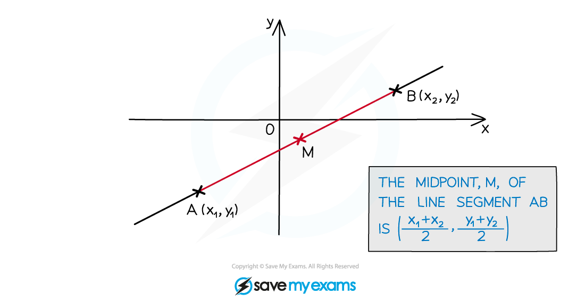

# Basic Coordinate Geometry

## Basic Coordinate Geometry

> **Spec point** — `spcpt_XT4rfZ58Z33Xs5pg`

## Basic Coordinate Geometry

### What are Cartesian coordinates?

- **Cartesian** coordinates are the coordinates used in the *x-y* coordinate system

  - They allow us to label where things are in a two-dimensional plane
- In the 2D Cartesian system, the horizontal axis is labelled *x*  and the vertical axis is labelled *y*

### What can I do with coordinates?

- If you have two points with coordinates $( x_{1} , y_{1} )$* *and* *$( x_{2} , y_{2} )$* *then you should be able to find

  - The **distance** between the two points
  - The point that **divides** the line between the two points in a given **ratio**
  - The **gradient** of the line joining the two points

### How do I find the distance between two points?

- The **distance **$d$ between two points with coordinates $( x_{1} , y_{1} )$* *and* *$( x_{2} , y_{2} )$* *can be found using the formula

  - $d = \sqrt{( x_{1} - x_{2} )^{2} + ( y_{1} - y_{2} )^{2}}$

- $d$ is the **hypotenuse** of a right-angled triangle

  - The differences between the $x$-coordinates and the $y$-coordinates give the other two side lengths
  - So by Pythagoras’ Theorem  $d^{2} = ( x_{1} - x_{2} )^{2} + ( y_{1} - y_{2} )^{2}$

### How do I divide the line between two points in a given ratio?

- The coordinates of the point **dividing** the line joining $( x_{1} , y_{1} )$ and $( x_{2} , y_{2} )$ in the **ratio** $m:n$ are given by

  - $( \frac{n x_{1} + m x_{2} }{m + n} , \frac{n y_{1} + m y_{2} }{m + n} )$

- If $m>n$ then the point is closer to $( x_{2} , y_{2} )$
- If $m<n$ then the point is closer to $( x_{1} , y_{1} )$

### How do I find the midpoint between two points?

- The **midpoint** is the point **halfway between** the two points

  - This is just 'dividing in a given ratio' where the ratio is $1:1$
- The **coordinates** of the **midpoint** will be

  - $( \frac{x_{1} + x_{2} }{2} , \frac{y_{1} + y_{2} }{2} )$

### How do I find the gradient of a straight line joining two points?

- The **gradient** $m$ of a line between two points with coordinates $( x_{1} , y_{1} )$* *and* *$( x_{2} , y_{2} )$* *can be found using the formula

  - $m=\frac{y_{2}-y_{1}}{x_{2}-x_{1}}$

- This is also known as  $m=\frac{\mathrm{rise}}{\mathrm{run}}$

> **Worked Example**
> Point $A$ has coordinates $( 3 , - 4 )$ and point $B$ has coordinates $( - 5 , 8 )$.
> 
> (a) Calculate the distance between points $A$ and $B$.
> 
> > *Let* $A ( 3 , - 4 )$*be 'point 1', so* $x_{1}=3$ *and* $y_{1}=-4$
> 
> *Let* $B ( - 5 , 8 )$ *be 'point 2', so* $x_{2}=-5$ *and* $y_{2}=8$
> 
> > *Use the formula* $d = \sqrt{( x_{1} - x_{2} )^{2} + ( y_{1} - y_{2} )^{2}}$
> 
> $d = \sqrt{( 3 - ( - 5 ) )^{2} + ( - 4 - 8 )^{2}} = \sqrt{8^{2} + ( - 12 )^{2}} = \sqrt{64 + 144}$
> 
> **Final answer:** $\sqrt{208}$**  ****(or **$4\sqrt{13}$** ****or 14.4 to 3 s.f.)**
> 
> (b) Find the gradient of the line joining points *A* and *B*.
> 
> > *Let* $A ( 3 , - 4 )$ *be 'point 1', so* $x_{1}=3$ *and* $y_{1}=-4$
> 
> *Let* $B ( - 5 , 8 )$ *be 'point 2', so* $x_{2}=-5$ *and* $y_{2}=8$
> 
> > *Use the formula* $m=\frac{y_{2}-y_{1}}{x_{2}-x_{1}}$
> 
> $m = \frac{8 - ( - 4 )}{- 5 - 3} = \frac{12}{- 8}$
> 
> > *Simplify the fraction*
> 
> $-\frac{3}{2}$
> 
> (c) Find point that divides the line joining points *A* and *B* in the ratio $1:3$.
> 
> > *Let* $A ( 3 , - 4 )$*be 'point 1', so* $x_{1}=3$ *and* $y_{1}=-4$
> 
> *Let* $B ( - 5 , 8 )$ *be 'point 2', so* $x_{2}=-5$ *and* $y_{2}=8$
> 
> > *Use the formula* $( \frac{n x_{1} + m x_{2} }{m + n} , \frac{n y_{1} + m y_{2} }{m + n} )$ *with* $m=1$ *and* $n=3$
> 
> > $( \frac{( 3 ( 3 ) + 1 ( - 5 ) )}{1 + 3} , \frac{( 3 ( - 4 ) + 1 ( 8 ) )}{1 + 3} ) = ( \frac{9 - 5}{4} , \frac{- 12 + 8}{4} )$* *
> 
> $(1,-1)$
