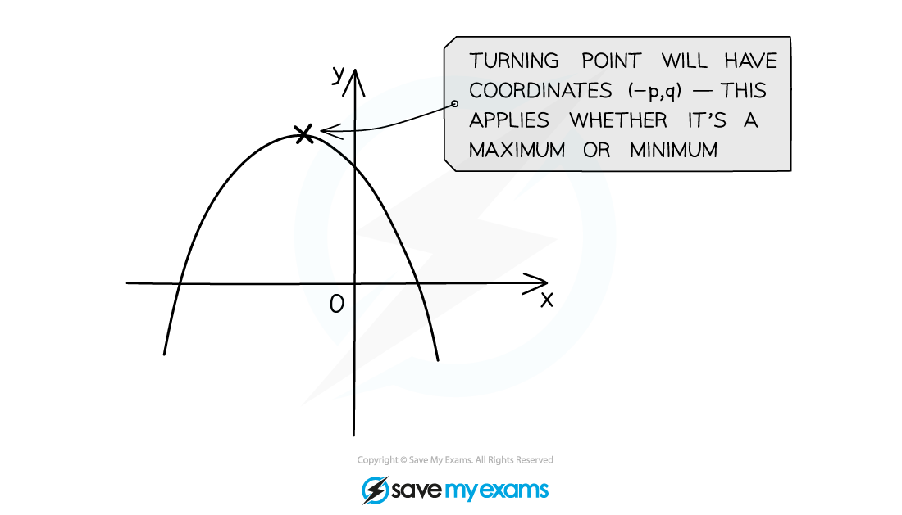
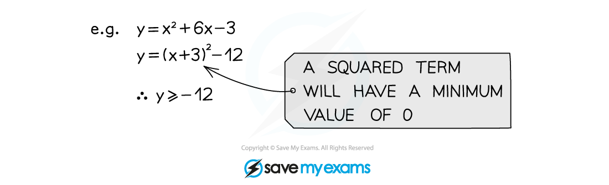

# Completing the Square

## Completing the Square

> **Spec point** — `spcpt_zWTdNSzkXXBfcWBR`

## Completing the Square

### How can I rewrite the first two terms of a quadratic expression as the difference of two squares?

- Look at the **quadratic expression** $x^{2}+bx+c$* *
- The first** two terms** can be written as the **difference of two squares** using the following rule

$x^{2}+bx$ is the same as `(x+p)²−p²` where $p$ is **half** of $b$

- **Check** this is true by **expanding** the right-hand side

  - Is $x^{2}+2x$ the same as `(x+1)²−1²`?
  
    - Yes: `(x+1)(x−1)−1²=x²+2x+1−1=x²+2x`
- This works for **negative values of **$b$ too

  - $x^{2}-20x$ can be written as `(x−10)²−(−10)²` which is `(x−10)²−100`
  - A negative $b$ **does not change the sign** at the end

### How do I complete the square?

- **Completing the square** is a way to rewrite a quadratic expression in a form containing a squared bracket
- To complete the square on $x^{2}+10x+9$

  - Use the rule above to replace the first two terms, $x^{2}+10x$*,* with `(x+5)²−5²`
  - add 9:  `(x+5)²−5²+9`
  - **simplify** the **numbers**:  `(x+5)²−25+9`
  - answer: `(x+5)²−16`

### How do I complete the square when there is a coefficient in front of the x2 term?

- You first need to **take **$a$** out** as a factor of the $x^{2}$ and $x$ terms only

  - `a x²+b x+c=a open square brackets x²+b / a x close square brackets+c`
  
    - Use **square-shaped** **brackets** here to avoid confusion with round brackets later
  - For example,  `4x²+16x+5=4 open square brackets x²+4x close square brackets+5`
- Then complete the square on the bit **inside** the square brackets: $x^{2}+\frac{b}{a}x$

  - This gives `a open square brackets (x+p)²−p² close square brackets+c`
  
    - where *p* is half of $\frac{b}{a}$
  - `4 open square brackets x²+4x close square brackets+5=4 open square brackets (x+2)²−4 close square brackets+5`
- Finally **multiply** this expression by the $a$ outside the square brackets and **add** the $c$

  - `a (x+p)²−a p²+c`
  - This looks far more complicated than it is in practice!
  
    - Usually you are asked to give your **final answer** in the form  `a (x+p)²+q`
    - Here  $q=-ap^{2}+c$
  - `4 open square brackets (x+2)²−4 close square brackets+5=4 (x+2)²−16+5=4 (x+2)²−11`
- For quadratics like $-x^{2}+bx+c$, do the above with $a=-1$

### How do I find the turning point by completing the square?

- Completing the square helps us find the **turning** **point** on a quadratic graph

  - If `y=(x+p)²+q` then the turning point is at `(−p comma q)`
  
    - Notice the negative sign in the $x$-coordinate
    - This links to **transformations of graphs** (translating $y=x^{2}$ by $p$ to the left and $q$* *up)
  - If `y=a (x+p)²+q` then the turning point is still at `(−p comma q)`
  
    - It's a **minimum** point if  $a>0$
    - It's a **maximum** point if  $a<0$
- It can also help you **create the equation** of a quadratic when given the turning point

- It can also be used to **prove** and/or **show** results using the fact that any "squared term", i.e. the bracket (*x* ± *p*)2 , will always be **greater than or equal to 0**

  - You cannot square a number and get a negative value

> **Exam Hint**
> - Expand your answer to check that you have completed the square correctly.

> **Worked Example**
> (a) By completing the square, find the coordinates of the turning point on the graph of $y=x^{2}+6x-11$.
> 
> > *Find half of* $+6$ *(call this* $p$*)*
> * *
> 
> > $p=\frac{6}{2}=3$
> * *
> 
> > *Write* $x^{2}+6x$ *in the form* `(x+p)²−p²`* *
> * *
> 
> $x^{2}+6x$ *is the same as* `(x+3)²−3²`
> * *
> 
> > *Put this result into the equation of the curve*
> * *
> 
> > `y=(x+3)²−3²−11`
> * *
> 
> > *Simplify the numbers*
> * *
> 
> > `y=(x+3)²−20`
> * *
> 
> > *Use the fact that the turning point of* `y=(x+p)²+q` *is at* `(−p comma q)`
> 
> > *Here* $p=3$ *and* $q=-20$
> 
> **Final answer:** **Turning point at **$(-3,-20)$
> 
> (b) Write $-3x^{2}+12x+24$ in the form `a (x+p)²+q`
> 
> > *Factorise* $-3$ *out of the first two terms only*
> *Use square-shaped brackets*
> * *
> 
> > `−3 open square brackets x²−4x close square brackets+24`
> * *
> 
> > *Complete the square on the* $x^{2}-4x$ *inside the brackets (write in the form* `(x+p)²−p²` *where* $p$ *is half of* $-4$*)*
> * *
> 
> > `−3 open square brackets (x−2)²−(−2)² close square brackets+24`
> * *
> 
> > *Simplify the numbers inside the brackets*
> `(−2)²` *is* $4$
> * *
> 
> > `−3 open square brackets (x−2)²−4 close square brackets+24`
> * *
> 
> > *Multiply all the terms inside the square-shaped brackets by* $-3$
> * *
> 
> > `−3 (x−2)²+12+24`
> * *
> 
> > *Simplify the numbers*
> * *
> 
> > `−3 (x−2)²+36`
> * *
> 
> > *This is now in the form* `a (x+p)²+q` *where* $a=-3$*,* $p=-2$ *and* $q=36$
> 
> $-3(x-2)^{2}+36$
