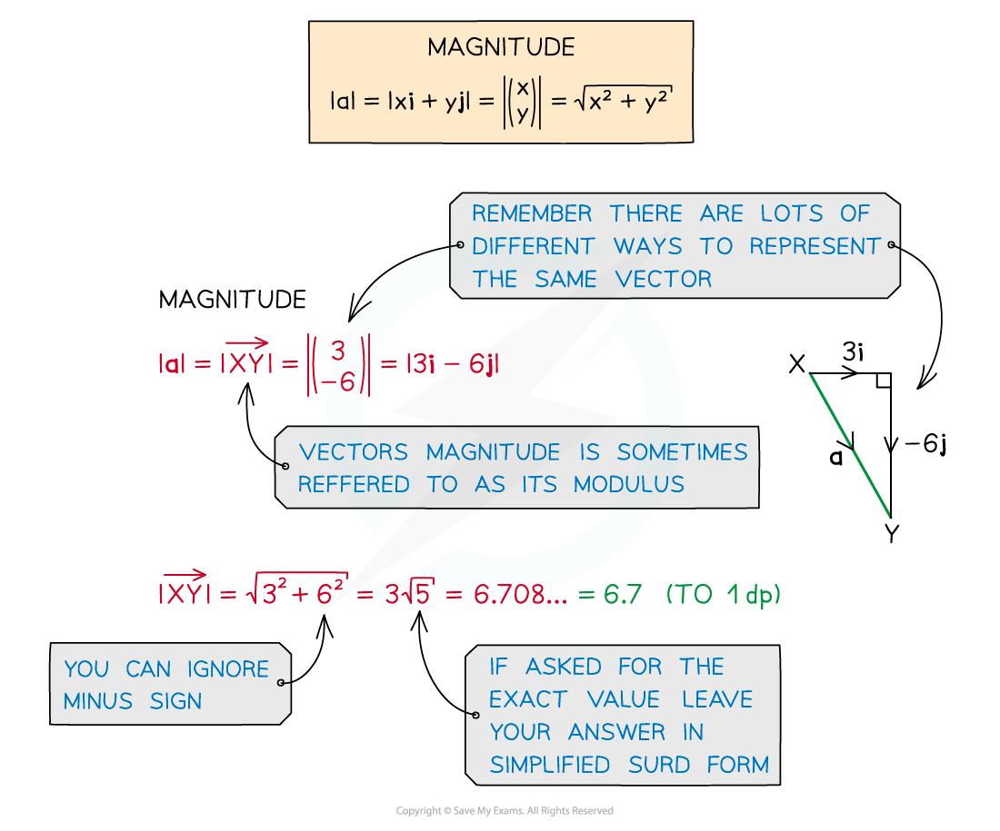

# Magnitude of a Vector

## Magnitude of a Vector

> **Spec point** — `spcpt_zqGQtK2S4rZfWPy8`

## Magnitude of a Vector

### How do I find the magnitude of a vector?

- The **magnitude **of a **vector** is its **length **(distance)

  - It is also called the **modulus**
- The magnitude of $\overset{\rightarrow}{AB}$ is written $\left| \vec{AB} \right|$

  - The magnitude of **a** is written |**a**|
- In** component** form, the magnitude is the **hypotenuse** of a right-angled triangle

  - Use **Pythagoras' theorem** to find it
  - The magnitude of $a=xi+yj$ is
  
    - $\left| a \right| = \sqrt{x^{2 } + \mathrm{y}^{2}}$
    - where $a = ( \begin{gathered} x \\ y \end{gathered} )$

### How do I find harder magnitudes?

- The magnitude of a **sum** of vectors is **not equal** to the sum of the magnitudes

  - $\vert a \pm b \vert \text{eq} \vert a \vert \pm \vert b \vert$
  
    - Work out **a** + **b** (or **a** - **b**) first, then find its magnitude
- You may need to **form an equation**

  - For example, |**a**| = 5 where **a** = 4**i** + *x***j**
  
    - $\sqrt{4^{2}+x^{2}}=5$
    - This solves to give $x=\pm3$

### How do I find the magnitude of a displacement vector?

- You can use **coordinate geometry** to find **magnitudes **of **displacement vectors** from *A * to *B*

  - From the **position vectors** of *A*  and *B*  you know their coordinates
  
    - If  $a = \vec{OA} = x_{1} i + y_{1} j = ( \begin{gathered} x_{1} \\ y_{1} \end{gathered} )$,  then point A has coordinates $( x_{1} , y_{1} )$
    - If  $b = \vec{OB} = x_{2} i + y_{2} j = ( \begin{gathered} x_{2} \\ y_{2} \end{gathered} )$,  then point B has coordinates $( x_{2} , y_{2} )$
  - The **distance** between two points is given by $d = \sqrt{( x_{1} - x_{2} )^{2} + ( y_{1} - y_{2} )^{2}}$
  
    - So  $\left| \vec{AB} \right| = \sqrt{( x_{1} - x_{2} )^{2} + ( y_{1} - y_{2} )^{2}}$
  - For example, if points A and B have position vectors $5i+3j$ and $3i-6j$ respectively
  
    - then  $\left| \vec{AB} \right| = \sqrt{( 5 - 3 )^{2} + ( 3 - ( - 6 ) )^{2}} = \sqrt{85} = 9.22 ( 3 \mathrm{s} . \mathrm{f} . )$

- Alternatively, you could find $\left| \vec{AB} \right|$ by

  - first using  $\overset{\rightarrow}{AB}=-\overset{\rightarrow}{OA}+\overset{\rightarrow}{OB}$ to find $\overset{\rightarrow}{AB}$ in **vector form**
  
    - and then calculating its **magnitude** directly
  - See the Worked Example below

> **Exam Hint**
> - When magnitudes involve algebra, it helps to square both sides to get rid of the square root sign!

> **Worked Example**
> $O$, $A$and $B$ are fixed points, where $\overset{\rightarrow}{OA}=2i+mj$ and $\overset{\rightarrow}{OB}=-i+4j$.
> 
> Given that $\vert \vec{AB} \vert = 3 \sqrt{2}$ and $m>5$, find the value of $m$.
> 
> > *Use  *$\overset{\rightarrow}{AB}=\overset{\rightarrow}{AO}+\overset{\rightarrow}{OB}=-\overset{\rightarrow}{OA}+\overset{\rightarrow}{OB}$
> *Simplify and collect components *
> 
> > $\begin{gathered} \vec{AB} & = - ( 2 i + m j ) + ( - i + 4 j ) \\ = - 2 i - m j - i + 4 j \\ = - 3 i + ( 4 - m ) j \end{gathered}$
> * *
> 
> > *Use  *$\vert x i + y j \vert = \sqrt{x^{2} + y^{2}}$* *
> 
> > $\begin{gathered} \left| \vec{AB} \right| & = \sqrt{( - 3 )^{2} + ( 4 - m )^{2}} \end{gathered}$
> * *
> 
> > *Expand and simplify inside the square root*
> *You cannot just take the square root of the individual terms!*
> * *
> 
> > $\begin{gathered} \left| \vec{AB} \right| & = \sqrt{9 + 16 - 8 m + m^{2 } } \\ = \sqrt{25 - 8 m + m^{2 } } \end{gathered}$
> * *
> 
> > *Substitute in *$\left| \vec{AB} \right| = 3 \sqrt{2}$* from the question*
> *Square both sides and form a quadratic in *$m$
> * *
> 
> > $\begin{gathered} 3 \sqrt{2 & = \sqrt{25} - 8 m + m^{2}} \\ ( 3 \sqrt{2} )^{2} & = 25 - 8 m + m^{2} \\ 18 = 25 - 8 m + m^{2} \\ 0 = m^{2} - 8 m + 7 \end{gathered}$
> * *
> 
> > *Factorise and solve *
> 
> > $0 = ( m - 1 ) ( m - 7 )
> m = 1 , m = 7$
> * *
> 
> > *You are given that *$m>5$* in the question*
> *This means *$m=7$* is the only valid answer*
> 
> $m=7$

## Unit Vectors

> **Spec point** — `spcpt_7bdp3GppCFjsMw5y`

## Unit Vectors

### What is a unit vector?

- A **unit vector** is a vector of **length 1**
- Any vector, **a**, can be made a unit vector by **dividing** it by its **magnitude**,$\frac{a}{\left| a \right|}$

  - This will result in a vector of length 1
  
    - It still points in the same direction as **a**
- For example, to make 3**i** – 4**j** a unit vector

  - find its magnitude, $\sqrt{3^{2} + ( - 4 )^{2}} = \sqrt{25} = 5$
  - divide by its magnitude
  
    - $\frac{(3i-4j)}{5}=\frac{3}{5}i-\frac{4}{5}j$
    - Each** component **is divided by the magnitude

> **Exam Hint**
> - Read vector questions carefully
> 
>   - Some may want you to give your final answer as a unit vector!

> **Worked Example**
> The position vector of a point,* *$A$, relative to the origin,* *$O$, is given by $\overset{\rightarrow}{OA}=-7i+j$
> 
> Find a unit vector in the direction of $\overset{\rightarrow}{OA}$, giving your answer in exact form.
> 
> > *To find a unit vector, divide the vector by its magnitude*
> *Find and simplify the magnitude, *$\vert \vec{OA} \vert$*, using *$\sqrt{x^{2}+y^{2}}$
> * *
> 
> > $\begin{gathered} \vert \vec{OA} \vert & = \sqrt{( - 7 )^{2} + 1^{2}} \\ = \sqrt{49 + 1} \\ = \sqrt{50 \\ = \sqrt{25} \times 2} \\ = 5 \sqrt{2} \end{gathered}$
> * *
> 
> *Divide each component in *$\overset{\rightarrow}{OA}$* by *$\begin{array}{rcl} 5 \sqrt{2} \end{array}$
> 
> $\frac{\vec{OA}}{\vert \vec{OA} \vert} = - \frac{7}{5 \sqrt{2} } i + \frac{1}{5 \sqrt{2} } j$
> 
> **Final answer:** **The unit vector is **$-\frac{7}{5\sqrt{2}}i+\frac{1}{5\sqrt{2}}j$
> 
> $-\frac{7}{\sqrt{50}}i+\frac{1}{\sqrt{50}}j$** would be accepted**
> **Decimals would not be accepted**
> **Rationalised denominators would be accepted, **$-\frac{7\sqrt{2}}{10}i+\frac{\sqrt{2}}{10}j$
