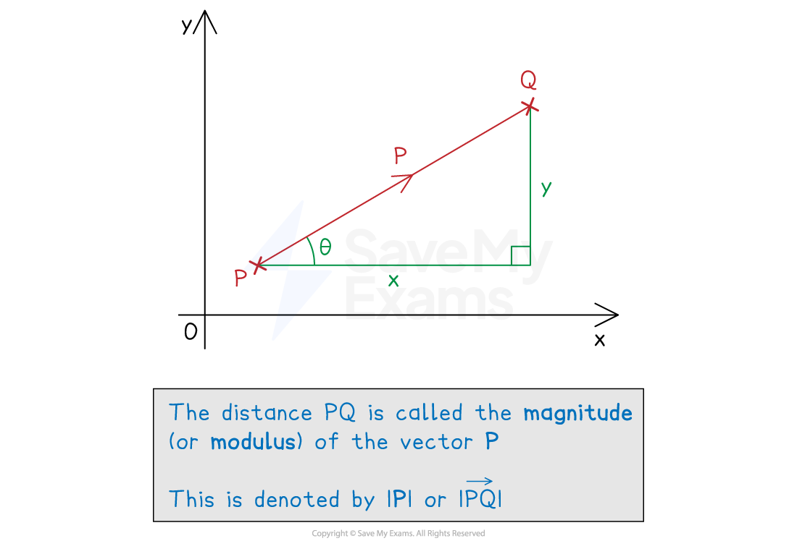

# Magnitude of a Vector

## Magnitude of a Vector

> **Spec point** — `spcpt_vqmZYnJx9pH7mGMC`

## Magnitude of a vector

### How do I find the magnitude of a vector?

- The **magnitude **of a **vector** is its **length **(distance)

  - It is also called the **modulus**
  - This is always a **positive** value
  - The direction of the vector is irrelevant
- The magnitude of $\overset{\rightarrow}{AB}$ is written $\left| \vec{AB} \right|$

  - The magnitude of **a** is written |**a**|

- Depending on the use of the vector, the magnitude of a vector represents** different quantities**

  - For velocity, magnitude would be speed
  - For a force, magnitude would be the strength of the force (in Newtons)

- In** component** form, the magnitude is the **hypotenuse** of a right-angled triangle

  - Use **Pythagoras' theorem** to find the magnitude
  - The magnitude of $a = ( \begin{gathered} x \\ y \end{gathered} )$
  
    - $\left| a \right| = \sqrt{x^{2 } + \mathrm{y}^{2}}$

> **Exam Hint**
> - If there is no diagram, sketch one!
> 
>   - You can sketch a vector and use it to form a right-angled triangle

> **Worked Example**
> Consider two points $A ( - 3 , 5 )$ and $B ( 7 , 1 )$.
> 
> (a) Write down the column vector $\overset{\rightarrow}{AB}$.
> 
> **Answer:**
> 
> > *Find the horizontal and vertical distances between the two points*
> *Subtract the **x** and **y** components of **A** from **B*
> 
> $\vec{AB} = ( \begin{gathered} 7 - - 3 \\ 1 - 5 \end{gathered} )$
> 
> `Error converting from MathML to accessible text.`
> 
> (b) Find the modulus of vector $\overset{\rightarrow}{AB}$.
> 
> **Answer:**
> 
> > *Sketching a diagram of the vector *$\overset{\rightarrow}{AB}$* can help*
> 
> 
> 
> > *Apply Pythagoras' theorem to the **x** and **y** components of *$\overset{\rightarrow}{AB}$
> 
> $\begin{gathered} \left| \vec{AB} \right| & = \sqrt{10^{2} + ( - 4 )^{2}} \\ = \sqrt{100 + 16} \\ = \sqrt{116} \end{gathered}$
> 
> `Error converting from MathML to accessible text.`
> 
> (c) Briefly explain why $\left| \vec{BA} \right| = \left| \vec{AB} \right|$.
> 
> **Answer:**
> 
> > *The magnitude of a vector is it's 'size'*
> 
> > *Direction of the vector is ignored*
> 
> **Final answer:** $\left| \vec{BA} \right| = \left| \vec{AB} \right|$** since both vectors have the same distance**
> 
> Another vector, $\overset{\rightarrow}{CD}$, has three times the magnitude of vector $\overset{\rightarrow}{AB}$.
> 
> (d) Write down a possible column vector for $\overset{\rightarrow}{CD}$.
> 
> **Answer:**
> 
> > *Being three times *$\left| \vec{AB} \right|$* means the vector *$\overset{\rightarrow}{AB}$* is three times longer*
> 
> > *One way to find a vector is to multiply each component of the vector *$\overset{\rightarrow}{AB}$* by 3 or -3*
> 
> $\begin{gathered} \vec{CD} & = 3 \vec{AB} = 3 ( \begin{gathered} 10 \\ - 4 \end{gathered} ) \end{gathered}$
> 
> `Error converting from MathML to accessible text.`** or *** *`Error converting from MathML to accessible text.`
