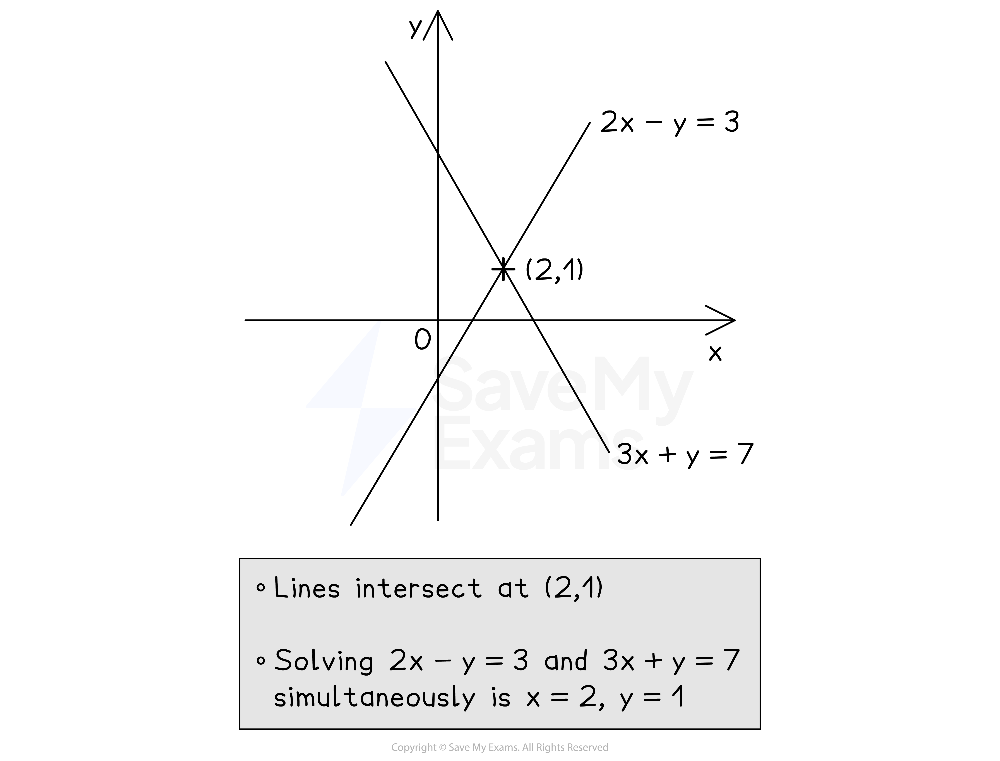

# Simultaneous Equations

## Linear Simultaneous Equations

> **Spec point** — `spcpt_4xsdMKbx5zYg9FpN`

## Linear simultaneous equations

### What are linear simultaneous equations?

- When there are **two unknowns** (***x***** and *****y***), we need **two equations** to find them both

  - For example, 3*x* + 2*y *= 11 and 2*x* - *y *= 5
  
    - The values that work for both equations at the same time are *x* = 3 and *y* = 1
- These are called **linear** **simultaneous equations**

  - **Linear **because there are no complicated terms like *x*2 or *y*2
  - **Simultaneous **because the solutions satisfy both equations at the **same time**

### How do I solve linear simultaneous equations by elimination?

- **Elimination** removes one of the variables, *x *or *y*
- To eliminate the *x*'s from 3*x *+ 2*y* = 11 and 2*x* - *y *= 5, make the number in front of the *x* (the **coefficient**) in both equations the same (the sign may be different)

  - Multiply** every term** in the **first** equation **by 2**
  
    - 6*x* + 4*y* = 22
  - Multiply **every term** in the **second **equation **by 3**
  
    - 6*x *- 3*y* = 15
  - **Subtracting** the second equation from the first **eliminates *****x***
  
    - When the** sign** in front of the term you want to eliminate is the** same**, **subtract **the equations

`- bottom | 6 x + 4 y = 22 | | 6 x - 3 y = 15 | | 7 y = 7`

- The *y*  terms have become 4*y *- (-3*y*) = 7*y *(be careful with **negatives**)

  - **Solve** the resulting equation to find *y*
  - *y *= 1
- Then **substitute** *y * = 1 into one of the **original **equations to find* x*

  - 3*x* + 2 = 11, so 3*x *= 9, giving *x* = 3
- Write out **both** **solutions** together, *x *= 3 and *y *= 1
- **Alternatively**, you could have eliminated the *y*'s from 3*x *+ 2*y * = 11 and 
2*x *- *y *= 5 by making the **coefficient** of *y* in both equations the same

  - Multiply every term in the second equation by 2
  - **Adding** this to the first equation **eliminates *****y ***(and so on)
  
    - When the** sign** in front of the term you want to eliminate is **different**, **add **the equations

`+ bottom | 3 x + 2 y = 11 | | 4 x - 2 y = 10 | | 7 x = 21`

### How do I solve linear simultaneous equations by substitution?

- **Substitution **means substituting one equation into the other

  - This is an **alternative** method to **elimination**
  
    - You can still use elimination if you prefer
- To solve 3*x *+ 2*y* = 11 and 2*x* - *y* = 5 by substitution

  - **Rearrange** one of the equations into ***y***** =** ... (or *x *= ...)
  
    - For example, the second equation becomes *y* = 2*x* - 5
  - **Substitute **this into the first equation
  
    - This means **replace **all *y*'s with 2*x *- 5 in brackets
    - 3*x* + 2(2*x* - 5) = 11
  - **Solve** this equation to find *x*
  
    - *x* = 3
  - Then **substitute** *x* = 3 into *y *= 2*x* - 5 to find *y*
  
    - *y *= 1

### How do I solve linear simultaneous equations graphically?

- **Plot** both equations on the same set of axes

  - To do this, you can use a **table of values**
  
    - or rearrange into *y* = *mx* + *c  *if that helps
- Find where the lines **intersect** (cross over)

  - The *x *and *y ***solutions** to the simultaneous equations are the *x *and *y ***coordinates** of the point of **intersection**
- For example, to solve 2*x *- *y* = 3 and 3*x* + *y* = 7 simultaneously

  - First **plot** them both on the **same axes** (see graph)
  - Find the **point of intersection**, (2, 1)
  - The solution is *x* = 2 and *y* = 1

> **Exam Hint**
> - Always check that your final solutions satisfy **both **original simultaneous equations!
> - Write out both solutions (*x* and *y*) together at the end to avoid examiners missing a solution in your working.

> **Worked Example**
> Solve the simultaneous equations
> 
> $\begin{gathered} 5 x + 2 y & = 11 \\ 4 x - 3 y & = 18 \end{gathered}$
> 
> **Answer:**
> 
> > *It helps to number the equations*
> 
> $\begin{gathered} 5 x + 2 y & = 11 \\ 4 x - 3 y & = 18 \end{gathered}$$\begin{gathered} \textcircled{1} \end{gathered} 
> \begin{gathered} \textcircled{2} \end{gathered}$
> 
> > *We will choose to eliminate the **y **terms*
> *Make the **y** terms equal by multiplying all parts of equation 1 by 3 and all parts of equation 2 by 2*
> 
> $\begin{gathered} 15 x + 6 y & = 33 \\ 8 x - 6 y & = 36 \end{gathered}$$\begin{gathered} \textcircled{3} \end{gathered} 
> \begin{gathered} \textcircled{4} \end{gathered}$
> 
> > *The 6**y **terms have different signs, so they can be eliminated by adding equation 4 to equation 3 *
> 
> `15 x + 6 y = 33 > bottom + 8 x - 6 y = 36 > 23 x = 69`
> 
> > *Solve the equation to find** x **(divide both sides by 23)*
> 
> $\begin{gathered} x = \frac{69}{23} = 3 \end{gathered}$
> 
> > *Substitute **x** = 3 into either of the two original equations*
> 
> $\textcircled{1}$* *$5 ( 3 ) + 2 y = 11$
> 
> > *Solve this equation to find** y*
> 
> $\begin{gathered} 15 + 2 y & = 11 \\ 2 y & = 11 - 15 \\ 2 y & = - 4 \\ y = \frac{- 4}{2} = - 2 \end{gathered}$
> 
> > *Substitute **x** = 3  and **y **= - 2 into the other equation to check that they are correct*
> 
> $\begin{gathered} \textcircled{2} \end{gathered}$* *$\begin{gathered} 4 x - 3 y & = 18 \end{gathered}$
> *   *$\begin{gathered} 4 ( 3 ) - 3 ( - 2 ) & = 18 \\ 12 - ( - 6 ) & = 18 \\ 18 = 18 \end{gathered}$
> 
> > *Write out both solutions together*
> 
> $x=3,y=-2$
