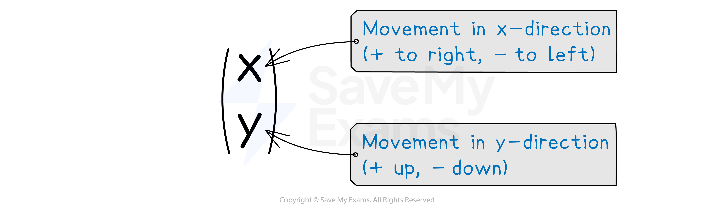

# Introduction to Column Vectors

## Basic Vectors

> **Spec point** — `spcpt_v6tP4DSVShVJMJhk`

## Basic vectors

### What are column vectors?

- A **column vector** can be used to **describe** how to get **from one point to another point**

  - This is also called a **translation vector**
  - $( \begin{gathered} 6 \\ 3 \end{gathered} )$ means **6 units to the right** and **3 units up**

### How do I add and subtract column vectors?

- **Adding and subtracting vectors** is done by looking at the **top** numbers and **bottom** numbers **separately**
- To **add** column vectors

  - Add the top numbers together
  - Add the bottom numbers together
  
    - $( \begin{gathered} 5 \\ 2 \end{gathered} ) + ( \begin{gathered} 3 \\ - 1 \end{gathered} ) = ( \begin{gathered} 5 + 3 \\ 2 + ( - 1 ) \end{gathered} ) = ( \begin{gathered} 8 \\ 1 \end{gathered} )$
- To **subtract **column vectors

  - Subtract** **the second top number from the first
  - Subtract the second bottom number from the first
  
    - $( \begin{gathered} 5 \\ 2 \end{gathered} ) - ( \begin{gathered} 3 \\ - 1 \end{gathered} ) = ( \begin{gathered} 5 - 3 \\ 2 - ( - 1 ) \end{gathered} ) = ( \begin{gathered} 2 \\ 3 \end{gathered} )$

### How do I multiply a vector by a scalar?

- A **scalar** is a **number** not a** vector**

  - It does not have a direction
- To **multiply** a column vector by a **scalar**

  - Multiply the top number by the scalar
  - Multiply the bottom number by the scalar
  
    - $3 ( \begin{gathered} 2 \\ - 1 \end{gathered} ) = ( \begin{gathered} 3 \times 2 \\ 3 \times ( - 1 ) \end{gathered} ) = ( \begin{gathered} 6 \\ - 3 \end{gathered} )$

### How do I write an expression as a single column vector?

- You need to follow the **order of operations**

  - $2 ( \begin{gathered} 5 \\ 2 \end{gathered} ) + 5 ( \begin{gathered} 3 \\ - 1 \end{gathered} )$
- **STEP 1**
**Multiply** each vector by the scalar in front of it

  - $( \begin{gathered} 2 \times 5 \\ 2 \times 2 \end{gathered} ) + ( \begin{gathered} 5 \times 3 \\ 5 \times ( - 1 ) \end{gathered} ) = ( \begin{gathered} 10 \\ 4 \end{gathered} ) + ( \begin{gathered} 15 \\ - 5 \end{gathered} )$
- **STEP 2**
**Add or subtract** the new column vectors

  - $( \begin{gathered} 10 + 15 \\ 4 + ( - 5 ) \end{gathered} ) = ( \begin{gathered} 25 \\ - 1 \end{gathered} )$

> **Worked Example**
> $a = ( \begin{gathered} p \\ 3 \end{gathered} )$ and $b = ( \begin{gathered} - 2 \\ 1 \end{gathered} )$.
> 
> Given that $2 a + 3 b = ( \begin{gathered} 4 \\ q \end{gathered} )$, find the value of $p$ and the value of $q$.
> 
> **Answer:**
> 
> > *Write the left-side side as one vector*
> *Multiply each vector by the scalar in front of it*
> 
> $( \begin{gathered} 2 p \\ 6 \end{gathered} ) + ( \begin{gathered} - 6 \\ 3 \end{gathered} ) = ( \begin{gathered} 4 \\ q \end{gathered} )$
> 
> > *Add the vectors together*
> 
> $( \begin{gathered} 2 p - 6 \\ 9 \end{gathered} ) = ( \begin{gathered} 4 \\ q \end{gathered} )$
> 
> > *The top components are equal*
> *Form and solve an equation*
> 
> $\begin{gathered} 2 p - 6 & = 4 \\ 2 p & = 10 \\ p = 5 \end{gathered}$
> 
> > *The bottom components are equal*
> 
> $9=q$
> 
> $p=5$ **and** $q=9$
