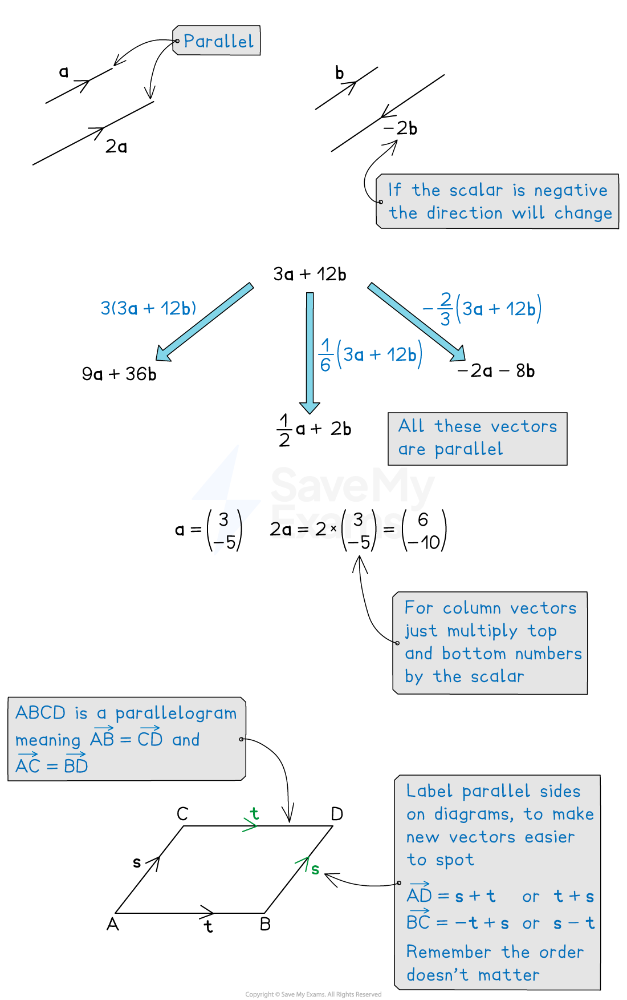

# Parallel Vectors & Unit Vectors

## Parallel Vectors

> **Spec point** — `spcpt_9Y69tw58MFQvdBvT`

## Parallel vectors

### How can I tell if two vectors are parallel?

- Two vectors are **parallel **if one is a **scalar multiple** of the other

  - This means that **all components** of the vector have been multiplied by a **common constant (scalar)**
  - For example, $( \begin{gathered} 1 \\ 3 \end{gathered} )$ and $( \begin{gathered} 2 \\ 6 \end{gathered} )$ are scalar multiples
  
    - The numbers in the first vector have each been multiplied by 2 to get the numbers in the second vector
- **Multiplying **the components of a vector by a **positive scalar **changes the **magnitude **of the vector but not the **direction**

  - For example, $( \begin{gathered} 2 \\ 6 \end{gathered} )$  is double the length of $( \begin{gathered} 1 \\ 3 \end{gathered} )$ but in the same direction
- **Multiplying **the components of a vector by a **negative scalar **reverses the direction
- You can **factorise **a vector to help spot if two vectors are **parallel**

  - $( \begin{gathered} 9 \\ - 3 \end{gathered} ) = 3 ( \begin{gathered} 3 \\ - 1 \end{gathered} )$
  - $( \begin{gathered} - 6 \\ 2 \end{gathered} ) = - 2 ( \begin{gathered} 3 \\ - 1 \end{gathered} )$
  
    - They are scalar multiples of the same vector so they are parallel

*Examples of parallel vectors*

> **Exam Hint**
> If you are told that two vectors ($a$ and $b$) are parallel, then it can be helpful to define a scalar to form an equation $a=kb$ .

> **Worked Example**
> Show that the vectors $a = ( \begin{gathered} 2 \\ - 4 \end{gathered} )$ and $b = ( \begin{gathered} - 3 \\ 6 \end{gathered} )$** **are parallel**.**
> 
> **Answer:**
> 
> **Method 1**
> 
> > *Show that one vector is a multiple of the other*
> 
> $\begin{gathered} - 1.5 a & = - 1.5 ( \begin{gathered} 2 \\ - 4 \end{gathered} ) \\ = ( \begin{gathered} - 1.5 \times 2 \\ - 1.5 \times - 4 \end{gathered} ) \\ = ( \begin{gathered} - 3 \\ 6 \end{gathered} ) \\ = b \end{gathered}$
> 
> **Final answer:** $b=-1.5a$**, so the two vectors are parallel**
> 
> **Method 2**
> 
> > *Show that both vectors are multiples of another vector*
> 
> $a = ( \begin{gathered} 2 \\ - 4 \end{gathered} ) = 2 ( \begin{gathered} 1 \\ - 2 \end{gathered} )$
> 
> $b = ( \begin{gathered} - 3 \\ 6 \end{gathered} ) = - 3 ( \begin{gathered} 1 \\ - 2 \end{gathered} )$
> 
> **Final answer:** $a$** and **$b$** are both scalar multiples of **$( \begin{gathered} 1 \\ - 2 \end{gathered} )$**, so they are parallel to each other**

## Unit vectors

> **Spec point** — `spcpt_tmkXtCpJ4srbmNZM`

## Unit vectors

### What is a unit vector?

- A **unit vector** is a vector with a **modulus **(length) of 1
- To find a unit vector that is in the **same direction** as the vector $a$

  - **divide **the components of the vector by the **modulus **of the vector
  - I.e. $\frac{a}{\left| a \right|}$ is a unit vector in the direction of vector $a$
- For example, a unit vector in the direction $( \begin{gathered} 3 \\ - 4 \end{gathered} )$ is

$\begin{gathered} \frac{1}{ \sqrt{3^{2} + ( - 4 )^{2}} } ( \begin{gathered} 3 \\ - 4 \end{gathered} ) & = 1 \frac{1}{5} ( \begin{gathered} 3 \\ - 4 \end{gathered} ) \\ = ( \begin{gathered} \frac{3}{5} \\ - \frac{4}{5} \end{gathered} ) \end{gathered}$

> **Worked Example**
> Find a unit vector in the same direction as  $( \begin{gathered} - 2 \\ 5 \end{gathered} )$.
> 
> **Answer:**
> 
> > *Find the modulus of the vector*
> 
> $\sqrt{( - 2 )^{2} + 5^{2}} = \sqrt{4 + 25} = \sqrt{29}$
> 
> > *Divide each of the vector components by the modulus*
> 
> $( \begin{gathered} - \frac{2}{ \sqrt{29} } \\ \frac{5}{ \sqrt{29} } \end{gathered} )$
