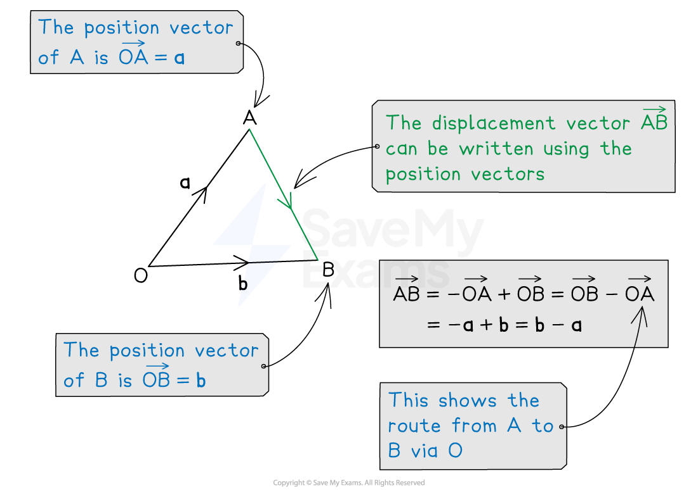

# Position & Displacement Vectors

## Position & Displacement Vectors

> **Spec point** — `spcpt_B37MzscGX3VQwSK2`

## Position & displacement vectors

### What are position vectors?

- A** position vector** describes where a specific **point**, *A *, is, relative to a fixed **origin**, *O*

  - **Lower-case bold** (or underlined) letters are used
  
    - The point *A*  has position vector **a** = $\overset{\rightarrow}{OA}$
- Their **components **are equal to their **coordinates**

  - The point with** **coordinates (3, -2) has position vector $( \begin{gathered} 3 \\ - 2 \end{gathered} )$ from the origin

### What are displacement vectors?

- A** displacement vector** describes the **direction and distance** between **two points**

  - The displacement vector from *A * to *B * is $\overset{\rightarrow}{AB}$
  
    - How to get from *A*  to *B*
- If the points *A * and *B * have position vectors **a** and **b** relative to *O *

  - then* A  *to *B * is the same as *A * to *O * (**-a**) followed by *O * to *B * (**b**)
  
    - $\overset{\rightarrow}{AB}=-a+b=b-a$
    - This is a useful rule to remember

> **Exam Hint**
> You may need to draw an origin, *O *, on to a diagram to be able to sketch position vectors.

> **Worked Example**
> The points $P$ and $Q$ have position vectors $( \begin{gathered} 3 \\ 2 \end{gathered} )$ and $( \begin{gathered} 6 \\ - 10 \end{gathered} )$respectively.
> 
> Find and simplify the vector $\overset{\rightarrow}{PQ}$.
> 
> **Answer:**
> 
> > *Let *$p$* and *$q$* be position vectors of **P ** and **Q*
> $\overset{\rightarrow}{PQ}$* is the displacement vector from **P**  to **Q*
> *Use the rule that *$\overset{\rightarrow}{AB}=-a+b=b-a$
> 
> $\overset{\rightarrow}{PQ}=q-p$
> 
> > *Substitute in *$p$* and *$q$* *
> 
> $\vec{PQ} = ( \begin{gathered} 6 \\ - 10 \end{gathered} ) - ( \begin{gathered} 3 \\ 2 \end{gathered} )$
> 
> > *Expand and simplify*
> 
> $\begin{gathered} = ( \begin{gathered} 6 - 3 \\ - 10 - 2 \end{gathered} ) \\ = ( \begin{gathered} 3 \\ - 12 \end{gathered} ) \end{gathered}$
> 
> `P Q -vec = stretchy ( | 3 | - 12 | | stretchy )`
